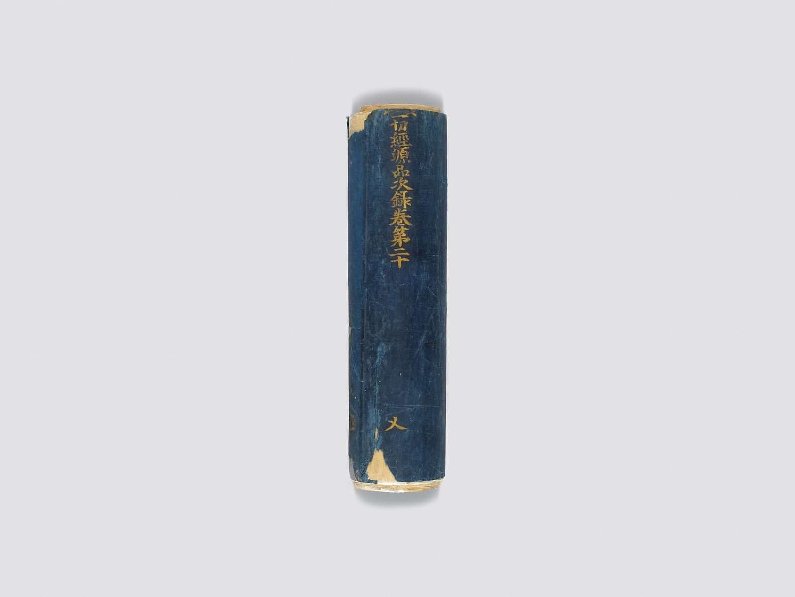

한국사 공부노트 · 06

고려의 정치 변화와 대외 관계  
왕·권력 기구·외침을 연결하기

> **이번 글의 질문**
>
> 고려의 지배 세력은 어떻게 바뀌었고, 외침에 대응하는 과정에서 어떤 변화가 일어났을까요?

> **핵심 요약**
>
> -   **초기:** 태조의 호족 포섭 → 광종의 왕권 강화 → 성종의 제도 정비
> -   **정치 변화:** 문벌 귀족 → 무신 정권 → 권문세족 → 신진 사대부
> -   **대외 관계:** 거란: 서희·강감찬 / 여진: 윤관 / 몽골: 강화 천도·삼별초
> -   **고려 말:** 공민왕 개혁 → 위화도 회군 → 과전법 → 조선 건국

## 1. 고려 초기의 주요 왕

> **918 고려 건국** → 935 신라 항복 → **936 후삼국 통일**

| 왕 | 핵심 정책 | 의미·구별 단서 |
| --- | --- | --- |
| 태조 | **흑창** 설치, 조세 부담 완화 혼인·사성 정책, **사심관·기인 제도** 서경 중시, 발해 유민 수용, **훈요 10조** | 민생 안정, 호족 포섭·견제, 북진 정책 |
| 광종 | **노비안검법**(956) **과거제**(958, 쌍기 건의) 공복 제정, 독자적 연호 **광덕·준풍** | 호족 기반 약화, 왕권 강화 노비안검법은 모든 노비를 해방한 법이 아닙니다. |
| 경종 | **시정 전시과**(976) | 관리에게 토지의 수조권 등을 지급하는 제도 마련 |
| 성종 | 최승로의 **시무 28조** 수용 **12목에 지방관 파견**(983) 국자감 설치, 유교 정치와 통치 체제 정비 | 유교를 통치 이념으로 활용 불교 자체를 없애려 한 것은 아닙니다. |

**사심관**은 중앙의 고위 관리가 출신 지역의 통제에 관여하는 제도이고, **기인**은 지방 호족의 자제를 개경에 머물게 하는 제도입니다.

## 2. 중앙 정치와 통치 기구

고려는 당의 제도를 받아들이면서도 **2성 6부**와 독자적인 회의 기구를 운영했습니다.

| 기구 | 기능 | 암기 단서 |
| --- | --- | --- |
| 중서문하성 | 국정 총괄·정책 심의 **재신**: 고위 관료 / **낭사**: 간쟁 등 | 장관은 **문하시중** |
| 상서성·6부 | 이·호·예·병·형·공부의 행정 실무 | 정책 집행 |
| 중추원 | **추밀**: 군사 기밀 / **승선**: 왕명 출납 | 군사·왕명 |
| 삼사 | 곡식·화폐의 출납과 **회계** | 조선의 삼사와 구별 |
| 어사대 | 관리의 비리 감찰 | 낭사와 함께 **대간** |
| 도병마사 | 국방 문제를 논의하는 회의 기구 | 후기에 **도평의사사**로 개편 |
| 식목도감 | 법제·격식 논의 | 고려의 독자적 회의 기구 |

> **대간 = 중서문하성의 낭사 + 어사대**  
> 간쟁: 왕에게 잘못을 지적함 / 봉박: 부당한 왕명을 돌려보냄 / 서경: 인사·법령 등을 심사하고 동의함

## 3. 지방·군사 조직

| 구분 | 담당·조직 | 핵심 역할 |
| --- | --- | --- |
| 5도 | **안찰사** 파견 | 일반 행정 구역, 지방 순찰 |
| 양계 | **병마사** 파견 | 북계·동계, 국경 방어 |
| 주현·속현 | 주현에는 지방관, 속현에는 미파견 | **속현이 주현보다 많음** |
| 향리 | 지방 행정 실무 담당 | 조세·공물 등 처리, 속현에서 영향력 큼 |
| 중앙군 | **2군 6위** | 2군: 왕의 친위 / 6위: 수도 경비·국방 |
| 지방군 | **5도: 주현군 / 양계: 주진군** | 지역 방위·국경 수비 |

향리가 지방을 운영했다고 해서 현대적인 지방자치였던 것은 아닙니다. 지방관이 파견된 **주현을 통해 속현도 통제**했습니다.

## 4. 문벌 귀족의 동요와 무신 정권

문벌 귀족은 **음서·공음전·폐쇄적인 혼인**을 바탕으로 지위를 유지했습니다. 음서는 5품 이상 관리 등의 자손이 과거 없이 관직에 진출하는 제도입니다.

| 사건 | 배경·주장 | 결과 |
| --- | --- | --- |
| 이자겸의 난 1126 · 인종 | 왕실 외척의 권력 확대, 왕과의 충돌 | 인종이 **척준경**을 이용해 이자겸 제거 |
| 묘청의 서경 천도 운동 1135 · 인종 | **서경 천도·칭제건원·금 정벌** 묘청·정지상 ↔ 개경의 김부식 | 천도 실패 후 **대위국**을 세워 봉기 김부식이 진압 |
| 무신 정변 1170 · 의종 | 문신 중심 정치, 무신 차별 **정중부·이의방·이고** 등 참여 | 의종 폐위, 명종 즉위 **무신 정권** 성립 |

> 무신 집권의 흐름: **이의방 → 정중부 → 경대승 → 이의민 → 최충헌 → 최우**

| 권력 기구 | 구별할 기능 |
| --- | --- |
| 중방 | 고위 무신의 회의 기구, 초기 무신 정권의 중심 |
| 교정도감 | **최충헌** 설치, 무신 정권의 최고 권력 기구 |
| 정방 | **최우** 설치, 관리 인사권 장악 |
| 서방 | 최우가 문신을 등용하여 자문을 받던 기구 |
| 도방·삼별초 | 도방: 사병·신변 보호 / 삼별초: 최씨 정권의 군사 기반 |

저항은 **망이·망소이: 공주 명학소 / 김사미·효심: 경상도 / 만적: 개경의 노비 신분 해방 운동**으로 연결합니다. 만적의 봉기 계획은 1198년 사전에 발각되었습니다.

## 5. 거란·여진과의 관계

| 상대·시기 | 고려의 대응 | 결과·연결어 |
| --- | --- | --- |
| 거란 1차 993 · 성종 | **서희와 소손녕의 담판** | 강동 6주 확보의 계기, 고구려 계승 주장 |
| 거란 2차 1010 · 현종 | 강조의 정변을 구실로 침입 **양규**의 활약 | 개경 함락, 현종 피난 |
| 거란 3차 1018\~1019 · 현종 | **강감찬의 귀주 대첩**(1019) | 거란군 격파 |
| 여진 숙종·예종 | **윤관의 별무반** 숙종 때 조직(1104), 예종 때 정벌(1107) | **동북 9성** 축조 후 반환 |
| 금 인종 | 금의 군신 관계 요구 수용 | 묘청의 금 정벌 주장과 연결 |

> **별무반**: 신기군(기병) · 신보군(보병) · 항마군(승병)  
> **강동 6주: 서희·거란 / 동북 9성: 윤관·여진**

거란 침입 때는 **초조대장경**을 조성했고, 전쟁 이후에는 거란·여진에 대비하여 **천리장성**을 쌓았습니다.

**초조대장경의 인쇄본** — ***초조대장경은 거란 침입**에 맞서 조성했습니다. 사진은 경판에서 찍은 인쇄본이며, 몽골 항쟁기에 만든 팔만대장경과 구별합니다. · 사진: 국립중앙박물관 · 신찬일체경원품차록 권20 · 신수13697 · 공공누리 제1유형(출처표시) · [유물 설명·원본 이미지](https://www.museum.go.kr/CHN/contents/M0502000000.do?relicId=2299&schM=view)*

## 6. 몽골 항쟁과 원 간섭기

> **1231 몽골의 첫 침입** → **1232 강화 천도** → 1259 강화 성립 → **1270 개경 환도**

-   **최우**가 강화 천도를 주도하여 장기 항전을 추진했습니다.
-   **김윤후**는 처인성 전투(1232)와 충주성 전투(1253)에서 활약했습니다.
-   몽골 침입으로 초조대장경 경판과 황룡사 9층 목탑이 소실되었고, 항쟁 중 **재조대장경인 팔만대장경**을 조성했습니다.
-   개경 환도에 반대한 **삼별초**는 강화도 → 진도 → 제주도로 이동하며 항쟁했습니다(1270\~1273).

| 원 간섭기의 변화 | 핵심 내용 |
| --- | --- |
| 왕실·정치 | 원 황실과 혼인, 왕위 계승 간섭, 관제 격하 |
| 영토 | **쌍성총관부·동녕부·탐라총관부** 설치 |
| 정동행성 | 일본 원정 지원 기구에서 내정 간섭 기구로 변화 |
| 사회 | **권문세족** 성장, 대농장 확대·토지와 노비 겸병 |

## 7. 공민왕의 개혁과 고려의 마지막

| 개혁 방향 | 공민왕의 정책 |
| --- | --- |
| 반원 자주 | **기철 등 친원 세력 제거** 정동행성 이문소 폐지, 몽골풍 금지 **쌍성총관부 공격·철령 이북 영토 회복** |
| 왕권·민생 | 정방 폐지, **신돈 등용·전민변정도감** 운영 빼앗긴 토지 반환, 강제로 노비가 된 양인의 신분 회복 |

개혁 과정에서 **신진 사대부**가 성장했습니다. 고려 말에는 홍건적·왜구를 격퇴하며 최영·이성계 등 신흥 무인도 부상했습니다.

> 왜구 격퇴: **최영: 홍산 대첩 / 최무선: 진포 대첩 / 이성계: 황산 대첩**  
> 최무선은 **화통도감**을 통한 화약 무기 제작과 연결합니다.

> 명의 철령위 설치 통보 → 요동 정벌 추진 → **1388 위화도 회군** → **1391 과전법** → **1392 조선 건국**

> **시험 직전 확인**
>
> -   **태조: 흑창·훈요 10조 / 광종: 노비안검법·과거제 / 성종: 시무 28조·12목**
> -   **고려 삼사: 회계 / 대간: 낭사와 어사대**
> -   **도병마사: 국방 / 식목도감: 법제·격식 / 정방: 인사**
> -   **5도: 안찰사·주현군 / 양계: 병마사·주진군**
> -   **서희: 강동 6주 / 윤관: 동북 9성 / 강감찬: 귀주 대첩**
> -   **초조대장경: 거란 / 팔만대장경: 몽골**
> -   **공민왕: 전민변정도감 / 공양왕: 과전법**

고려 정치는 **왕별 정책 → 통치 기구 → 지배 세력의 변화**로, 외교는 **상대 국가 → 대응 인물 → 결과**로 연결해 복습합니다.
