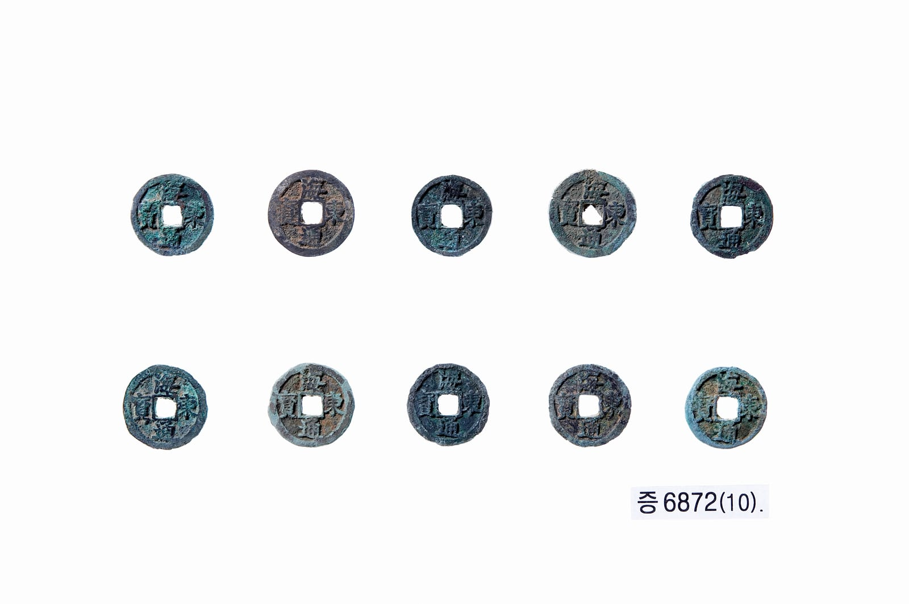

한국사 공부노트 · 07

고려의 경제와 사회  
토지·신분·구휼 제도를 구별하기

> **이번 글의 질문**
>
> 고려는 토지와 세금을 어떻게 운영했고, 사람들은 어떤 신분과 공동체 속에서 살았을까요?

> **핵심 요약**
>
> -   **전시과:** 경종: 시정 → 목종: 개정 → 문종: 경정
> -   **경제:** 벽란도 무역, 숙종의 화폐 발행, 고려 말 목화 전래
> -   **신분:** 고려의 백정은 일반 농민, 향·부곡·소 주민도 양인입니다.
> -   **사회:** 향도, 구휼·의료 기관, 남녀 균분 상속을 기억합니다.

## 1. 토지 제도와 수조권

**전시과**는 관료와 직역 담당자에게 **전지**(곡물 생산)와 **시지**(땔감 채취)의 수조권 등을 지급한 제도입니다. 토지 자체를 소유하게 한 제도와 구별합니다.

| 제도 | 왕·시기 | 지급 기준·대상 |
| --- | --- | --- |
| 역분전 | 태조 · 940 | 후삼국 통일의 **공로·인품** 등을 고려 |
| 시정 전시과 | 경종 · 976 | **관직·인품** 고려 / 전·현직 관리 |
| 개정 전시과 | 목종 · 998 | **관직** 기준 / 전·현직 관리 |
| 경정 전시과 | 문종 · 1076 | **현직 관리 중심** / 지급량 축소 |

> **경·목·문 / 시·개·경**  
> 인품 고려 → 관직 중심 → 현직 중심

| 토지 | 지급 대상·성격 |
| --- | --- |
| 공음전 | 교과서 기준 **5품 이상 관리**, 자손에게 세습 가능 → 귀족의 경제 기반 |
| 군인전 | **군역**의 대가, 군역 계승과 연결 |
| 구분전 | 하급 관리·군인의 **유가족 생계** 등 지원 |
| 공해전 | **관청 운영 경비** 마련 |
| 민전 | 귀족·농민 등이 소유한 사유지, **매매·상속·기증·임대** 가능 |

고려 후기에는 권세가의 토지 겸병과 농장 확대로 **전시과 체제가 무너지고 국가 재정이 약화**되었습니다.

## 2. 수취 제도와 양안·호적

| 구분 | 내용 | 기억할 단서 |
| --- | --- | --- |
| 조세 | 토지에서 생산한 곡물 납부 | **양안**, 원칙적으로 생산량의 10분의 1 |
| 공물 | 지역 특산물 납부 | **상공**: 정기 / **별공**: 수시 |
| 역 | 국가에 노동력 제공 | **호적**, 군역·요역 |

> **양안: 토지 / 호적: 사람**  
> 지방에서 거둔 조세 → 조창에 집결 → **조운**으로 개경 운송

## 3. 생산과 교역

| 분야 | 핵심 내용 |
| --- | --- |
| 농업 | 밭농사: **2년 3작 윤작법** 보급 논농사: 고려 말 **남부 일부 지역에 이앙법** **이암: 『농상집요』 소개 / 문익점: 목화씨 전래** |
| 상업 | 개경의 시전, 서적점·다점 등 관영 상점 **경시서**: 상업 활동 감독 |
| 무역 | **벽란도**: 예성강 하구, 개경과 가까운 국제 무역항 송·일본·아라비아 상인 등과 교역 <strong>『노걸대』</strong>: 중국어 회화 학습서 |
| 수공업 | 전기: **관청·소 수공업** 중심 후기: 민간·사원 수공업 발달 |

**이앙법**이 고려 말에 나타났다고 해서 전국에 널리 보급된 것은 아닙니다. 조선 후기의 확산과 구별합니다.

| 왕 | 화폐·기구 | 특징 |
| --- | --- | --- |
| 성종 | **건원중보** | 뒷면의 ‘동국’ 표기 |
| 숙종 | **주전도감** 해동통보·삼한통보·은병 | 은병은 **활구**라고도 불림 |

국가가 화폐 유통을 추진했지만 일상 거래에 널리 정착하지는 못했습니다. **쌀과 베 같은 현물**이 계속 중요한 교환 수단이었습니다.

**고려의 동전, 해동통보** — *사진의 글자를 확인하고 **숙종·주전도감·화폐 유통 추진**을 연결합니다. · 사진: 국립중앙박물관 · 증6872 · 공공누리 제1유형(출처표시) · [유물 설명·원본 이미지](https://www.museum.go.kr/MUSEUM/contents/M0502000000.do?schM=view&searchId=search&relicId=8541)*

## 4. 신분 구조

| 계층 | 구성·특징 |
| --- | --- |
| 지배층 | 문벌 귀족 → 무신 → 권문세족 고려 말 **신진 사대부** 성장 |
| 중류층 | **향리·잡류·남반·군반·역리** 행정·궁중 실무·군사·역 관리, 직역 세습 |
| 일반 양민 | 대부분 농민, **백정**이라 불림 조세·공물·역 부담 |
| 향·부곡·소 주민 | **양인**이지만 거주 이전·과거 응시 등에 차별 향·부곡: 농업 / 소: 수공업 등 특정 생산 |
| 천민 | 대부분 **노비**, 공노비·사노비로 구분 부모 중 한쪽이 노비이면 자녀도 노비가 되는 원칙 |

> **고려의 백정 = 일반 농민**  
> 조선의 도살업 등에 종사하던 백정과 구별합니다.

## 5. 공동체와 구휼 제도

**향도**는 불교 신앙을 매개로 한 공동체 조직입니다. 매향과 불상·탑 조성 등에 참여했고, 점차 공동 노동·혼례·상장례를 돕는 마을 조직의 성격이 커졌습니다.

| 기관·제도 | 구별할 기능 |
| --- | --- |
| 흑창 → 의창 | **태조의 흑창**을 성종 때 의창으로 정비 빈민에게 곡식을 빌려주는 구휼 |
| 상평창 | 곡식을 사거나 팔아 **물가 조절** |
| 제위보 | 기금을 운영하여 얻은 **이자**로 빈민 구제·질병 치료 |
| 동·서대비원 | 가난한 환자 치료, 빈민·행려자 구호 |
| 혜민국 | 백성의 질병 치료·의약 제공 |
| 구제도감·구급도감 | 재난·질병 등에 대응하는 **임시 구호 기구** |

> **의창: 곡식 대여 / 상평창: 물가 / 제위보: 기금 이자 / 혜민국: 의료**

## 6. 가족과 여성의 지위

-   **남녀 균분 상속:** 아들과 딸이 재산을 나누어 받았습니다.
-   **윤행 봉사:** 자녀들이 돌아가며 제사를 지냈습니다.
-   **호적:** 자녀를 성별보다 출생 순서에 따라 기록했고, 여성의 호주 지위도 인정했습니다.
-   이러한 모습은 조선 전기에도 이어졌으며, **조선 후기의 부계·장자 중심 관행**과 차이가 있습니다.

> **시험 직전 확인**
>
> -   **경종: 시정 / 목종: 개정 / 문종: 경정 전시과**
> -   **전시과: 수조권 / 민전: 사유지**
> -   **이암: 농상집요 / 문익점: 목화**
> -   **성종: 건원중보 / 숙종: 해동통보·은병**
> -   **벽란도: 예성강 / 경시서: 상업 감독**
> -   **백정: 일반 농민 / 향·부곡·소 주민: 차별받는 양인**
> -   **의창: 구휼 / 상평창: 물가 조절 / 제위보: 기금 운영**

고려의 경제·사회는 **제도 이름과 기능**을 짝지어 복습합니다. 전시과의 지급 기준, 화폐를 발행한 왕, 구휼 기관의 역할 차이를 먼저 확인합니다.
