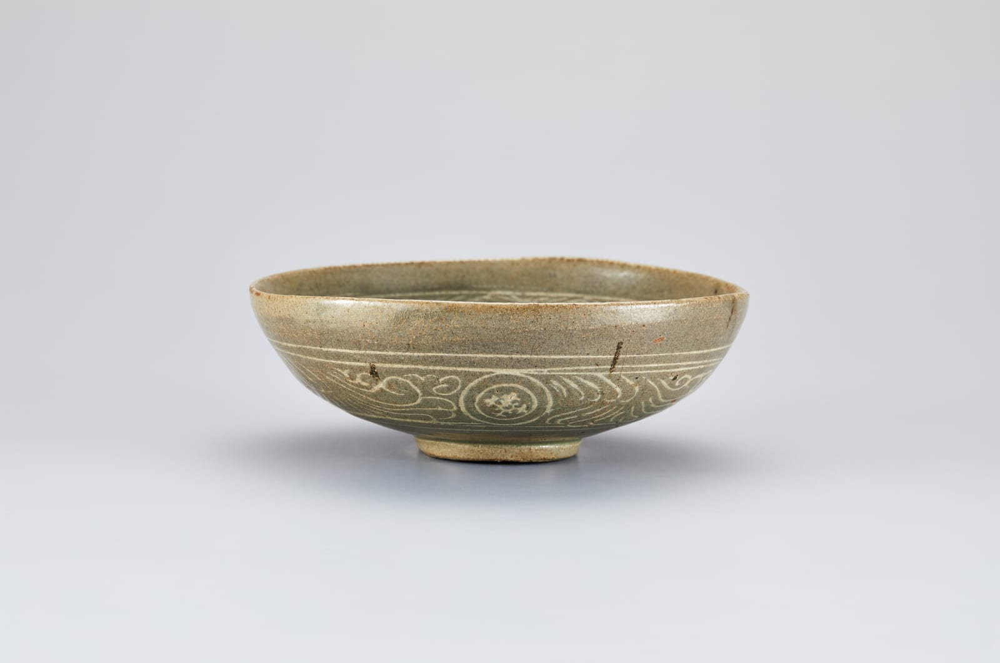
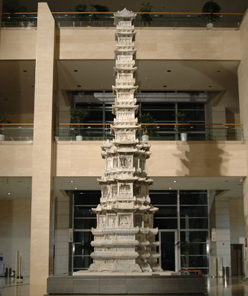

> **이번 글의 질문**
>
> 고려의 역사서와 승려, 문화재를 각각의 특징으로 구별할 수 있을까요?

> **핵심 요약**
>
> - **역사서:** 김부식: 삼국사기 / 일연: 삼국유사
> - **불교:** 의천: 교관겸수 / 지눌: 정혜쌍수·돈오점수
> - **인쇄:** 팔만대장경은 목판, 직지는 금속 활자입니다.
> - **예술:** 상감청자, 주심포 건축, 경천사 10층 석탑을 기억합니다.

## 1. 유학과 교육

| 구분 | 핵심 내용 |
| --- | --- |
| 성종 | **국자감** 정비, 유학과 기술 교육 지방에 경학박사·의학박사 파견 |
| 최충 | **9재 학당** 설립, 해동공자로 불림 사학 12도 발달 → 관학 위축 |
| 예종 | 국학의 전문 강좌 **7재**, 장학 재단 **양현고** 설치 |
| 고려 말 성리학 | **안향**이 원에서 수용 신진 사대부의 사상적 기반으로 발전 |
| 만권당 | **충선왕**이 원의 연경에 설치 **이제현**이 원 학자들과 교류, 『역옹패설』 저술 |

> **최충: 9재 학당 / 예종: 7재·양현고 / 안향: 성리학 / 충선왕: 만권당**

## 2. 역사서의 저자와 역사 인식

| 책 | 저자·시기 | 구별할 특징 |
| --- | --- | --- |
| 삼국사기 | **김부식** 인종 · 1145 | **현존하는 가장 오래된 우리나라 역사서** 기전체, 유교적·합리적 역사 서술 |
| 삼국유사 | **일연** 충렬왕 때 | 불교사·설화·신화 수록 **단군의 건국 이야기**, 고유 전통 중시 |
| 동명왕편 | **이규보** | 고구려 건국 영웅 동명왕을 노래한 서사시 |
| 제왕운기 | **이승휴** | 중국사와 우리 역사를 서사시로 서술 **단군부터 우리 역사**를 다룸 |
| 해동고승전 | **각훈** | 고승들의 전기, 불교사 |
| 사략 | **이제현** | 성리학적 역사 인식, 정통·대의명분 중시 |

『삼국사기』는 합리적인 서술을 지향했지만 **신화와 전설을 전혀 기록하지 않은 책은 아닙니다.** 『삼국유사』와는 서술 관점과 수록 내용의 비중을 비교합니다.

## 3. 불교와 사상

| 인물 | 핵심 활동 | 사상·연결어 |
| --- | --- | --- |
| 의천 | **천태종** 개창 교장 간행, 교장도감 설치 | **교관겸수**: 교학과 수행 병행 교종을 중심으로 교·선 통합 시도 |
| 지눌 | **수선사 결사** 불교계의 세속화 비판 | **정혜쌍수·돈오점수** 선을 중심으로 교학 포용 |
| 혜심 | 지눌의 뒤를 이어 수선사 계승 | **유불일치설** |
| 요세 | 강진 만덕사에서 **백련 결사** | 천태종, 참회·법화 신앙 |

> **정혜쌍수**: 선정과 지혜를 함께 닦음  
> **돈오점수**: 단번에 깨달은 뒤에도 꾸준히 수행함

국가 행사는 **연등회: 불교 / 팔관회: 불교와 토속 신앙 / 초제: 도교**로 연결합니다. 풍수지리·도참 사상은 도읍 선정과 묘청의 서경 천도 주장 등에 영향을 주었습니다.

## 4. 인쇄와 과학 기술

| 자료·기술 | 핵심 특징 |
| --- | --- |
| 초조대장경 | **현종 때 거란 침입**에 대응하여 조성 몽골 침입 때 경판 소실 |
| 교장 | **의천**이 불교 경전의 주석서 등을 모아 간행 흔히 속장경으로 불림 |
| 팔만대장경 | **고종 때 몽골 항쟁** 중 조성한 재조대장경 목판, 현재 해인사에 경판 보관 |
| 상정고금예문 | 13세기 **금속 활자** 인쇄 기록 인쇄본은 현존하지 않음 |
| 직지심체요절 | **1377 · 청주 흥덕사 · 금속 활자** 현존하는 세계에서 가장 오래된 금속 활자본 |
| 향약구급방 | **현존하는 가장 오래된 우리나라 의학서** 우리 땅의 약재인 향약 활용 |
| 최무선 | **화통도감**(1377), 화약·화포 제작 **진포 대첩**(1380)과 연결 |

> **목판: 초조대장경·교장·팔만대장경**  
> **금속 활자: 상정고금예문·직지**

## 5. 공예와 불교 미술

- **청자:** 비색의 아름다움, 귀족 문화와 연결합니다.
- **상감청자:** 표면에 무늬를 파고 백토·흑토를 메우는 상감 기법을 활용했습니다.
- **나전칠기:** 조개껍질로 무늬를 장식한 칠 공예품입니다.
- **불상:** 하남 하사창동 철조 석가여래 좌상, 논산 관촉사 석조 미륵보살 입상 등 지역적 개성이 나타납니다.
- **불화:** 수월관음도·아미타내영도, 섬세한 표현과 화려한 색채가 특징입니다.

***청자 상감 구름 학무늬 대접:** 구름과 학 무늬를 확인하고 **고려·상감 기법**을 연결합니다. · 사진: 국립중앙박물관 · 남산569 · 공공누리 제1유형(출처표시) · [유물 설명·원본 이미지](https://www.museum.go.kr/MUSEUM/contents/M0502000000.do?relicId=104741&schM=view&searchId=search)*

## 6. 건축과 탑

| 양식·문화재 | 구별 단서 |
| --- | --- |
| 주심포 | 공포를 **기둥 위**에 배치 안동 봉정사 극락전·영주 부석사 무량수전·예산 수덕사 대웅전 |
| 다포 | 공포를 **기둥 위와 기둥 사이**에 배치 고려의 대표 사례: 성불사 응진전 |
| 부석사 무량수전 | **배흘림기둥**: 기둥 중간 부분이 불룩함 |
| 월정사 8각 9층 석탑 | **고려 전기**, 다각다층 석탑 |
| 경천사 10층 석탑 | **고려 후기 · 원의 영향 · 대리석** 현재 국립중앙박물관에 전시 |

***경천사 10층 석탑:** **고려 후기의 대리석 탑**입니다. 조선 세조 때 세운 원각사지 10층 석탑과 구별합니다. · 사진: 국립중앙박물관 · 공공누리 제3유형(출처표시·변경금지) · [유물 설명·원본 이미지](https://vcm.museum.go.kr/MUSEUM/contents/M0501000000.do?relicRecommendId=16858&schM=view)*

> **마지막 확인**
>
> - 김부식: 삼국사기 / 일연: 삼국유사 / 이승휴: 제왕운기
> - 의천: 교관겸수 / 지눌: 정혜쌍수·돈오점수
> - 혜심: 유불일치 / 요세: 백련 결사
> - 충선왕: 만권당 설치 / 이제현: 만권당 활동·역옹패설
> - 팔만대장경: 목판 / 직지: 금속 활자·청주 흥덕사
> - 경천사 10층 석탑: 고려 / 원각사지 10층 석탑: 조선

고려 문화는 **책과 저자, 사상과 승려, 문화재와 특징**을 짝지어 복습합니다. 비슷한 이름과 양식을 비교해 구별하는 것이 핵심입니다.
