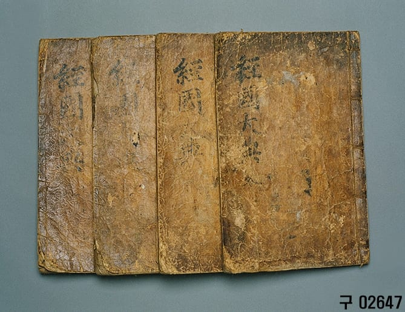
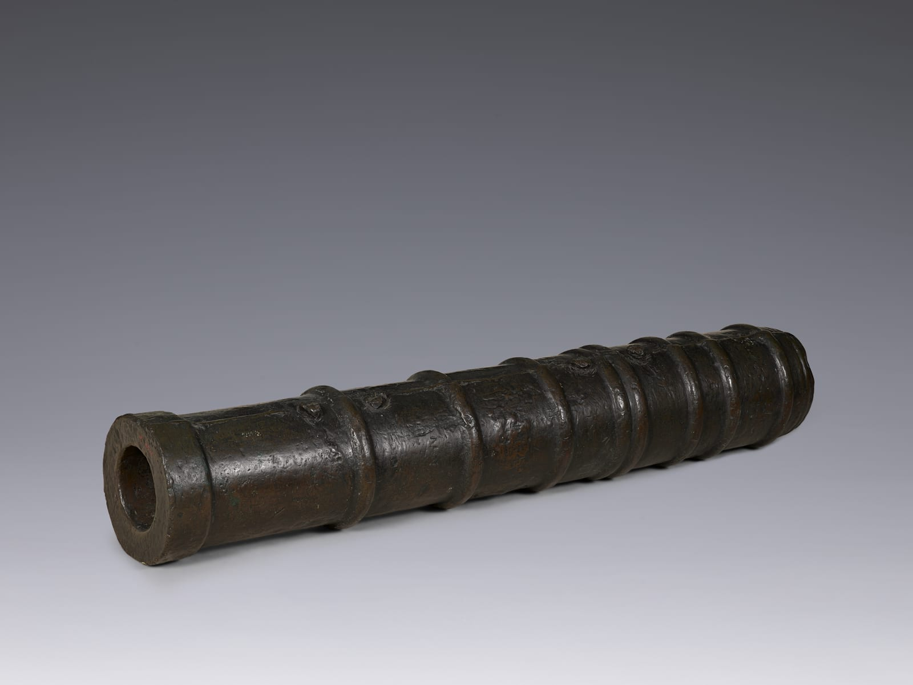

조선 전기 정치는 **왕별 정책 → 통치 조직 → 사림의 성장 → 대외 관계** 순서로 정리합니다. 인물과 제도, 사건의 연결을 중심으로 살펴봅니다.

> **이번 글의 질문**
>
> 조선은 어떻게 중앙집권 체제를 정비했으며, 사림의 성장과 전쟁은 정치 운영을 어떻게 바꾸었을까요?

> **핵심 요약**
>
> - **태종·세조는 6조 직계제**, 세종은 의정부 서사제로 연결합니다.
> - **성종은 『경국대전』 완성**과 사림 등용이 핵심입니다.
> - 조선의 삼사는 **사헌부·사간원·홍문관**입니다.
> - 사화는 **무오 → 갑자 → 기묘 → 을사** 순서입니다.
> - 임진왜란의 3대 대첩은 **한산도·진주·행주**입니다.
> - 정묘호란은 **후금·형제 관계**, 병자호란은 **청·군신 관계**입니다.

## 1. 조선의 건국과 왕별 정책

조선은 **신진 사대부와 신흥 무인 세력**이 함께 세웠습니다. 정도전은 성리학을 바탕으로 재상 중심의 정치를 구상했습니다.

| 인물·왕 | 핵심 정책과 연결어 |
| --- | --- |
| 태조·정도전 | 조선 건국(1392), 한양 천도 정도전: **『조선경국전』·『경제문감』**, 불교 비판서 『불씨잡변』 |
| 태종 | **6조 직계제·사병 혁파·호패법** 양전 사업, 신문고 설치 → 왕권과 국가 재정 기반 강화 |
| 세종 | **의정부 서사제·집현전·훈민정음** 4군 6진 개척, 이종무의 대마도 정벌 |
| 세조 | **6조 직계제·집현전 폐지·직전법** 『경국대전』 편찬 추진 |
| 성종 | **『경국대전』 완성·반포(1485)** 홍문관 정비, 경연 활성화, 김종직 등 사림 등용 |

> **6조 직계제:** 6조 → 왕에게 직접 보고 → 왕권 강화  
> **의정부 서사제:** 6조 → 의정부의 검토 → 왕에게 보고

**연도 구분:** 계유정난은 1453년, 세조의 즉위는 1455년입니다.

***『경국대전』과 조선의 통치 체제:** 세조 때 편찬을 시작해 성종 때 완성했습니다. **이·호·예·병·형·공의 6전**으로 구성됩니다. · 사진: 국립중앙박물관, 구2647 · 공공누리 제1유형 · [소장품 정보](https://www.museum.go.kr/MUSEUM/contents/M0502000000.do?relicId=4470&schM=view)*

## 2. 훈구와 사림, 네 차례의 사화

**훈구**는 세조의 집권을 도운 공신을 중심으로 성장했습니다. **사림**은 향촌을 기반으로 성종 때 중앙에 진출하여 삼사에서 훈구를 비판했습니다.

| 사화 | 왕 | 사건의 단서 |
| --- | --- | --- |
| 무오사화 1498 | 연산군 | <strong>김종직의 「조의제문」</strong>을 김일손이 사초에 수록 |
| 갑자사화 1504 | 연산군 | **폐비 윤씨의 사사 사건** |
| 기묘사화 1519 | 중종 | **조광조의 개혁**에 대한 반발 |
| 을사사화 1545 | 명종 | **대윤 윤임과 소윤 윤원형**의 외척 갈등 |

> **조광조의 개혁**
>
> **현량과 실시 · 위훈 삭제 · 소격서 폐지 · 향약 보급**
>
> 현량과는 추천받은 인재를 시험으로 선발하는 제도입니다. 위훈 삭제는 중종반정 공신 중 잘못 책정된 공훈을 없애려는 조치입니다.

사림은 사화 이후에도 **서원과 향약**을 기반으로 성장했습니다. 선조 때 정치를 주도했으며, 이조 전랑 임명 문제 등을 계기로 **동인과 서인**으로 나뉘었습니다.

## 3. 중앙과 지방의 통치 조직

| 중앙 기구 | 주요 역할 |
| --- | --- |
| 의정부·6조 | 의정부: 국정 총괄·논의 6조: 행정 실무 |
| 승정원 | **왕명 출납** |
| 의금부 | **왕 직속 사법 기구** |
| 사헌부 | 관리 감찰, 비리 탄핵 |
| 사간원 | 왕의 잘못에 대한 간쟁 |
| 홍문관 | 경연, 왕의 자문, 학술 활동 |
| 춘추관·한성부 | 춘추관: 역사 편찬·기록 한성부: 수도 행정 |

**삼사 = 사헌부 + 사간원 + 홍문관**입니다. 고려의 회계 기구인 삼사와 구별합니다. 사헌부와 사간원은 서경권도 행사했습니다.

> **지방 행정:** 전국 8도 → 관찰사 → 부·목·군·현의 수령  
> 고려와 달리 **모든 군현에 지방관을 파견**하여 중앙의 통제를 강화했습니다.

| 지방의 인물·조직 | 구별할 역할 |
| --- | --- |
| 수령 | 중앙에서 파견, 행정·사법·군사 업무 담당 |
| 향리 | 수령을 보좌하는 **행정 실무 담당자** |
| 유향소 | **지방 사족의 자치 기구** 수령 보좌, 향리의 비리 감찰, 향촌 질서 유지 |
| 경재소 | 중앙에 설치하여 연고지의 유향소 통제 |
| 서원·향약 | 서원: 교육과 선현 제사 향약: 유교적 향촌 규약 |

## 4. 관리 선발과 군사 제도

- **과거:** 문과·무과·잡과로 구분합니다. 잡과는 역관·의관 등 기술관을 선발합니다.
- **문과:** 원칙적으로 양인에게 응시 자격을 부여했으나, 실제로는 양반 중심으로 운영되었습니다. 서얼의 문과 응시는 제한되었습니다.
- **음서·천거:** 과거 외의 관직 진출 방법도 있었습니다. 조선의 음서는 고려보다 범위와 영향력이 축소되었습니다.
- **군사:** 중앙은 5위, 지방은 영진군을 두었습니다. 양인개병·농병일치가 기본 원칙입니다.
- **방어 체제:** 진관 체제는 지역 단위 방어입니다. 제승방략은 유사시 여러 지역의 병력을 모아 중앙에서 내려온 지휘관이 지휘하는 방식입니다.

## 5. 사대교린과 국경의 정비

대외 정책의 기본은 **명에 대한 사대, 여진·일본에 대한 교린**입니다. 필요할 때 군사적 대응도 실시했습니다.

| 대상 | 핵심 내용 |
| --- | --- |
| 여진 | 세종 때 **4군: 최윤덕·압록강 / 6진: 김종서·두만강** 북방 이주 정책, 토관 제도 실시 |
| 일본 | **이종무의 대마도 정벌(1419)** 3포 개항: 부산포·제포·염포 계해약조(1443): 대마도주와 무역 규모 규정 |
| 왜변과 대응 | **삼포왜란: 중종·1510** **을묘왜변: 명종·1555** 왜변에 대응하며 비변사가 상설 기구로 발전 |

## 6. 임진왜란과 군사 체제의 변화

> **임진왜란(1592)** → 수군·의병의 활약과 명의 지원 → 강화 협상 결렬 → **정유재란(1597)** → 노량 해전과 전쟁 종결(1598)

| 전투 | 인물 | 구별할 내용 |
| --- | --- | --- |
| 한산도 대첩 1592 | 이순신 | 학익진, 해상 주도권 확보 |
| 진주 대첩 1592 | 김시민 | 진주성 방어 |
| 행주 대첩 1593 | 권율 | 행주산성에서 승리 |
| 명량 해전 1597 | 이순신 | 정유재란 중 수군의 승리 |
| 노량 해전 1598 | 이순신 | 철수하는 일본군과 전투, 이순신 전사 |

**3대 대첩은 한산도·진주·행주**입니다. 명량 해전과 혼동하지 않습니다.

- **훈련도감(1593):** 급료를 받는 상비군입니다. 포수·사수·살수의 삼수병으로 편성됩니다.
- **지방 속오군:** 양반부터 노비까지 편성하여 지방 방어를 담당했습니다.
- **비변사:** 전쟁을 거치며 기능이 확대되어 국정 운영의 중심 기구가 됩니다.
- **중앙 5군영:** 훈련도감을 시작으로 후대에 순차적으로 설치됩니다. 임진왜란 때 모두 완성된 것은 아닙니다.

***조선의 화포, 천자총통:** 사진의 유물은 **1555년 제작**된 천자총통입니다. 총통은 조선의 화약 무기로, 조총과 구별합니다. · 사진: 국립중앙박물관, 본관6526 · 공공누리 제1유형 · [소장품 정보](https://www.museum.go.kr/MUSEUM/contents/M0502000000.do?relicId=4635&schM=view)*

## 7. 광해군의 외교와 두 차례의 호란

**광해군**은 명과 후금 사이에서 실리 외교를 추진했습니다. 인조반정(1623) 이후에는 **친명배금** 정책으로 전환했습니다.

| 구분 | 정묘호란 | 병자호란 |
| --- | --- | --- |
| 발생 | 1627년, 인조 | 1636년, 인조 |
| 침입 세력 | **후금** | **청** |
| 왕의 피란 | 강화도 | 남한산성 |
| 결과 | **형제 관계**의 화약 | 삼전도 항복(1637) **군신 관계** 수립 |

병자호란 당시 **김상헌은 척화**, **최명길은 주화**를 주장했습니다. 이후 효종 때 청을 정벌하자는 북벌론이 추진되었습니다.

> **마지막 확인**
>
> - 호패법·사병 혁파 → 태종
> - 집현전·의정부 서사제 → 세종
> - 직전법·집현전 폐지 → 세조
> - 『경국대전』 완성·사림 등용 → 성종
> - 조의제문 → 무오 / 폐비 윤씨 → 갑자
> - 조광조 → 기묘 / 대윤·소윤 → 을사
> - 왕명 출납 → 승정원 / 왕 직속 사법 → 의금부
> - 한산도 이순신 · 진주 김시민 · 행주 권율
> - 삼수병·급료병 → 훈련도감
> - 후금·형제 → 정묘 / 청·군신 → 병자

사건의 이름과 함께 **왕·인물·제도·결과**를 연결하여 복습합니다.
