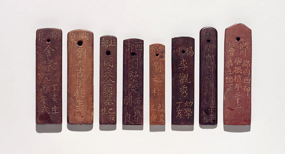

한국사 공부노트 · 10

조선 전기의 경제와 사회

조선은 농업을 중시하고 양반 중심의 사회 질서를 강화했습니다. **수조권의 변화, 세금의 종류, 신분별 역할**을 구분하는 것이 핵심입니다.

> **이번 글의 질문**
>
> 관리에게 지급하던 수조권은 어떻게 바뀌었으며, 백성은 어떤 부담을 지고 있었을까요?

> **핵심 요약**
>
> -   **과전법 → 직전법 → 관수관급제 → 직전 지급 중단** 순서입니다.
> -   세종의 공법은 **전분 6등법·연분 9등법**입니다.
> -   백성의 부담은 **전세·공납·역**으로 구분합니다.
> -   **양천제는 법제적 구분**, 반상제는 양반 중심의 사회적 구분입니다.
> -   **『경국대전』은 기본 법전**, 『대명률』은 형벌 적용의 주요 기준입니다.

## 1. 토지 제도와 수조권의 변화

**수조권**은 일정한 토지에서 세금을 거둘 권리입니다. 토지 자체의 소유권과 구별합니다.

| 제도·시기 | 핵심 내용 |
| --- | --- |
| 과전법 1391·공양왕 | **전·현직 관리**에게 경기 지역 토지의 수조권 지급 관리 사후 수신전·휼양전으로 일부 유지 → 지급할 토지 부족 |
| 직전법 1466·세조 | **현직 관리에게만** 수조권 지급 수신전·휼양전 폐지 |
| 관수관급제 1470·성종 | **국가가 세금을 거두어 관리에게 지급** 관리의 직접 수취와 과다 징수를 억제 |
| 직전 지급 중단 16세기·명종 | 관리에게 수조권을 나누어 주는 제도 소멸 **녹봉만 지급** |

> **지급 대상 축소:** 전·현직 → 현직만  
> **수취 방식 변화:** 관리의 직접 수취 → 국가가 수취·지급

**주의:** 과전법은 조선 건국 이전에 시행되었습니다. 녹봉도 처음부터 있었으며, 직전 지급 중단 후 새로 생긴 제도는 아닙니다.

## 2. 수취 제도와 백성의 부담

| 구분 | 부담과 핵심 단서 |
| --- | --- |
| 전세 | **토지에 부과하는 세금** 조선 초기에는 수확량의 10분의 1을 기준으로 수취 세종 때 공법 제정 |
| 공납 | **지역의 토산물을 납부** 군현에 공물을 배정하고 가호 등에 분담 방납의 폐단으로 부담 증가 |
| 역 | **16\~60세 양인 남성**을 중심으로 부과 군역: 군사적 의무 / 요역: 토목 공사 등에 노동력 제공 |

> **세종의 공법**
>
> **전분 6등법:** 토지의 비옥도를 6등급으로 구분합니다.
>
> **연분 9등법:** 그해의 풍흉을 9등급으로 구분합니다.
>
> 전세는 **1결당 4\~20두**를 부과했습니다. 이후 최저액인 4두를 적용하는 경향이 나타났습니다.

-   **방납:** 공물 납부를 대신하는 과정에서 과도한 대가를 받아 백성에게 피해를 주었습니다.
-   **대립:** 다른 사람에게 자신의 군역을 대신 맡기는 것입니다.
-   **방군수포:** 군 복무를 면제하고 포를 거두는 것입니다.
-   **군역의 요역화:** 군사를 군사 훈련보다 각종 노동에 동원하는 현상입니다.

**전세와 지대 구분:** 전세는 세금이고, 지대는 소작농이 지주에게 내는 몫입니다. 병작반수는 수확량의 절반을 지대로 내는 방식입니다.

## 3. 생산과 유통

-   **농업:** 『농사직설』과 『금양잡록』으로 농업 기술을 보급했습니다. 시비법이 발전하고 남부 일부 지역에서는 이앙법이 시행되었습니다.
-   **수공업:** 관영 수공업 중심입니다. 공장안에 등록된 장인이 관청에 필요한 물품을 만들었습니다.
-   **상업:** 서울의 시전을 경시서가 감독했습니다. 지방에서는 장시가 성장하고 보부상이 활동했습니다.
-   **화폐:** 저화·조선통보의 유통은 활발하지 못했습니다. 주로 쌀과 면포를 교환 수단으로 사용했습니다.

## 4. 양천제와 반상제

법적으로는 **양인과 천인**을 구분했습니다. 사회적으로는 양반의 특권이 강화되면서 **양반과 상민을 구별하는 반상 질서**가 굳어졌습니다.

| 신분 | 특징 |
| --- | --- |
| 양반 | 문반·무반에서 비롯된 지배층 관직 진출과 토지·노비 소유를 바탕으로 특권 유지 |
| 중인 | 기술관, 서리·향리 등 행정 실무층 **서얼은 문과 응시와 관직 진출에 제한** |
| 상민 | 농민·수공업자·상인 등 **전세·공납·역의 주요 부담층** |
| 천민 | 노비가 대표적이며 신분 세습 백정 등도 사회적 차별을 받음 |

**신량역천:** 신분은 양인이지만 수군·봉수군 등 천하게 여긴 역을 담당한 사람들입니다. 천인과 구별합니다.

조선시대 목패 자료입니다. 호패에는 신분·직역 등 인적 사항을 기록했습니다. **태종의 호패법**은 인구 파악과 국역 담당자 확보에 연결합니다.

**호패를 통한 신분 확인과 인구 파악** — *사진: 국립중앙박물관 · 공공누리 제3유형(출처표시·변경금지) · [호패 자료 보기](https://www.museum.go.kr/MUSEUM/contents/M0501000000.do?relicRecommendId=16873&schM=view)*

## 5. 법률·구휼과 향촌 운영

| 제도·기구 | 핵심 역할 |
| --- | --- |
| 『경국대전』 | **국가 운영의 기본 법전** 행정·경제·신분·형벌 등 규정 |
| 『대명률』 | 명나라의 형법전 **형벌 적용의 주요 기준** |
| 의창·상평창 | 의창: 곡식을 빌려주어 빈민 구제 상평창: 곡물 가격 조절 |
| 혜민서·활인서 | 혜민서: 백성의 질병 치료·의약품 지급 활인서: 병자 치료와 빈민 구호 |
| 『구황촬요』 | 흉년에 굶주림을 해결하는 방법을 정리한 책 |

지방에서는 **관찰사와 수령이 행정·사법 업무를 함께 담당**했습니다. 중앙에도 형조·의금부 등의 사법 기구가 있었습니다.

> **향촌 운영:** 수령의 통치 + 향리의 실무 보조 + 사족의 영향력  
> **사족의 기반:** 유향소·서원·향약  
> **중앙의 통제:** 경재소를 통해 유향소 감독

**오가작통법**은 다섯 집을 하나의 통으로 묶어 관리하는 제도입니다. 호패법과 함께 인구 파악·주민 통제에 연결합니다.

> **시험 직전 확인**
>
> -   **전·현직 → 과전법 / 현직만 → 직전법**
> -   **국가가 수취·지급 → 관수관급제·성종**
> -   **토지 비옥도 → 전분 6등 / 풍흉 → 연분 9등**
> -   **공물 대납의 폐단 → 방납**
> -   **군역 대신 포 납부 → 방군수포**
> -   **양인이지만 천한 역 → 신량역천**
> -   **서민 의료 → 혜민서 / 병자·빈민 구호 → 활인서**
> -   **유향소 통제 → 경재소 / 다섯 집 → 오가작통법**

**과전법은 수조권 지급, 공법은 전세 부과, 공납은 토산물 납부**입니다. 이름이 비슷한 제도를 구분하며 복습합니다.
