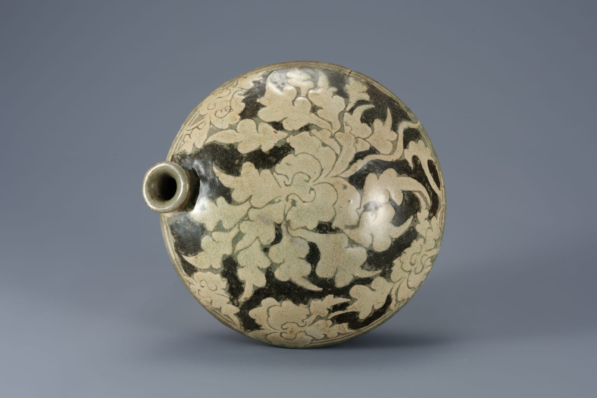
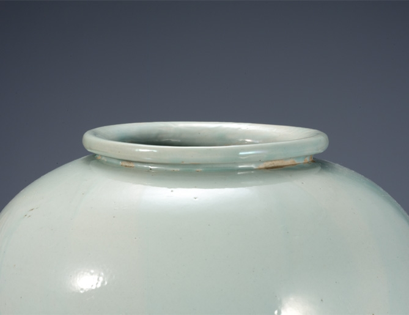

한국사 공부노트 · 11

조선 전기의 문화  
성리학과 훈민정음, 과학 기술과 예술

> **이번 글의 질문**
>
> 교육기관과 성리학자의 특징은 어떻게 구별하며, 조선 전기의 책과 문화재는 누구와 연결해야 할까요?

> **핵심 요약**
>
> -   **성균관·4학·향교는 관학**, 서원·서당은 사학입니다.
> -   **이황은 『성학십도』**, <strong>이이는 『성학집요』</strong>와 연결합니다.
> -   **세종**은 훈민정음, 천문·역법, 농업·의학의 발전을 주도했습니다.
> -   **성종**은 역사·지리·의례·음악 관련 서적을 정비했습니다.

## 1. 교육기관: 관학과 사학

| 기관 | 시험에서 찾을 특징 |
| --- | --- |
| 성균관 | 중앙의 **최고 교육기관**. 책임자는 대사성, 명륜당은 교육 공간, 대성전은 제향 공간입니다. |
| 4학 | 한양의 중등 교육기관. **동학·서학·남학·중학**으로 구성됩니다. |
| 향교 | 지방의 관학. 유학 교육과 공자·유학자에 대한 제향을 담당합니다. |
| 서원 | 지방의 사학. **선현 제향·후학 교육**을 담당하며 사림의 활동 기반이 됩니다. |
| 서당 | 민간의 초등 교육기관. 읽기·쓰기와 기초 유학을 가르칩니다. |

> 중종: 주세붕의 백운동서원 설립 → 명종: 이황의 건의로 소수서원 사액

**백운동서원은 최초의 서원**, **소수서원은 최초의 사액 서원**입니다. 안향을 기리기 위해 세웠으며, 사액은 왕이 이름을 지어 현판을 내려주는 것을 뜻합니다.

## 2. 성리학: 이황과 이이

| 구분 | 퇴계 이황 | 율곡 이이 |
| --- | --- | --- |
| 사상 | **이(理)의 역할**과 도덕적 수양을 중시합니다. | 상대적으로 **기(氣)의 역할**을 강조하며 현실 개혁에 관심을 기울입니다. |
| 대표 저서 | <strong>『성학십도』</strong> 『주자서절요』 | <strong>『성학집요』</strong> 『동호문답』 『격몽요결』 |
| 주요 단서 | **기대승과 사단칠정 논쟁**, 일본 성리학에 영향 | 통치 체제·수취 제도의 개혁 방안 제시 |
| 관련 서원 | 도산서원 | 자운서원 |

**『성학십도』는 군주의 수양을 열 개의 도표로 설명한 책**입니다. 『성학집요』도 군주의 수양과 정치를 다루지만, 저자는 이이입니다.

조선 초기 인물은 **정도전: 『불씨잡변』**, <strong>권근: 『입학도설』</strong>로 연결합니다.

## 3. 훈민정음과 불교

> 훈민정음 창제: 1443년 → 반포: 1446년

세종은 백성이 자신의 뜻을 쉽게 표현하도록 훈민정음을 만들었습니다. **『용비어천가』는 조선 건국을 찬양한 노래**, **『월인천강지곡』은 부처의 공덕을 기린 노래**입니다.

| 구분 | 핵심 내용 |
| --- | --- |
| 숭유억불 | 유교를 국가 운영의 중심으로 삼고 불교의 세력을 억제합니다. **도첩제**로 승려가 되는 것을 통제합니다. |
| 세종 때 | 수양대군이 <strong>『석보상절』</strong>을 편찬하고, 세종이 『월인천강지곡』을 짓습니다. |
| 세조 때 | **간경도감**을 설치하여 불경의 간행과 한글 번역을 추진합니다. |

## 4. 역사·지리·의례 서적

| 서적·지도 | 왕과 특징 |
| --- | --- |
| 『고려사』 | **문종**. 고려의 역사를 정리한 **기전체** 역사서입니다. |
| 『고려사절요』 | **단종**. 고려의 역사를 시간순으로 정리한 **편년체** 역사서입니다. |
| 『조선왕조실록』 | 왕대별로 편찬한 **편년체** 기록. 사초 등을 바탕으로 왕이 사망한 뒤 편찬합니다. |
| 『동국통감』 | **성종**. 고조선부터 고려까지 다룬 편년체 통사입니다. |
| 혼일강리역대국도지도 | **태종**. 중국·조선뿐 아니라 아프리카·유럽까지 표현한 세계 지도입니다. |
| 『동국여지승람』 | **성종**. 각 지역의 지리·인물·풍속 등을 정리합니다. |
| 『신증동국여지승람』 | **중종**. 『동국여지승람』을 증보한 지리서입니다. |
| 『삼강행실도』 | **세종**. 충신·효자·열녀의 행실을 그림과 글로 설명합니다. |
| 『국조오례의』 | **성종**. 국가의 다섯 가지 의례를 정리합니다. |

**기전체는 인물·분야 중심**, **편년체는 연월 순서 중심**입니다. 『고려사』와 『고려사절요』를 구별할 때 가장 먼저 확인합니다.

## 5. 과학 기술: 세종의 업적

| 자료·기구 | 핵심 단서 |
| --- | --- |
| 『칠정산』 | **이순지·김담** 등이 편찬에 참여한 역법서. 한양을 기준으로 천체의 운행을 계산합니다. |
| 앙부일구 | 오목한 솥 모양의 **해시계**. 해 그림자로 시각을 확인합니다. |
| 자격루 | 장영실 등이 제작한 **자동으로 시각을 알리는 물시계**입니다. |
| 측우기 | **강수량**을 측정합니다. |
| 혼천의·간의 | **천체의 위치와 운행**을 관측합니다. |
| 『농사직설』 | **정초·변효문** 등이 편찬. 우리 풍토와 농민의 경험을 반영한 농서입니다. |
| 『향약집성방』 | **우리 약재**와 치료법을 정리한 의서입니다. |
| 『의방유취』 | 여러 의학 서적을 모아 정리한 **의학 백과사전**입니다. |
| 갑인자 | 세종 때 주조한 금속 활자. **태종의 계미자**와 구별합니다. |

**천상열차분야지도는 태조 때 제작한 천문도**입니다. 세종의 『칠정산』과 시대를 구별합니다.

## 6. 예술과 건축

| 작품·문화재 | 인물과 특징 |
| --- | --- |
| 『금오신화』 | **김시습**. 우리나라 최초의 한문 소설집입니다. |
| 『동문선』 | **성종·서거정**. 역대 시문을 모은 문집입니다. |
| 「몽유도원도」 | **안견**. 안평대군의 꿈을 바탕으로 그립니다. |
| 「고사관수도」 | **강희안**. 물을 바라보는 선비를 그린 문인화입니다. |
| 음악 정비 | **세종·박연: 아악 정비** **성종·성현: 『악학궤범』** |
| 해인사 장경판전 | 고려 때 만든 **팔만대장경판을 보관하는 조선 시대 건물**. 통풍과 습도 조절에 유리합니다. |
| 원각사지 10층 석탑 | **세조**. 대리석 석탑이며, 고려의 경천사지 10층 석탑과 구별합니다. |

도자기는 **고려의 청자, 조선 전기의 분청사기와 백자**를 구별합니다. 분청사기와 백자는 한동안 함께 제작되었고, 이후 백자가 중심을 이룹니다.

**분청사기 박지 철채 모란무늬 자라병**

**분청사기: 회색 바탕흙에 백토로 분장**

*이 작품은 무늬 주변의 백토를 긁어내고 철분 안료를 칠하여 흰 모란무늬를 또렷하게 드러냈습니다. · 사진: [국립중앙박물관, 덕수6231](https://www.museum.go.kr/MUSEUM/contents/M0502000000.do?relicId=1475&schM=view) · 공공누리 제1유형*

**조선 전기 백자 항아리**

**백자: 흰 바탕과 단정한 형태**

*분청사기의 백토 분장과 구별합니다. 백자에 코발트 안료로 푸른 무늬를 그린 것은 청화 백자입니다. · 사진: [국립중앙박물관, 신수2587](https://www.museum.go.kr/MUSEUM/contents/M0502000000.do?relicId=2026&schM=view&searchId=search) · 공공누리 제1유형*

## 7. 시험 단서와 구별할 내용

> -   **성학십도·주자서절요·기대승과 논쟁:** 이황
> -   **성학집요·동호문답·격몽요결:** 이이
> -   **안향 제향·주세붕·최초의 서원:** 백운동서원
> -   **이황의 건의·명종·최초의 사액 서원:** 소수서원
> -   **해 그림자:** 앙부일구 / **자동 물시계:** 자격루
> -   **고려의 경판:** 팔만대장경 / **조선의 보관 건물:** 장경판전
> -   **경천사지 10층 석탑:** 고려 / **원각사지 10층 석탑:** 조선 세조

> **마지막 확인**  
> 이황: 성학십도 / 이이: 성학집요  
> 세종: 훈민정음·칠정산·농사직설·향약집성방·의방유취  
> 성종: 동국통감·동국여지승람·동문선·국조오례의·악학궤범  
> 중종: 신증동국여지승람 / 세조: 간경도감·원각사지 10층 석탑
