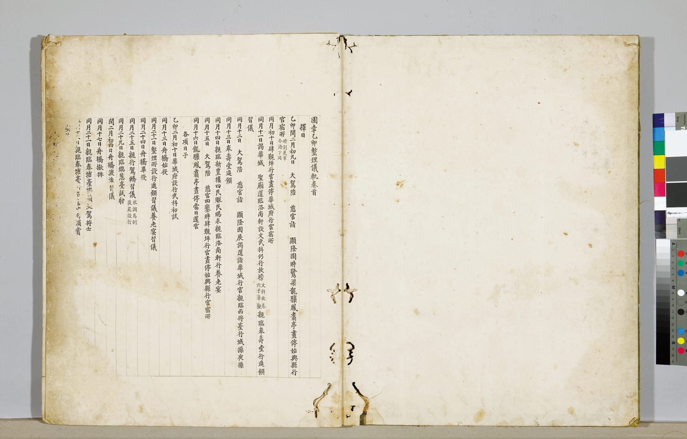
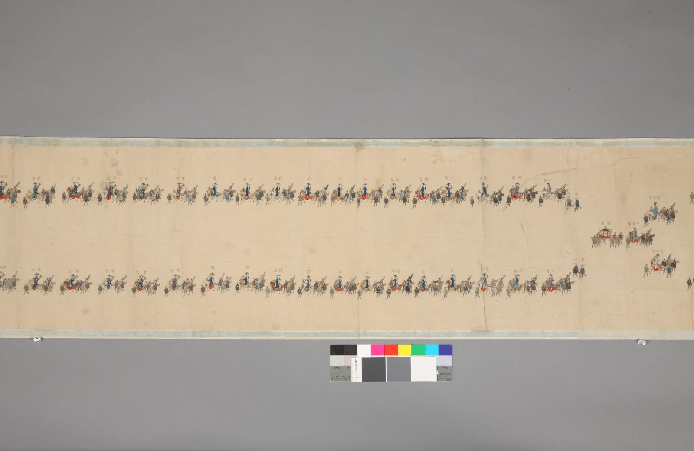

한국사 공부노트 · 12

조선 후기의 정치와 대외 관계

> **이번 글의 질문**
>
> 붕당 정치는 어떻게 변했으며, 양난 이후 통치 체제와 대외 관계에는 어떤 변화가 나타났을까요?

> **핵심 요약**
>
> -   정치의 흐름은 **붕당 정치 → 예송 → 환국 → 탕평 → 세도 정치**로 정리합니다.
> -   **현종은 예송**, **숙종은 환국**, **영조·정조는 탕평**과 연결합니다.
> -   양난 이후 **비변사의 권한이 강화**되고, 중앙은 **5군영**, 지방은 **속오군**으로 개편됩니다.
> -   **광해군의 중립 외교**, **인조의 친명배금**, **효종의 북벌**을 구별합니다.

## 1. 붕당의 형성과 인조반정

선조 때 사림이 정국을 주도하면서 **이조 전랑 임명 문제** 등을 둘러싸고 동인과 서인으로 나뉩니다.

> 동인: 남인·북인으로 분열  
> 서인: 숙종 때 노론·소론으로 분열

| 구분 | 정치적 특징 |
| --- | --- |
| 광해군 | **북인**이 집권합니다. 전후 복구와 중립 외교를 추진하지만, 영창대군 살해와 인목대비 폐위가 반정의 명분이 됩니다. |
| 인조반정 1623년 | **서인**이 주도하여 광해군을 몰아냅니다. 이후 서인이 정국을 주도하고 남인도 정치에 참여합니다. |

## 2. 현종: 두 차례의 예송

**자의대비가 상복을 입는 기간**을 둘러싼 서인과 남인의 논쟁입니다. 왕실의 예법과 효종의 정통성에 대한 견해 차이가 정치적 대립으로 이어집니다.

| 구분 | 서인 | 남인 | 채택 |
| --- | --- | --- | --- |
| 기해예송 1659년 효종 사망 | 1년 | 3년 | **서인** |
| 갑인예송 1674년 인선왕후 사망 | 9개월 | 1년 | **남인** |

자의대비는 **인조의 계비**입니다. 두 예송 모두 상복을 입는 사람은 자의대비라는 점을 기억합니다.

## 3. 숙종: 환국과 정권 교체

**환국**은 국왕의 주도로 집권 세력이 급격하게 바뀌는 것입니다. 상대 붕당에 대한 숙청이 반복되면서 공존과 견제의 정치가 약해집니다.

| 사건 | 정권의 이동과 단서 |
| --- | --- |
| 경신환국 1680년 | **남인 → 서인** 허적·허견 관련 사건 등을 계기로 남인이 축출됩니다. |
| 기사환국 1689년 | **서인 → 남인** 장희빈의 아들 원자 책봉, 인현왕후 폐위와 연결합니다. |
| 갑술환국 1694년 | **남인 → 서인** 인현왕후 복위와 연결합니다. |

> 경신: 서인 → 기사: 남인 → 갑술: 서인

**노론·소론의 분열은 경신환국 이후**부터 나타납니다. 갑술환국 이후 처음 갈라진 것으로 외우지 않습니다.

## 4. 영조와 정조: 탕평과 개혁

| 구분 | 영조 | 정조 |
| --- | --- | --- |
| 탕평 | **완론 탕평** 온건파를 중심으로 고르게 등용합니다. | **준론 탕평** 정치적 시비를 가리며 인재를 등용합니다. |
| 왕권 강화 | **탕평비** 건립, 이조 전랑의 권한 축소, 서원 정리 | **규장각·초계문신제·장용영**, 수원 화성 건설 |
| 경제 | **균역법**: 군포를 1년에 2필에서 1필로 줄입니다. | **신해통공**: 육의전을 제외한 시전의 금난전권을 폐지합니다. |
| 민생·인재 | 신문고 부활, 청계천 준설, 가혹한 형벌 완화 | 서얼 출신을 규장각 검서관으로 등용합니다. |
| 법전 | **『속대전』** | **『대전통편』** |

**초계문신제는 젊은 문신을 선발하여 재교육하는 제도**, **장용영은 정조의 친위 군영**입니다.

**화성원행의궤도 일부** — *1795년 정조의 수원 행차와 관련 행사를 기록한 그림입니다. **수원 화성·장용영·규장각**을 정조의 왕권 강화 정책과 연결합니다. · 사진: [국립중앙박물관, 신수201](https://www.museum.go.kr/MUSEUM/contents/M0502000000.do?relicId=1919&schM=view&searchId=search) · 공공누리 제1유형*

## 5. 세도 정치와 삼정의 문란

정조 사후 **순조·헌종·철종** 때 안동 김씨·풍양 조씨 등 소수 외척 가문이 권력을 장악합니다. 비변사와 주요 관직을 통해 권력을 행사하고, 매관매직과 수취의 폐단이 심해집니다.

> 세도 정치 → 매관매직·삼정의 문란 → 농민 봉기

| 삼정 | 기억할 내용 |
| --- | --- |
| 전정 | **토지세** 징수의 폐단 |
| 군정 | **군포** 징수의 폐단. 어린아이에게 징수하는 황구첨정, 죽은 사람에게 징수하는 백골징포 |
| 환곡 | 곡식을 빌려주고 돌려받는 제도가 **고리대와 수탈**의 수단으로 변질됩니다. |

**홍경래의 난은 순조 때인 1811년**, **임술 농민 봉기는 철종 때인 1862년**입니다.

## 6. 통치 체제: 비변사와 군사 조직

**비변사**는 국방 문제를 논의하는 임시 기구에서 상설 기구로 발전합니다. 양난 이후 군사뿐 아니라 주요 국정을 처리하면서 **의정부·6조의 기능이 약해집니다.**

| 조직 | 특징과 설치 시기 |
| --- | --- |
| 훈련도감 | **선조·임진왜란 중** 설치. 급료를 받는 상비군이며, **포수·사수·살수의 삼수병**으로 편성됩니다. |
| 어영청·총융청·수어청 | **인조** 때 설치됩니다. |
| 금위영 | **숙종** 때 설치되면서 5군영 체제가 갖추어집니다. |
| 속오군 | **지방군**. 양반부터 노비까지 편성하며, 평소 생업에 종사하고 유사시에 동원됩니다. |

> 중앙: 5위 → 5군영 / 지방: 속오군

**5군영이 모두 훈련도감과 같은 급료병 체제로 운영된 것은 아닙니다.** 삼수병과 직업적 상비군이라는 단서는 훈련도감부터 확인합니다.

## 7. 명·후금·청과의 관계

| 왕·시기 | 외교 정책과 사건 |
| --- | --- |
| 광해군 | **명과 후금 사이의 중립 외교**. 명의 요청으로 파병한 강홍립이 후금에 항복한 사건과 연결합니다. |
| 인조 | **친명배금** 정책. **정묘호란: 1627년, 후금** / **병자호란: 1636년, 청** |
| 효종 | **북벌론**과 군비 강화. 송시열 등과 청을 공격할 준비를 하지만 실행하지 못합니다. |
| 효종의 나선 정벌 | **청의 요청으로 러시아 세력을 공격**합니다. 1차는 변급, 2차는 신류가 지휘합니다. |
| 숙종 | **백두산정계비: 1712년**. 조선과 청의 경계로 서쪽은 압록강, 동쪽은 토문강을 명시합니다. |

**북벌은 청을 공격하려는 주장**, **나선 정벌은 청을 도와 러시아 세력과 싸운 사건**입니다. 청의 문물을 배우자는 주장은 북학론입니다.

## 8. 일본과의 관계, 영토 문제

| 주제 | 시험에서 찾을 단서 |
| --- | --- |
| 기유약조 1609년 | **광해군** 때 일본과 제한된 교역을 재개합니다. 부산의 왜관을 통해 교역합니다. |
| 통신사 | **조선에서 일본으로 파견한 외교 사절**. 외교 관계 유지와 문화 교류를 담당합니다. |
| 안용복 | **숙종** 때 일본에 건너가 울릉도·독도가 조선의 영토임을 주장합니다. |
| 간도 문제 | **백두산정계비의 토문강 해석**을 둘러싼 조선과 청의 국경 분쟁과 연결합니다. |
| 간도협약 1909년 | **일본과 청**이 체결합니다. 대한제국을 배제한 채 간도를 청의 영토로 인정합니다. |

**백두산정계비는 숙종 때**, **간도협약은 대한제국 시기**입니다. 통신사와 개항 후 일본에 파견한 수신사도 구별합니다.

**조선 통신사 행렬도 일부** — *1636년 인조 때 통신사 일행이 일본 에도로 들어가는 모습을 그린 그림입니다. **통신사: 일본에 파견한 외교 사절, 문화 교류**로 연결합니다. · 사진: [국립중앙박물관, 신수1195](https://www.museum.go.kr/MUSEUM/contents/M0502000000.do?relicId=1965&schM=view&searchId=search) · 공공누리 제1유형*

> **시험 단서와 구별할 내용**
>
> -   **자의대비·상복 기간:** 현종의 예송
> -   **경신·기사·갑술:** 숙종의 환국
> -   **탕평비·균역법·속대전:** 영조
> -   **규장각·초계문신제·장용영·대전통편:** 정조
> -   **삼수병·급료를 받는 상비군:** 훈련도감
> -   **청 공격 준비:** 북벌 / **청과 함께 러시아 공격:** 나선 정벌
> -   **압록강·토문강:** 백두산정계비 / **1909년·일본과 청:** 간도협약

> **마지막 확인**  
> 현종: 예송 / 숙종: 환국·금위영·안용복·백두산정계비  
> 영조: 균역법·속대전 / 정조: 신해통공·대전통편  
> 순조·헌종·철종: 세도 정치  
> 중앙: 5군영 / 지방: 속오군  
> 광해군: 중립 외교 / 인조: 친명배금 / 효종: 북벌·나선 정벌
