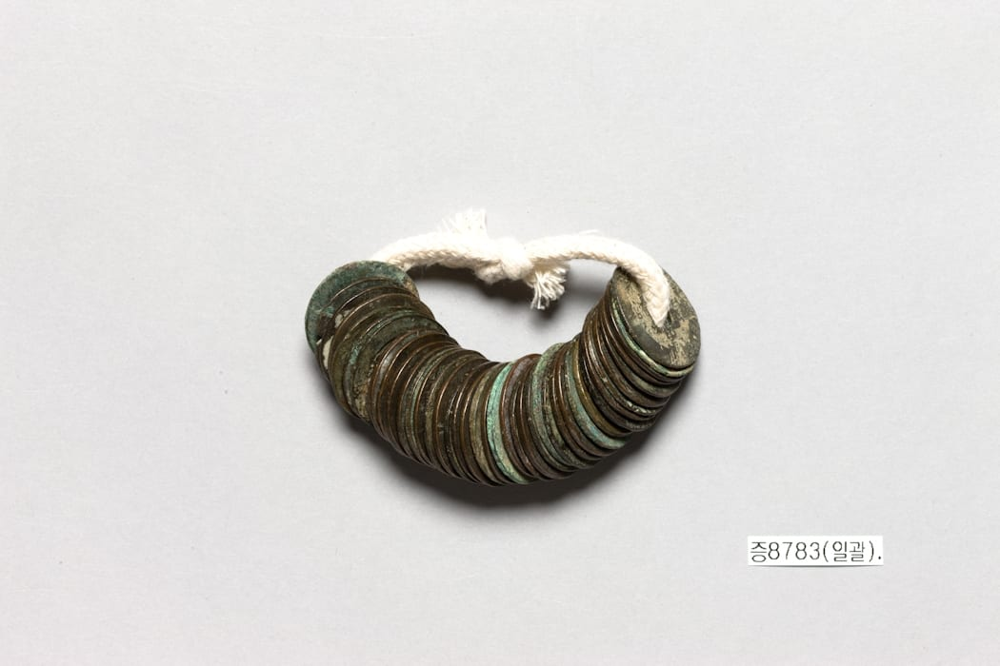

> **이번 글의 질문**
>
> 수취 제도와 생산·유통 방식은 어떻게 바뀌었으며, 이러한 변화는 신분제와 농민의 삶에 어떤 영향을 주었을까요?

> **핵심 요약**
>
> - **영정법은 전세**, **대동법은 공납**, **균역법은 군역**의 개편입니다.
> - **이앙법의 확산**으로 노동력을 절약하고 이모작·광작이 확대됩니다.
> - **공인·사상 성장과 상평통보 유통**으로 상품 화폐 경제가 발달합니다.
> - **신분제가 동요**하지만, 양반 중심의 질서와 차별은 유지됩니다.
> - **삼정의 문란과 지역 차별**은 농민 봉기의 배경이 됩니다.

## 1. 수취 제도: 무엇을 바꿨는가

| 제도 | 대상·왕 | 핵심 내용 |
| --- | --- | --- |
| 영정법 | **전세** 인조 | 풍흉과 관계없이 **토지 1결당 쌀 4두**를 거두는 것을 원칙으로 합니다. |
| 대동법 | **공납** 광해군 때 시작 | 집집마다 부과하던 공물을 **토지 결수에 따라 쌀·포·동전** 등으로 납부하게 합니다. 일반적으로 1결당 쌀 12두입니다. |
| 균역법 | **군역** 영조 | **군포를 1년에 2필에서 1필**로 줄입니다. |

대동법은 **1608년 경기도**에서 시작하여 김육 등의 노력으로 확대됩니다. 이후 **1708년 황해도**까지 시행되지만, 평안도·함경도에는 시행되지 않습니다.

> 대동법 시행 → 공인의 물품 구매 → 상품 수요 증가 → 상업·수공업 발달

**공인**은 관청에서 공가를 받아 필요한 물품을 구입하여 납품하는 상인입니다. 공물을 대신 내주며 과도한 대가를 요구하던 **방납업자**와 구별합니다.

> **균역법의 부족한 재정 보충**
>
> - **결작:** 토지 1결당 쌀 2두를 거둡니다.
> - **선무군관포:** 일부 부유한 양인에게 선무군관이라는 칭호를 주고 군포 1필을 거둡니다.
> - **어세·염세·선세:** 어장·소금·선박 관련 세금을 균역청에서 관할합니다.

법정 세액이 줄어도 각종 부가 징수와 부담 전가로 **농민의 실제 부담이 계속 가벼워진 것은 아닙니다.**

## 2. 농업: 이앙법·광작·도조법

| 변화 | 특징과 영향 |
| --- | --- |
| 이앙법 | 못자리에서 기른 모를 논에 옮겨 심습니다. **김매기 노동력 절약**, 수확량 증가, **벼·보리 이모작 확대**와 연결합니다. |
| 견종법 | **밭고랑에 씨를 뿌리는 농법**입니다. |
| 광작 | 노동력 절약 등을 바탕으로 **넓은 경지를 경작**합니다. 부농의 성장과 농민층 분화에 영향을 줍니다. |
| 상품 작물 | 판매를 목적으로 **담배·인삼·면화·채소** 등을 재배합니다. |

이앙법은 물 확보가 중요합니다. 정부가 가뭄 피해를 우려하여 금지하기도 했지만, 수리 시설의 발달과 함께 확산됩니다.

| 소작료 방식 | 구별할 내용 |
| --- | --- |
| 타조법 | **수확량의 일정 비율**을 소작료로 납부합니다. |
| 도조법 | 계약으로 정한 **일정한 양**을 납부합니다. 생산량을 늘리면 소작농이 확보할 몫도 늘어납니다. |

도조법이 확대되어도 타조법은 함께 유지됩니다. 농민층은 **부농과 영세농·토지를 잃은 농민**으로 분화합니다.

## 3. 상업과 화폐 경제

공인의 활동, 장시의 확대, 사상의 성장으로 유통이 활발해집니다. **도고**는 물품의 매점매석 등으로 판매를 독점하여 이익을 얻는 상인이나 그 행위를 뜻합니다.

| 상인 | 활동 지역·특징 |
| --- | --- |
| 송상 | **개성**. 송방이라는 지점을 설치하고 인삼 교역 등에 참여합니다. |
| 만상 | **의주**. 청과의 무역을 담당합니다. |
| 내상 | **동래**. 일본과의 무역을 담당합니다. |
| 유상 | **평양**을 중심으로 활동합니다. |
| 경강상인 | **한강**. 선박을 이용하여 곡물·목재·소금 등을 운송하고 판매합니다. |
| 보부상 | **장시를 오가는 행상**입니다. |
| 객주·여각 | 상품의 **중개·보관·운송**, 숙박·금융 등의 역할을 합니다. |

**정조의 신해통공: 1791년**에는 **육의전을 제외한 시전의 금난전권**을 폐지하여 사상의 활동을 확대합니다.

**상평통보**는 숙종 때 전국적으로 유통됩니다. 화폐 수요 증가와 동전의 축적 등으로 **화폐가 부족해지는 전황**이 나타나기도 합니다.

***상평통보:** **숙종·동전의 전국적 유통·상품 화폐 경제**를 연결합니다. 가운데 네모난 구멍과 ‘常平通寶’라는 글자를 확인합니다. · 사진: [국립중앙박물관, 증8783](https://www.museum.go.kr/MUSEUM/contents/M0502000000.do?relicId=212181&schM=view&searchId=search) · 공공누리 제1유형*

## 4. 수공업과 광업

| 분야 | 핵심 변화 |
| --- | --- |
| 민영 수공업 | 관영 수공업이 쇠퇴하고 **판매를 위한 생산**이 활발해집니다. |
| 선대제 | **상인이 자금·원료를 미리 제공**하고 수공업자가 만든 제품을 거두어 판매합니다. |
| 광업 | 금·은 등의 수요가 늘면서 민간 광산과 잠채가 확대됩니다. **덕대**가 자본을 조달하고 노동자를 고용하여 광산을 운영합니다. |

상업 자본의 생산 참여와 임금 노동의 확대가 나타납니다. **상품 화폐 경제의 발달**을 중심으로 이해합니다.

## 5. 신분제와 향촌 사회의 변화

| 계층·분야 | 변화와 시험 단서 |
| --- | --- |
| 양반 | 권세 있는 양반, 지방의 향반, 몰락한 잔반 등으로 분화합니다. 부농은 **족보 매입·위조, 공명첩 구매** 등으로 신분 상승을 꾀합니다. |
| 서얼 | 관직 진출 제한의 완화를 요구합니다. 정조 때 **박제가·유득공·이덕무** 등이 규장각 검서관으로 활동합니다. |
| 기술직 중인 | 전문 지식과 경제력을 바탕으로 성장하며 **소청 운동·시사·위항 문학**과 연결됩니다. |
| 노비 | 도망·납속 등으로 신분에서 벗어납니다. **영조의 노비종모법**, **순조 때인 1801년 공노비 해방**을 기억합니다. |
| 향촌 | 기존 사족인 **구향**과 경제력을 바탕으로 성장한 **신향**이 대립합니다. 수령·향리의 영향력이 커집니다. |

**공명첩**은 이름을 적는 칸이 비어 있는 관직·품계 관련 증서입니다. 이를 샀다고 실제 관직에 임명되어 업무를 맡는 것은 아닙니다.

**노비종모법**에 따라 노비 남성과 양인 여성 사이에서 태어난 자녀는 어머니의 신분을 따라 양인이 됩니다. **1801년의 해방은 내노비·시노비를 대상으로 한 것**이며, 모든 노비가 해방된 것은 아닙니다.

신분제가 동요하는 한편, **부계 중심의 족보·동성 마을·장자 중심 제사와 상속** 등 성리학적 가족 질서는 강화됩니다.

## 6. 새로운 사상과 신앙

| 사상·신앙 | 기억할 특징 |
| --- | --- |
| 『정감록』·미륵 신앙 | 새로운 세상에 대한 기대와 현실에 대한 불만을 반영합니다. |
| 천주교 | **인간 평등**을 강조하지만 제사 거부 등이 기존 질서와 충돌합니다. **신유박해: 1801년·순조**와 연결합니다. |
| 동학 | **1860년·철종·최제우**. 시천주 사상과 보국안민을 내세웁니다. 최시형이 교단 조직을 확대하고 경전을 간행합니다. |

**최제우는 시천주**, 이후 천도교를 이끈 **손병희는 인내천**과 연결하여 구별합니다.

## 7. 삼정의 문란과 농민 봉기

> 세도 정치와 수탈 → 삼정의 문란 → 농민 봉기

삼정은 **전정: 토지세**, **군정: 군포**, **환곡: 곡식 대여·회수**입니다. 군정의 폐단으로는 황구첨정·백골징포·인징·족징 등이 있습니다.

| 구분 | 홍경래의 난 | 임술 농민 봉기 |
| --- | --- | --- |
| 시기 | **1811년·순조** | **1862년·철종** |
| 배경 | 세도 정치의 수탈과 **서북 지역민 차별** | **삼정의 문란**과 탐관오리의 수탈 |
| 지역·인물 | **평안도·홍경래** 농민·상인·광산 노동자 등이 참여합니다. | **진주·유계춘** 삼남 등 여러 지역으로 확산됩니다. |
| 결과·대응 | **정주성**에서 정부군에 진압됩니다. | **안핵사 박규수 파견**, **삼정이정청 설치**. 근본적 해결에는 이르지 못합니다. |

> **구별할 내용**
>
> - **1결당 4두·전세:** 영정법 / **1결당 12두·공납:** 대동법
> - **군포 1필·결작:** 균역법
> - **관청 물품 납품·공가:** 공인
> - **수확량의 일정 비율:** 타조법 / **정해진 양:** 도조법
> - **화폐 부족:** 전황 / **매점매석·독점:** 도고
> - **자금·원료를 미리 제공:** 선대제 / **광산 운영:** 덕대
> - **서북 차별·정주성:** 홍경래의 난
> - **유계춘·박규수·삼정이정청:** 임술 농민 봉기

> **마지막 확인**
>
> - 인조: 영정법 / 광해군: 대동법 시작 / 영조: 균역법
> - 숙종: 상평통보의 전국적 유통 / 정조: 신해통공
> - 이앙법: 노동력 절약·이모작·광작 확대
> - 1801년: 공노비 해방·신유박해 / 1811년: 홍경래의 난
> - 1860년: 동학 창시 / 1862년: 임술 농민 봉기
