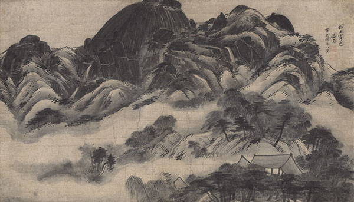
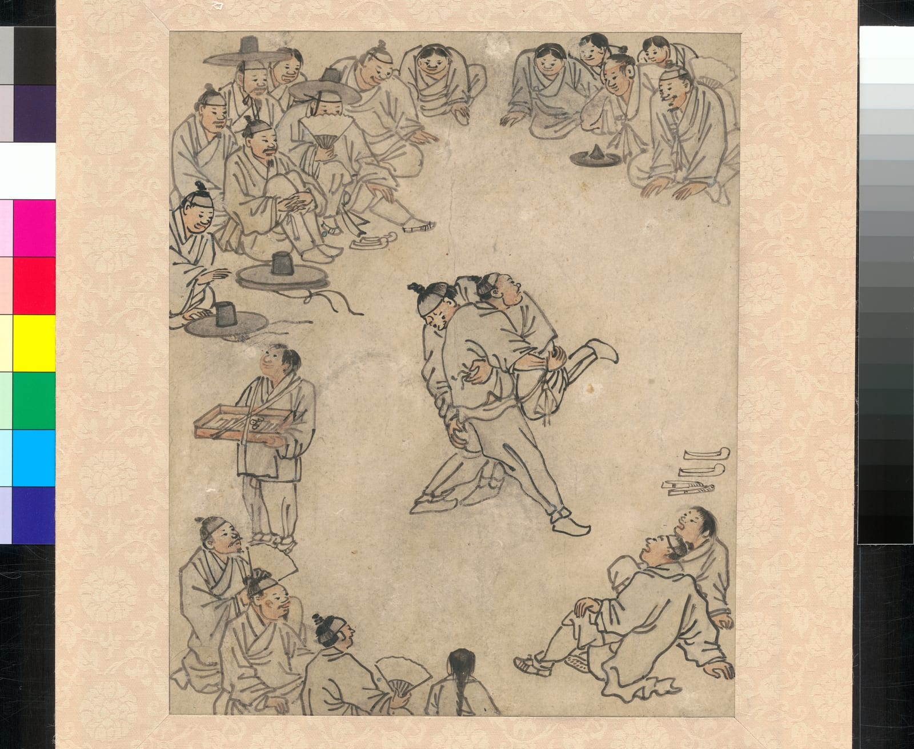

한국사 공부노트 · 14

조선 후기의 문화

> **이번 글의 질문**
>
> 실학자들은 어떤 개혁을 주장했으며, 국학·과학 기술과 서민 문화는 어떻게 발전했을까요?

> **핵심 요약**
>
> -   농업 중심 개혁론은 **유형원·이익·정약용**의 토지 개혁안을 비교합니다.
> -   상공업 중심 개혁론은 **유수원·홍대용·박지원·박제가**의 저서와 주장을 연결합니다.
> -   국학은 **역사서·지리서·지도와 저자**를 짝지어 기억합니다.
> -   **정선은 진경산수화**, **김홍도·신윤복은 풍속화**, **김정희는 추사체·세한도**입니다.

## 1. 실학: 농업 중심과 상공업 중심

실학자들은 사회·경제적 모순을 해결하고 백성의 생활을 개선할 방안을 탐구합니다. **실제 사실에 근거한 연구와 실용성**을 중시합니다.

양명학은 **정제두·강화학파·지행합일**로 연결합니다.

| 학자 | 대표 저서 | 농업 중심 개혁론 |
| --- | --- | --- |
| 유형원 | **『반계수록』** | **균전론**: 신분 등에 따라 토지를 차등 분배하여 자영농을 육성합니다. |
| 이익 | **『성호사설』** | **한전론**: 생계에 필요한 영업전의 매매를 금지하여 농민의 몰락을 막습니다. |
| 정약용 | 『목민심서』 『경세유표』 『흠흠신서』 | **여전론 → 정전론**. 토지와 국가 제도의 개혁을 구상합니다. |

| 학자 | 대표 저서 | 상공업 중심 개혁론 |
| --- | --- | --- |
| 유수원 | **『우서』** | 상공업 진흥, **사농공상의 직업적 평등과 전문화**를 주장합니다. |
| 홍대용 | <strong>『담헌서』</strong> 「의산문답」 | **지전설·우주 무한론**, 중국 중심 세계관 비판과 연결합니다. |
| 박지원 | <strong>『열하일기』</strong> 『과농소초』 | 수레·선박 이용과 화폐 유통을 강조합니다. 「양반전」·「허생전」 등으로 양반 사회를 비판합니다. |
| 박제가 | **『북학의』** | 청의 문물 수용, 통상 확대, **소비를 통한 생산 촉진**을 강조합니다. |

> 박제가: 재물을 우물에 비유 → 소비와 유통이 생산을 촉진한다고 봅니다.

**북벌론은 청을 공격하자는 주장**, **북학론은 청의 유용한 문물을 배우자는 주장**입니다.

홍대용의 **지전설은 지구의 자전**을 뜻합니다. 지구가 태양 주위를 돈다는 설명과 구별합니다.

## 2. 정약용: 토지 개혁과 세 가지 저서

| 구분 | 핵심 내용 |
| --- | --- |
| 여전론 | **토지 공동 소유·공동 경작**, 노동량에 따른 수확물 분배를 구상합니다. |
| 정전론 | 정(井)자 형태의 토지 구획을 바탕으로 **공전은 공동 경작**, **사전은 개별 경작**하는 방안을 구상합니다. |
| 『목민심서』 | **지방 수령**이 지켜야 할 자세와 실무 지침입니다. |
| 『경세유표』 | **국가 통치 제도** 전반의 개혁안을 제시합니다. |
| 『흠흠신서』 | **형사 사건의 조사·심리**와 신중한 판결을 다룹니다. |

실학자의 토지 개혁안은 **실제로 시행된 제도와 구별**합니다.

## 3. 국학: 역사·지리·언어 연구

| 학자 | 저서·성과와 특징 |
| --- | --- |
| 안정복 | **『동사강목』**: 고조선부터 고려까지의 역사를 정리합니다. |
| 이긍익 | **『연려실기술』**: 조선의 정치·문화 등을 기사본말체로 정리합니다. |
| 한치윤 | **『해동역사』**: 외국 문헌을 폭넓게 활용하여 우리 역사를 연구합니다. |
| 이종휘 | **『동사』**: 고구려 역사에 주목합니다. |
| 유득공 | **『발해고』**: 발해사를 우리 역사로 다루고 **남북국**의 관점을 제시합니다. |
| 김정희 | **『금석과안록』**: 북한산비가 **진흥왕 순수비**임을 밝힙니다. |
| 이중환 | **『택리지』**: 사람이 살 만한 곳의 조건을 지리·생리·인심·산수로 설명합니다. |
| 정상기 | **「동국지도」**: 백리척을 사용합니다. |
| 김정호 | **「청구도」·「대동여지도」**: 대동여지도는 목판본·절첩식이며 도로에 10리마다 표시합니다. |

언어 연구는 **신경준: 『훈민정음운해』**, <strong>유희: 『언문지』</strong>로 연결합니다.

백과사전 성격의 저서는 **이수광: 『지봉유설』**, **서유구: 『임원경제지』**, <strong>이규경: 『오주연문장전산고』</strong>를 기억합니다.

## 4. 과학 기술과 실용 서적

| 자료·기술 | 인물과 특징 |
| --- | --- |
| 곤여만국전도 | **마테오 리치**가 중국에서 제작한 세계 지도. 세계에 대한 인식을 넓힙니다. |
| 시헌력 | **효종 때 도입**. 서양 천문학의 영향을 받은 역법입니다. |
| 『동의보감』 | **허준**. 선조 때 편찬을 시작하여 광해군 때 완성한 의서입니다. |
| 『침구경험방』 | **허임**. 침구술의 경험과 치료법을 정리합니다. |
| 『마과회통』 | **정약용**. 홍역에 관한 의학서입니다. |
| 『동의수세보원』 | **이제마**. 사상 의학과 체질에 따른 치료를 다룹니다. |
| 『농가집성』 | **신속**. 기존 농서를 모아 증보하고 이앙법 등을 소개합니다. |
| 거중기 | **정약용**. 수원 화성 축조에 활용된 도르래 장치입니다. |

**『농가집성』은 신속**, **판소리 정리는 신재효**입니다.

## 5. 서민 문화와 회화

상품 화폐 경제의 발달과 문화 향유층의 확대로 서민 문화가 성장합니다. **일상생활·해학·풍자와 양반 사회 비판**이 주요 특징입니다.

| 분야 | 시험 단서 |
| --- | --- |
| 한글 소설 | 「홍길동전」·「춘향전」 등. 신분 차별과 사회 현실을 다룹니다. **전기수**는 이야기를 읽어주는 사람입니다. |
| 사설시조 | 형식이 길고 자유로워지며 서민의 생활과 감정을 표현합니다. |
| 판소리·탈춤 | 해학과 풍자로 사회 모순을 드러냅니다. **신재효**가 판소리 여섯 마당을 정리합니다. |
| 민화 | 호랑이·까치·꽃·물고기 등을 소재로 **복·장수·풍요**를 기원합니다. |

| 화가 | 화풍·대표 작품 |
| --- | --- |
| 정선 | **진경산수화**. 우리 산천을 그린 「인왕제색도」·「금강전도」 |
| 김홍도 | **풍속화**. 「씨름」·「서당」·「벼타작」 등 일상생활과 생업 |
| 신윤복 | **풍속화**. 「단오풍정」·「월하정인」 등 남녀의 풍류와 생활 |
| 김정희 | **추사체·「세한도」**. 금석학 연구와 개성적인 서예 |

**정선, 인왕제색도** — ***정선: 진경산수화·우리 산천** · 비가 갠 인왕산의 바위와 안개를 표현했습니다. 실제 경관을 바탕으로 하되 화가의 해석을 담아 그립니다. · 사진: [국립중앙박물관](https://www.museum.go.kr/MUSEUM/contents/M0501000000.do?relicRecommendId=962060&schM=view) · 공공누리 제3유형, 출처표시·변경금지*

**김홍도, 씨름** — ***김홍도: 풍속화·서민의 생활** · 가운데 씨름꾼과 둥글게 모인 구경꾼의 모습으로 인물들의 표정과 현장의 분위기를 표현합니다. · 사진: [국립중앙박물관, 본관6504-22](https://www.museum.go.kr/MUSEUM/contents/M0502000000.do?relicId=551&schM=view&searchId=search) · 공공누리 제1유형*

## 6. 건축: 목탑·다층 건물·화성

| 문화재 | 구별할 특징 |
| --- | --- |
| 보은 법주사 팔상전 | **5층 목탑**. 석탑과 구별합니다. |
| 김제 금산사 미륵전 | 겉은 **3층**이지만 내부는 하나로 통하는 구조입니다. |
| 구례 화엄사 각황전 | 겉은 **2층**이지만 내부는 하나로 통하는 대규모 불전입니다. |
| 수원 화성 | **정조** 때 건설. 정약용의 설계 참여, 거중기 활용, 『화성성역의궤』와 연결합니다. |

> **시험 단서와 구별할 내용**
>
> -   **균전론·반계수록:** 유형원 / **영업전·성호사설:** 이익
> -   **공동 경작·노동량에 따른 분배:** 정약용의 여전론
> -   **지전설·의산문답:** 홍대용 / **소비·우물·북학의:** 박제가
> -   **고구려·동사:** 이종휘 / **발해·남북국·발해고:** 유득공
> -   **백리척·동국지도:** 정상기 / **목판본·10리 표시·대동여지도:** 김정호
> -   **북한산 진흥왕 순수비·추사체·세한도:** 김정희
> -   **진경산수화:** 정선 / **풍속화:** 김홍도·신윤복

> **마지막 확인**  
> 유형원: 균전론 / 이익: 한전론 / 정약용: 여전론·정전론  
> 목민심서: 수령 / 경세유표: 국가 제도 / 흠흠신서: 형사 사건  
> 박지원: 열하일기 / 박제가: 북학의 / 홍대용: 지전설  
> 유득공: 발해고 / 김정호: 청구도·대동여지도  
> 신속: 농가집성 / 신재효: 판소리 정리
