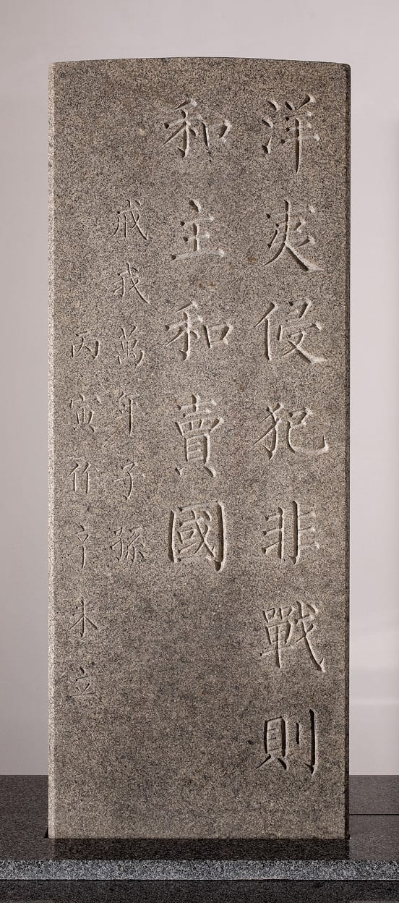

> **이번 글의 질문**
>
> 흥선 대원군은 무엇을 개혁했으며, 개항 이후 조선의 정치와 대외 관계는 어떻게 달라졌을까요?

> **핵심 요약**
>
> - **흥선 대원군**: 왕권 강화, 삼정의 문란 개선, 통상 수교 거부 정책을 추진했습니다.
> - **강화도 조약**: 운요호 사건을 계기로 체결한 최초의 근대적 조약이자 불평등 조약입니다.
> - **개화 정책**: 통리기무아문과 별기군을 설치하고 해외에 사절단을 보냈습니다.
> - **임오군란·갑신정변**: 청과 일본의 간섭이 확대되는 계기가 됐습니다.

## 1. 흥선 대원군의 국내 정책

고종 즉위 후 집권한 흥선 대원군은 **세도 정치의 폐단을 줄이고 왕권을 강화**하려 했습니다.

| 정책 | 시험에 나오는 핵심 |
| --- | --- |
| 통치 체제 정비 | 세도 가문 약화, 인재 등용 확대 **비변사 폐지, 의정부·삼군부 기능 회복** |
| 법전 정비 | **『대전회통』·『육전조례』** 편찬 |
| 서원 철폐 | 전국의 서원을 **47개소만 남기고 철폐** 양반 유생의 반발 |
| 양전 사업 | 토지 조사로 숨겨진 토지인 **은결**을 찾아 전정 개선 |
| 호포제 | **양반에게도 군포 부과** 군정의 문란 개선 |
| 사창제 | 환곡을 사창제로 개편해 **환정의 문란 개선** |
| 경복궁 중건 | 왕실 권위 회복 목적 **원납전 징수·당백전 발행**으로 백성 부담과 물가 상승 |

> **구별할 내용**
>
> **호포제**는 양반에게도 군포를 부과한 정책입니다. 군포를 2필에서 1필로 줄인 **영조의 균역법**과 구별합니다.
>
> **『대전통편』은 정조**, **『대전회통』은 고종 때 흥선 대원군 집권기**에 편찬됐습니다.

## 2. 외세의 침입과 통상 수교 거부

| 사건 | 배경과 핵심 단서 |
| --- | --- |
| 병인박해 1866 | 천주교 탄압, 프랑스 선교사 처형 **병인양요의 구실** |
| 제너럴 셔먼호 사건 1866 | 미국 상선이 **대동강**에서 통상을 요구하다 충돌·소각 신미양요의 구실 |
| 병인양요 1866 | **프랑스**의 강화도 침입 **양헌수·정족산성**, 외규장각 도서 약탈 |
| 오페르트 도굴 사건 1868 | 독일 상인 오페르트가 **남연군 묘 도굴 시도** 통상 수교 거부 기조 강화 |
| 신미양요 1871 | **미국**의 강화도 침입 **어재연·광성보**, 수자기 탈취 |

신미양요 이후 전국에 **척화비**를 세워 서양과의 통상 수교를 거부하는 뜻을 알렸습니다.

***척화비, 신미양요 이후의 정책을 보여 주는 단서:** 서양 세력과의 화친을 경계하는 내용을 새겼습니다. **1871년·신미양요 이후·흥선 대원군**을 연결합니다. · 사진: [국립중앙박물관, 척화비](https://www.museum.go.kr/MUSEUM/contents/M0502000000.do?relicId=4480&schM=view&searchId=search) · 본관 4371 · 공공누리 제1유형*

> **사건의 단서**
>
> **프랑스·정족산성·외규장각** → 병인양요
>
> **미국·광성보·어재연·수자기** → 신미양요
>
> **남연군 묘·독일 상인** → 오페르트 도굴 사건

## 3. 강화도 조약과 개항

> 대원군 실각(1873) → 운요호 사건(1875) → 강화도 조약(1876)

일본은 운요호 사건을 구실로 개항을 요구했습니다. 조선은 일본과 **강화도 조약, 즉 조일 수호 조규**를 체결했습니다.

| 조약·규칙 | 핵심 내용 |
| --- | --- |
| 강화도 조약 1876 | 조선을 **자주국**으로 규정 **부산 외 2개 항구** 개항 약속 일본의 **해안 측량권·영사 재판권** 인정 |
| 조일 수호 조규 부록 1876 | **일본 화폐 사용** 허용 개항장에서 일본인의 활동 범위를 **10리**로 설정 |
| 조일 무역 규칙 1876 | **무관세 무역·양곡 수출** 허용 |
| 조미 수호 통상 조약 1882 | **서양 국가와 맺은 최초의 조약** 거중 조정, 관세 규정 영사 재판권·최혜국 대우 포함 |

> **구별할 내용**
>
> <strong>‘조선은 자주국’</strong>이라는 조항에는 청의 간섭을 배제하려는 일본의 의도가 담겨 있습니다.
>
> 실제 개항 순서는 **부산(1876) → 원산(1880) → 인천**(1883)입니다.
>
> **해안 측량권·영사 재판권은 본 조약**, **일본 화폐는 부록**, **무관세·양곡 수출은 무역 규칙**으로 구별합니다.

## 4. 개화 정책과 위정척사 운동

정부는 **통리기무아문**(1880)을 설치하고 그 아래 12사를 두었습니다. 군사 제도에서는 **5군영을 2영으로 개편**하고 **별기군**(1881)을 창설했습니다.

| 해외 파견 | 목적지와 연결할 내용 |
| --- | --- |
| 수신사 | **일본** 김기수(1876), 김홍집(1880) 김홍집이 **『조선책략』** 소개 |
| 조사 시찰단 1881 | **일본**의 근대 시설·제도 시찰 |
| 영선사 1881 | **김윤식·청** 무기 제조 기술 학습 → 기기창 설치 |
| 보빙사 1883 | **민영익·미국** 조미 수호 통상 조약 이후 파견 |

<strong>『조선책략』</strong>은 러시아를 견제하기 위해 청·일본·미국과 협력할 것을 제안했습니다. 이에 **이만손 등의 영남 만인소**(1881)가 올라오는 등 위정척사 운동이 전개됐습니다.

## 5. 임오군란과 갑신정변

| 구분 | 임오군란 | 갑신정변 |
| --- | --- | --- |
| 연도 | **1882년** | **1884년** |
| 주도 세력 | 구식 군인, 도시 하층민 | **김옥균·박영효** 등 급진 개화파 |
| 배경·단서 | 별기군과의 차별, 급료 체불 **쌀에 모래가 섞인 급료** | 청의 간섭, 개화 노선 갈등 **우정총국 개국 축하연** 이용 |
| 전개 | 일본 공사관 공격 대원군 일시 재집권 | 일본의 지원을 기대하며 정변 개혁 정강 발표 |
| 결과 | 청군 진압, **대원군 청으로 납치** | 청군 개입으로 **3일 만에 실패** |
| 이후 협정 | **제물포 조약** 조청 상민 수륙 무역 장정 | **한성 조약·톈진 조약** |

> **갑신정변의 개혁 정강**
>
> - **청에 대한 사대 의례 폐지**: 자주독립 추구
> - **문벌 폐지·인민 평등권 확립**: 능력에 따른 인재 등용
> - **지조법 개혁**: 토지세 제도 개혁
> - **재정을 호조로 일원화**: 국가 재정 정비
>
> 근대 국가를 지향했지만 **민중의 지지 부족과 일본에 대한 의존**이라는 한계가 있었습니다. 개혁안이 발표됐다는 사실과 실제 시행 여부를 구별합니다.

## 6. 사건 이후의 조약 구별

| 조약·장정 | 핵심 내용 |
| --- | --- |
| 제물포 조약 1882 · 조선과 일본 | **임오군란 이후** 배상금 지급 **일본 공사관 경비 병력 주둔** 허용 |
| 조청 상민 수륙 무역 장정 1882 · 조선과 청 | **임오군란 이후** 조선을 청의 속방으로 규정 **청 상인의 내지 통상** 허용 |
| 한성 조약 1885 · 조선과 일본 | **갑신정변 이후** 일본에 배상금 지급 일본 공사관 신축 비용 부담 |
| 톈진 조약 1885 · 청과 일본 | **갑신정변 이후** 양국 군대의 조선 철수 **조선 파병 시 상대국에 사전 통보** |

> **시험에서 바로 찾는 단서**
>
> **일본 공사관 경비 병력 주둔** → 제물포 조약
>
> **일본 공사관 신축 비용** → 한성 조약
>
> **청·일 양국, 파병 전 통보** → 톈진 조약
>
> **청 상인의 내지 통상** → 조청 상민 수륙 무역 장정

> **마지막 확인**
>
> - 호포제: 양반도 군포 / 사창제: 환곡 폐단 개선
> - 병인양요: 프랑스·양헌수 / 신미양요: 미국·어재연
> - 1876 강화도 조약 → 1882 임오군란 → 1884 갑신정변
> - 임오군란 이후: 제물포 조약 / 갑신정변 이후: 한성·톈진 조약
