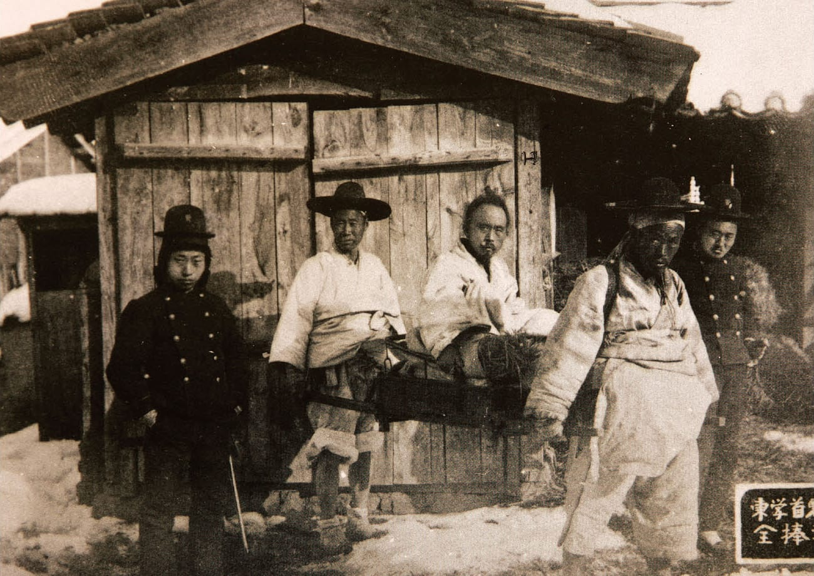

한국사 공부노트 · 16

개혁의 전개와 국권 수호

> **이번 글의 질문**
>
> 근대 국가를 만들기 위한 개혁은 어떻게 전개됐으며, 국권 침탈에 맞선 저항은 어떤 모습이었을까요?

> **핵심 요약**
>
> -   **동학 농민 운동**: 반봉건·반외세 운동이며, 집강소를 통해 개혁을 추진했습니다.
> -   **갑오·을미개혁**: 신분제 폐지 등 근대적 변화를 이끌었지만 일본의 간섭을 받았습니다.
> -   **독립협회·광무개혁**: 민권 확대와 황제권 강화라는 방향의 차이를 구별합니다.
> -   **국권 침탈**: 고문 정치 → 통감 정치 → 차관 정치 → 국권 피탈로 이어집니다.
> -   **국권 수호**: 의병 투쟁, 애국 계몽 운동, 외교·언론 활동이 전개됐습니다.

## 1. 동학 농민 운동의 전개

관리의 수탈과 외세의 경제적 침투에 대한 불만이 커졌습니다. **전봉준**을 중심으로 농민들이 봉기했습니다.

| 단계 | 핵심 내용 |
| --- | --- |
| 교조 신원 운동 | **최제우의 억울함 해소**와 동학 탄압 중지 요구 종교 운동에서 반봉건·반외세 운동으로 확대 |
| 고부 농민 봉기 1894 | **조병갑·만석보**를 단서로 확인 고부 군수의 수탈에 저항 |
| 제1차 봉기 | 무장 봉기·백산 집결 **황토현·황룡촌 승리 → 전주성 점령** |
| 전주 화약 | 정부와 농민군의 타협 **집강소** 설치, 폐정 개혁 추진 |
| 제2차 봉기 | 일본군의 경복궁 점령 등에 반발 **반외세·항일 성격 강화**, 남접·북접 연합 |
| 실패 | **공주 우금치**에서 일본군·관군에 패배 전봉준 등 지도자 체포 |

정부의 요청으로 청군이 들어왔고, 일본도 **톈진 조약**을 근거로 파병했습니다. 일본군은 전주 화약 이후에도 철수하지 않고 경복궁을 점령했으며, 청일 전쟁을 일으켰습니다.

> **폐정 개혁의 핵심**
>
> **노비 문서 소각, 과부 재가 허용, 부당한 세금 폐지, 토지의 평균 분작** 등을 요구했습니다.
>
> 토지 분배는 **농민군의 요구**로 기억합니다. 전국적으로 토지를 균등하게 나눠 준 것으로 이해하지 않습니다.

**전봉준: 동학 농민 운동의 인물 단서** — *1895년 2월 27일 법무아문으로 이송되기 전의 모습입니다. **전봉준·고부·집강소·우금치**를 연결합니다. · 촬영: 무라카미 텐신 · 이미지 제공: [Wikimedia Commons](https://commons.wikimedia.org/wiki/File:Jeon_Bong-jun_under_arrest_\(27_February_1895\).jpg) · 공개 이용 자료(Public domain)*

## 2. 갑오개혁과 을미개혁

| 구분 | 추진 기구와 핵심 정책 |
| --- | --- |
| 제1차 갑오개혁 1894 | **김홍집·군국기무처** 의정부와 궁내부 분리, 6조를 **8아문**으로 개편 **과거제·신분제·공사 노비제 폐지** 과부 재가 허용, 조혼 금지 탁지아문으로 재정 일원화, 조세 금납화, 은 본위제 |
| 제2차 갑오개혁 1894\~1895 | **김홍집·박영효 연립 내각** 군국기무처 폐지, **홍범 14조** 반포 **내각·7부, 지방 23부** 체제 재판소 설치, 교육 입국 조서 발표 |
| 을미개혁 1895\~1896 | **건양** 연호 채택 **태양력·단발령·종두법** 우체사 설치, 소학교 설립 등 |

신분 질서와 전통 제도를 바꾼 근대적 개혁입니다. 다만 **일본의 간섭을 배제하지 못했고, 농민이 요구한 토지 개혁도 실현하지 못했습니다.**

> **구별할 내용**
>
> **갑신정변의 14개조 정강** → 1884년 급진 개화파의 개혁안
>
> **홍범 14조** → 제2차 갑오개혁의 기본 방향
>
> **신분제 폐지** → 갑오개혁 / **단발령·태양력** → 을미개혁

## 3. 삼국 간섭에서 아관파천까지

> 청일 전쟁 → 시모노세키 조약 → 삼국 간섭 → 을미사변 → 을미개혁·을미의병 → 아관파천

| 사건 | 배경과 결과 |
| --- | --- |
| 삼국 간섭 1895 | **러시아·프랑스·독일**이 일본에 랴오둥반도 반환 요구 조선에서 러시아의 영향력 확대 |
| 을미사변 1895 | 일본을 견제하던 **명성황후를 일본 세력이 시해** 반일 감정 확산 |
| 아관파천 1896 | **고종이 러시아 공사관으로 거처 이동** 김홍집 내각 붕괴, 을미개혁 중단 열강의 이권 침탈 확대 |

<strong>거문도 사건(1885)</strong>은 러시아의 남하를 견제한 **영국의 거문도 불법 점령**입니다. 삼국 간섭과 시기·주체를 구별합니다.

## 4. 독립협회와 대한제국

| 구분 | 핵심 내용 |
| --- | --- |
| 독립협회 1896 | **서재필** 등 주도 독립문 건립, 토론회 개최 **자주 국권·자유 민권·자강 개혁** 추구 |
| 만민공동회 1898 | 시민의 정치 참여 확대 **러시아의 절영도 조차 요구 저지** |
| 관민공동회 1898 | 관리와 시민이 함께 참여 **헌의 6조** 결의: 이권 양여 통제, 재정 일원화·공개, 인권 보장 |
| 의회 설립 운동 | **중추원 개편** 추진 보수 세력의 반발과 고종의 탄압으로 좌절 독립협회 해산 |
| 대한제국 1897 | 고종이 경운궁으로 환궁한 뒤 선포 **환구단에서 황제 즉위**, 광무 연호 사용 |
| 광무개혁 | **구본신참**: 옛 제도를 바탕으로 새 제도 수용 **양전 사업·지계 발급**, 상공업·기술 교육 진흥 원수부 설치, 군사력 강화 |
| 대한국 국제 1899 | 대한제국의 자주독립과 **황제의 전제 권한** 규정 |

> **구별할 내용**
>
> **독립협회**는 민권 확대와 의회 설립을 추진했습니다. **광무개혁**은 황제권을 강화하며 근대화를 추진했습니다.
>
> <strong>독립신문(1896)</strong>은 최초의 민간 신문입니다. 최초의 근대 신문인 <strong>한성순보(1883)</strong>와 구별합니다.

## 5. 국권 침탈의 순서

러일 전쟁이 시작된 **1904년**부터 일본의 주권 침탈이 본격화됐습니다.

| 사건·조약 | 빼앗긴 권리와 핵심 단서 |
| --- | --- |
| 한일 의정서 1904 | 일본이 **군사상 필요한 지역 사용** 러일 전쟁 중 강요 |
| 제1차 한일 협약 1904 | **고문 정치** 재정 고문 메가타, 외교 고문 스티븐스 |
| 을사늑약 1905 | **외교권 박탈·통감부 설치** 초대 통감 이토 히로부미 |
| 헤이그 특사 1907 | **이상설·이준·이위종** 파견 을사늑약의 부당성 알리려 함 일본이 이를 구실로 **고종 강제 퇴위** |
| 한일 신협약 1907 | **정미 7조약·차관 정치** 각 부에 일본인 차관 배치 **부속 각서에 따라 군대 해산** |
| 기유각서 1909 | **사법권·감옥 사무**를 일본에 넘김 |
| 국권 피탈 1910 | **8월 29일 경술국치** 대한제국의 국권 상실 |

> 고문(1904) → 통감(1905) → 차관(1907) → 국권 피탈(1910)

## 6. 의병 투쟁의 확대

| 구분 | 계기와 특징 |
| --- | --- |
| 을미의병 1895 | **을미사변·단발령**에 저항 유인석·이소응 등 유생 주도 |
| 을사의병 1905 | **을사늑약**에 저항 최익현·민종식, 평민 의병장 **신돌석** 활동 |
| 정미의병 1907 | **고종 강제 퇴위·군대 해산**에 저항 해산 군인 합류로 전투력 강화 |

**13도 창의군**은 이인영·허위 등을 중심으로 서울 진공 작전을 추진했습니다. 이후 일제의 <strong>남한 대토벌 작전(1909)</strong>으로 국내 활동이 어려워지면서 일부 의병은 간도·연해주로 이동했습니다.

## 7. 애국 계몽 운동과 국권 수호

교육·언론·산업을 통해 실력을 길러 국권을 회복하려 했습니다.

| 단체·운동 | 시험에 나오는 단서 |
| --- | --- |
| 보안회 1904 | 일본의 **황무지 개간권 요구 저지** |
| 헌정연구회 1905 | **입헌 군주제** 지향 |
| 대한자강회 1906 | 교육·산업 진흥 **고종 강제 퇴위 반대 운동** 보안법으로 해산 |
| 신민회 1907 | **안창호·양기탁 등, 비밀결사·공화정 지향** 대성학교·오산학교, 태극서관·자기 회사 **국외 독립운동 기지 건설** 추진 105인 사건(1911)으로 큰 타격 |
| 국채 보상 운동 1907 | **대구·서상돈·김광제** 금연·모금으로 일본에 진 빚을 갚으려 함 **대한매일신보** 등이 지원 |

> **인물과 저항 활동**
>
> **장지연** → 황성신문에 「시일야방성대곡」 발표(1905)
>
> **민영환** → 을사늑약에 항거해 순국(1905)
>
> **장인환·전명운** → 샌프란시스코에서 스티븐스 처단(1908)
>
> **안중근** → 하얼빈에서 이토 히로부미 처단(1909)

> **마지막 확인**  
> 동학: 전봉준·집강소·우금치 / 갑오: 군국기무처·신분제 폐지  
> 을미: 건양·단발령 / 광무: 구본신참·지계·황제권 강화  
> 홍범 14조: 제2차 갑오개혁 / 헌의 6조: 관민공동회  
> 을미의병: 시해·단발 / 을사의병: 외교권 박탈 / 정미의병: 군대 해산  
> 1904 고문 → 1905 통감 → 1907 차관 → 1910 국권 피탈
