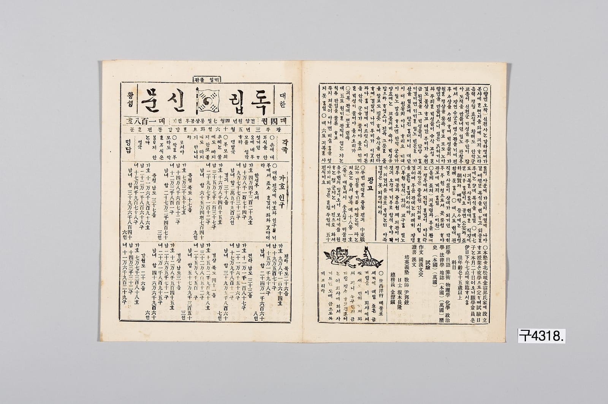

한국사 공부노트 · 17

개항기의 경제와 문화

> **이번 글의 질문**
>
> 개항 이후 경제와 생활은 어떻게 달라졌으며, 우리 민족은 경제적 침탈에 어떻게 대응했을까요?

> **핵심 요약**
>
> -   **경제 침투**: 곡물 유출과 외국 상품 유입, 외국 상인의 내지 진출, 이권 침탈이 확대됐습니다.
> -   **경제적 저항**: 방곡령, 상권 수호 운동, 이권 수호 운동, 국채 보상 운동이 전개됐습니다.
> -   **근대 문화**: 신문·학교·병원·철도 등이 등장했습니다.
> -   **민족의식**: 국어·국사 연구와 교육·언론 활동을 통해 높아졌습니다.

## 1. 조약과 경제 침투

| 조약·장정 | 경제 분야의 핵심 |
| --- | --- |
| 강화도 조약의 부속 협정 1876 | **부록**: 일본 화폐 사용 허용 **무역 규칙**: 무관세·양곡 수출 허용 |
| 조미 수호 통상 조약 1882 | **관세 규정·최혜국 대우** 영사 재판권을 포함한 불평등 조약 |
| 조청 상민 수륙 무역 장정 1882 | **청 상인의 내지 통상** 허용 청과 일본 상인의 경쟁 심화 |
| 조일 통상 장정 1883 | **관세 부과·방곡령 규정·최혜국 대우** 방곡령 시행 **1개월 전 통보** |

**최혜국 대우**는 다른 나라에 부여한 유리한 대우를 해당 국가에도 적용하는 조항입니다. 외국이 특권을 확대하는 수단으로 활용했습니다.

조선에서는 주로 **쌀·콩을 수출하고 면제품을 수입**했습니다. 곡물 유출은 식량 부족과 가격 상승을 일으켰고, 외국산 면제품은 전통 면직업에 타격을 줬습니다.

> **구별할 내용**
>
> **강화도 조약에는 최혜국 대우 조항이 없습니다.**
>
> 일본에 대한 관세 부과는 **1883년 조일 통상 장정**으로 연결합니다.
>
> 청 상인의 내지 진출은 **조미 조약이 아닌 조청 상민 수륙 무역 장정**과 연결합니다.

## 2. 이권 침탈과 경제적 저항

아관파천 이후 열강의 **광산 채굴권·철도 부설권·삼림 채벌권** 침탈이 확대됐습니다. 대표적으로 **미국의 운산 금광 채굴권**을 기억합니다.

| 대응 | 핵심 단서 |
| --- | --- |
| 방곡령 1889 | **함경도 관찰사 조병식** 흉년으로 곡물 반출 제한 일본이 사전 통보 문제 등을 구실로 배상 요구 |
| 상권 수호 운동 | <strong>황국 중앙 총상회(1898)</strong> 시전 상인 중심, 외국 상인의 상권 침해에 저항 |
| 이권 수호 운동 | **독립협회** 러시아의 절영도 조차 요구 저지 등 |
| 황무지 개간권 반대 1904 | **보안회·농광회사** 등 일본의 황무지 개간권 요구 저지 |
| 국채 보상 운동 1907 | **대구·서상돈·김광제** 금연·모금으로 일본에 진 빚을 갚으려 함 대한매일신보 등 언론의 지원 |
| 민족 자본 육성 | 상회사·근대 기업 설립 **한성은행·대한천일은행** 등 민족계 은행 설립 |

> **화폐 정리 사업: 메가타·제일은행**
>
> **재정 고문 메가타**가 주도해 1905년부터 추진했습니다. 백동화 등 구화폐를 정리하고 **일본 제일은행권**을 유통시켰습니다.
>
> 불리한 교환과 화폐 부족으로 한국 상인·민족계 은행이 타격을 받았으며, 일본의 금융 지배가 강화됐습니다.
>
> 사업은 **을사늑약 체결 이전부터** 시작됐습니다.

## 3. 근대 시설과 생활의 변화

| 시설·문물 | 역할과 핵심 단서 |
| --- | --- |
| 박문국·전환국 | **박문국**: 인쇄·출판, 한성순보 발행 **전환국**: 화폐 주조 |
| 기기창 | **근대 무기 제조** 영선사의 기술 학습과 연결 |
| 우정총국 1884 | 근대 우편 업무 **갑신정변**으로 업무 중단 |
| 광혜원·제중원 1885 | **알렌**의 건의로 설립한 서양식 병원 광혜원 설립 후 제중원으로 이름 변경 |
| 전신·전등 | **1885년** 한성\~인천 전신 개통 **1887년** 경복궁 전등 점등 |
| 전차 1899 | **한성전기회사** 서울에서 전차 운행 |
| 경인선 1899 | **최초의 철도** 노량진\~제물포 구간 개통 |
| 경부선·경의선 | **경부선 1905·경의선 1906** 일본의 군사적·경제적 침투와 연결 |

> **구별할 내용**
>
> **박문국은 신문, 전환국은 화폐, 기기창은 무기**입니다.
>
> **경인선은 1899년**에 개통됐습니다. 1904년 시작된 러일 전쟁보다 앞섭니다.

## 4. 근대 교육의 보급

| 학교·정책 | 구별할 특징 |
| --- | --- |
| 원산학사 1883 | **최초의 근대식 사립학교** 주민과 지방 관리의 협력 문예반·무예반, 전통 학문과 근대 학문 교육 |
| 동문학 1883 | **통역 인력 양성**을 위한 관립 교육기관 |
| 육영공원 1886 | **근대적 관립학교** 상류층 자제·관리 교육 헐버트 등 미국인 교사 초빙 |
| 선교사 설립 학교 | **배재학당**: 아펜젤러, 1885 **이화학당**: 스크랜턴, 1886 |
| 교육 입국 조서 1895 | **제2차 갑오개혁** 소학교·사범학교·외국어학교 등 설립 |
| 민족 교육 | **대성학교: 안창호** **오산학교: 이승훈** 애국 계몽 운동의 교육 구국 활동 |

## 5. 신문의 발달과 국권 수호

| 신문 | 시험에 나오는 특징 |
| --- | --- |
| 한성순보 1883 | **최초의 근대 신문** 박문국 발행, 순한문, 10일 간격 |
| 한성주보 1886 | 국한문 혼용 등, 주간 발행 **최초의 근대 상업 광고** |
| 독립신문 1896 | **서재필·최초의 민간 신문** 한글판과 영문판, 국민 계몽 |
| 제국신문 1898 | **순한글** 일반 대중·여성 독자층 |
| 황성신문 1898 | **국한문 혼용** 장지연의 **「시일야방성대곡」** |
| 대한매일신보 1904 | **베델·양기탁** 일제 침략 비판, 의병 활동 보도 **국채 보상 운동 지원** |

**독립신문: 한글 지면과 태극기 제호** — *사진은 1899년 5월 16일자입니다. **창간 연도는 1896년**이며, 서재필·최초의 민간 신문·한글판과 영문판을 연결합니다. · 사진: [국립중앙박물관, 독립신문](https://www.museum.go.kr/MUSEUM/contents/M0502000000.do?schM=view&searchId=search&relicId=2946) · 구 4318 · 공공누리 제1유형*

## 6. 국학·문학·종교의 변화

| 분야 | 인물과 핵심 내용 |
| --- | --- |
| 국어 연구 | <strong>국문 연구소(1907)</strong> 주시경·지석영 등 참여, 국문 정리·연구 |
| 역사 연구 | <strong>신채호 「독사신론」(1908)</strong> 대한매일신보 연재, 민족주의 사학 |
| 신소설 | <strong>이인직 『혈의 누』</strong> 안국선 『금수회의록』 등 |
| 신체시 | <strong>최남선 「해에게서 소년에게」</strong> 『소년』 창간호에 발표, 1908 |
| 천도교 | **손병희**가 동학을 천도교로 개편, 1905 교육·출판과 민족운동 전개 |
| 대종교 | **나철·단군 신앙** 1909년 단군교 중광, 이후 대종교로 개칭 만주 지역 독립운동과 연결 |
| 천주교·개신교 | **조불 수호 통상 조약(1886)** 이후 천주교 선교 여건 개선 개신교 선교사의 학교·병원 설립 |

> **해외 이주의 단서**
>
> **간도·연해주**: 19세기 후반부터 생계 등을 위해 이주, 이후 독립운동의 기반 형성
>
> **하와이(1903)**: 사탕수수 농장 노동 이민
>
> **멕시코(1905)**: 에네켄 농장 계약 노동 이민

> **마지막 확인**  
> 1883 조일 통상 장정: 관세·방곡령·최혜국 대우  
> 조병식: 방곡령 / 황국 중앙 총상회: 상권 / 보안회: 황무지  
> 메가타·제일은행: 화폐 정리 사업  
> 원산학사: 사립 / 동문학: 통역 / 육영공원: 관립·헐버트  
> 한성순보: 최초 근대 / 독립신문: 최초 민간 / 한성주보: 광고  
> 황성신문: 시일야방성대곡 / 대한매일신보: 국채 보상 운동  
> 천도교: 손병희·동학 / 대종교: 나철·단군
