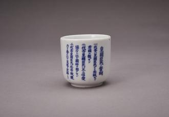

한국사 공부노트 · 18

일제의 식민 통치

> **이번 글의 질문**
>
> 일제의 통치 방식은 어떻게 바뀌었으며, 경제 수탈과 민족 말살 정책은 어떤 모습으로 나타났을까요?

> **핵심 요약**
>
> -   **1910년대**: 헌병 경찰을 앞세운 무단 통치, 토지 조사 사업·회사령을 시행했습니다.
> -   **1920년대**: 3·1 운동 이후 문화 통치를 내세웠지만, 감시·검열과 민족 분열 정책을 지속했습니다.
> -   **1930년대 이후**: 침략 전쟁을 확대하며 황국 신민화와 인적·물적 자원 동원을 강화했습니다.
> -   통치 방식은 바뀌었지만 **식민 지배와 경제 수탈이라는 목적**은 이어졌습니다.

## 1. 시대별 통치 방식 비교

| 시기 | 대표 단서 |
| --- | --- |
| 1910년대 무단 통치 | **헌병 경찰·태형·교사의 제복과 칼** 토지 조사 사업, 회사령 |
| 1920년대 문화 통치 | **보통 경찰·신문 발행 허용·치안 유지법** 산미 증식 계획, 회사령 폐지 |
| 1930년대 이후 민족 말살 통치 | **내선일체·황국 신민 서사·창씨개명** 병참 기지화, 국가 총동원법, 징병·징용 |

> 무단 통치 → 3·1 운동(1919) → 문화 통치 → 침략 전쟁 확대·민족 말살 통치 강화

## 2. 1910년대: 무단 통치

| 정책·기구 | 핵심 내용 |
| --- | --- |
| 조선 총독부 | 식민 통치의 최고 기구 **일본 군인 출신 총독**이 광범위한 권한 행사 |
| 중추원 | **총독의 자문 기구** 한국인의 정치 참여를 보장하는 의회가 아님 |
| 헌병 경찰제 | 군사 경찰이 일반 경찰 업무까지 담당 **즉결 처분권** 행사, 일상생활 감시 |
| 조선 태형령 1912 | **한국인에게만 태형 적용** 식민 통치의 차별과 폭력성 |
| 언론·교육 통제 | 언론·출판·집회·결사의 자유 억압 교사가 제복을 입고 칼을 착용 **제1차 조선 교육령(1911)**: 보통학교 4년, 차별 교육 |

## 3. 1920년대: 문화 통치의 실상

일제는 **3·1 운동** 이후 강압적인 통치 방식을 일부 바꿨습니다. 동시에 친일 세력을 육성하고 독립운동 세력을 분열시키려 했습니다.

| 내세운 변화 | 실제 통제 방식 |
| --- | --- |
| 문관 총독 허용 | **실제로 문관 출신 총독이 임명된 사례는 없음** |
| 보통 경찰제 전환 태형 폐지 | 경찰 인원·시설 확대 감시와 탄압 지속 |
| 조선일보·동아일보 발행 허용 | **검열·기사 삭제·압수·정간**으로 통제 |
| 교육 기회 확대 표방 | <strong>제2차 조선 교육령(1922)</strong> 보통학교 수업 연한 확대, 실제 교육 차별 지속 경성 제국 대학 설립, 민립 대학 설립은 허용하지 않음 |
| 지방 참여 확대 표방 | 도 평의회·부 협의회 등 설치 일부 계층의 제한적 참여, 친일 세력 육성 |

> **치안 유지법: 1925년**
>
> **국체 변혁·사유 재산제 부인**을 목적으로 하는 활동을 처벌했습니다. 사회주의 운동뿐 아니라 **독립운동 탄압**에도 이용했습니다.
>
> **문화 통치 = 자유 보장**으로 판단하지 않습니다. 허용 조치와 통제 조치를 함께 확인합니다.

## 4. 경제 수탈 정책의 변화

| 정책 | 목적과 영향 |
| --- | --- |
| 토지 조사 사업 1910\~1918 | **토지 소유권·가격·지목 조사** 신고주의, 토지 소유권 정비와 지세 확보 전통적인 경작권 약화, 식민지 지주제 강화 농민의 소작 조건 악화 |
| 회사령 1910 | 회사 설립에 **총독의 허가** 필요 기업 활동 통제, 민족 자본 성장 제약 |
| 회사령 폐지 1920 | **허가제에서 신고제로 전환** 일본 자본의 진출 확대 |
| 산미 증식 계획 1920년부터 | **일본의 식량 부족 해결** 목적 수리 시설·토지·품종 개량으로 쌀 증산 일본으로의 쌀 반출 증가, 농민에게 비용 부담 전가 |
| 남면북양 정책 1930년대 | **남부의 면화·북부의 양** 일본 공업에 필요한 원료 공급 |
| 병참 기지화 1930년대 이후 | **침략 전쟁에 필요한 군수 물자 생산** 북부를 중심으로 중화학 공업 확대 |

> **토지 조사와 산미 증식 구별**
>
> **토지 소유권 신고·측량·지세** → 토지 조사 사업
>
> **수리 조합·품종 개량·쌀 증산·일본 반출** → 산미 증식 계획
>
> 산미 증식 계획으로 쌀 생산은 늘었지만 일본 반출과 농민 부담도 커졌습니다. **생산량 증가를 농민 생활의 개선과 동일하게 보지 않습니다.**

## 5. 민족 말살 정책과 황국 신민화

> 만주 사변(1931) → 중일 전쟁(1937) → 태평양 전쟁(1941)

일제는 침략 전쟁을 확대하면서 한국인을 일본 천황에게 복종하는 **황국 신민**으로 만들려 했습니다.

| 정책·사건 | 핵심 내용 |
| --- | --- |
| 내선일체 | 일본과 조선이 하나라는 구호 **동화 정책과 전쟁 동원**의 명분 |
| 황국 신민 서사 1937 | **천황에 대한 충성 맹세 암송** 학교·직장·일상생활에서 강요 |
| 신사 참배·궁성 요배 | 일본 신사 참배와 천황의 궁성을 향한 예배 강요 |
| 창씨개명 1940년 시행 | **일본식 씨와 이름 사용 강요** |
| 언어·교육 통제 | **제3차 조선 교육령(1938)**: 조선어 과목을 수의 과목으로 축소, 이후 교육에서 배제 일본어 사용 강요 <strong>국민학교로 개칭(1941)</strong> 제4차 조선 교육령(1943): 전시 동원 교육 강화 |
| 신문 폐간 1940 | **조선일보·동아일보** 강제 폐간 |
| 조선어학회 사건 1942 | **우리말 연구·사전 편찬 활동 탄압** 회원 검거·투옥 |

**황국 신민 서사가 새겨진 컵** — *충성 맹세를 생활용품에까지 담았습니다. **황국 신민 서사·천황에 대한 충성·1930년대 이후 민족 말살 통치**를 연결합니다. · 사진: 부평역사박물관·한국문화정보원, 2018 · [공공누리 「황국신민서사 컵」](https://www.kogl.or.kr/recommend/recommendDivView.do?division=img&recommendIdx=5490) · 공공누리 제1유형*

## 6. 전쟁을 위한 인적·물적 동원

<strong>국가 총동원법(1938)</strong>은 전쟁 수행에 필요한 사람과 물자를 통제·동원하는 법적 근거가 됐습니다.

| 동원 방식 | 구별할 내용 |
| --- | --- |
| 지원병제 1938 | 조선인을 일본군 병력으로 동원 지원 형식을 내세우며 지원을 압박 |
| 징병제 1944 | **병역 의무를 부과해 군인으로 동원** |
| 징용 | **광산·공장·건설 현장 등의 노동력 동원** 국민 징용령(1939), 조선에서 본격적 징용 확대(1944) |
| 여자 근로 정신대 | 여성을 군수 공장 등 **노동 현장에 동원** |
| 일본군 ‘위안부’ | 일본군 위안소에서 **성노예 피해**를 입음 여자 근로 정신대와 구별 |
| 공출·배급 | **공출**: 쌀 등 물자 강제 수집 **배급**: 식량·생활필수품의 통제 공급 금속류 등 전쟁 물자 수탈 |

> **사료에서 찾는 시대의 단서**
>
> **헌병·태형·회사 설립 허가** → 1910년대
>
> **보통 경찰·신문 검열·산미 증식** → 1920년대
>
> **황국 신민·내선일체·남면북양** → 1930년대 이후
>
> **국가 총동원·징병·공출·배급** → 전시 동원 체제

> **마지막 확인**  
> 1910년대: 헌병 경찰·토지 조사·회사령 허가제  
> 1920년대: 보통 경찰·산미 증식·회사령 폐지  
> 1930년대 이후: 황국 신민화·병참 기지화·전시 동원  
> 1925 치안 유지법 / 1938 국가 총동원법  
> 1940 창씨개명·신문 폐간 / 1942 조선어학회 사건  
> 징병: 군인 / 징용: 노동력 / 공출: 물자
