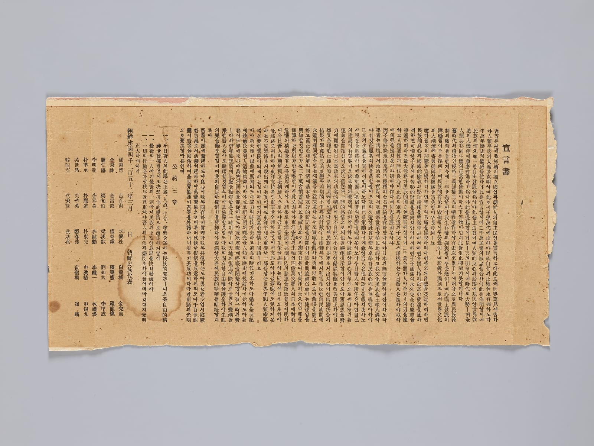

> **이번 글의 질문**
>
> 국내외 독립운동은 어떻게 전개되었으며, 3·1 운동은 대한민국 임시정부 수립으로 어떻게 이어졌을까요?

> **핵심 요약**
>
> - 국내에서는 **비밀결사**, 국외에서는 **독립운동 기지 건설**이 추진됩니다.
> - **독립의군부는 복벽주의**, **대한광복회는 공화주의**를 지향합니다.
> - **3·1 운동**은 전국과 해외로 확산된 독립운동입니다.
> - 1919년 **대한민국 임시정부**가 수립되고, 민주공화제를 채택합니다.

## 1. 국내의 비밀결사

| 단체 | 인물과 핵심 활동 |
| --- | --- |
| 신민회 1907년 | **안창호·양기탁** 등이 조직합니다. 교육·산업 진흥과 국외 독립운동 기지 건설을 추진하며, **105인 사건**(1911)으로 큰 타격을 받습니다. |
| 독립의군부 1912년 | **임병찬**이 고종의 밀명을 받아 조직합니다. 황제 중심의 국가를 되찾는 **복벽주의**를 지향하며, 일본 정부와 조선 총독에게 국권 반환을 요구합니다. |
| 대한광복회 1915년 | **박상진**을 중심으로 대구에서 조직됩니다. **공화정 수립**을 지향하며, 군자금 모집·친일 부호 처단·독립군 양성을 추진합니다. |

> 독립의군부: 임병찬·복벽주의  
> 대한광복회: 박상진·공화주의

## 2. 국외 독립운동 기지

지역별로 **교육기관·독립운동 단체·주요 인물**을 묶어서 기억합니다. 일부 학교와 단체는 국권 피탈 이전부터 설립되었습니다.

| 지역 | 시험에 나오는 연결 |
| --- | --- |
| 서간도 삼원보 | **이회영 일가·이상룡** 등이 활동합니다. **경학사**를 조직하고 **신흥강습소**를 세웁니다. 이후 **신흥무관학교**로 발전하여 독립군을 양성합니다. |
| 북간도 | **이상설의 서전서숙**, **김약연의 명동학교**가 민족교육을 담당합니다. 대종교 계열의 **중광단**은 이후 **북로군정서**로 발전합니다. |
| 연해주 신한촌 | **최재형·이상설** 등이 **권업회**(1911)에서 활동합니다. **대한광복군정부**(1914), **대한국민의회**(1919)를 연결합니다. |
| 상하이 | **여운형** 등이 **신한청년당**(1918)을 조직합니다. **김규식**을 파리 강화 회의에 파견하여 독립을 알리는 외교 활동을 추진합니다. |
| 미주·하와이 | **대한인국민회**(1909)는 안창호 등을 중심으로 교민 조직과 독립운동 지원에 힘씁니다. 하와이에서는 **박용만**이 **대조선국민군단**(1914)을 조직합니다. |

> **구별할 내용**
>
> - **신흥무관학교는 서간도**, **서전서숙·명동학교는 북간도**입니다.
> - **대한광복회는 국내**, **대한광복군정부는 연해주**에서 조직됩니다.
> - **대조선국민군단은 박용만·하와이**를 연결합니다.

## 3. 3·1 운동

| 구분 | 핵심 내용 |
| --- | --- |
| 배경 | 일제의 무단 통치에 대한 반발, **윌슨의 민족 자결주의**, **도쿄 유학생의 2·8 독립 선언**, 고종의 죽음과 독살설이 영향을 줍니다. |
| 시작 1919. 3. 1. | 민족대표들이 **태화관**에서 독립을 선언합니다. **탑골공원**에 모인 학생·시민들은 독립선언서를 낭독하고 만세 시위를 전개합니다. |
| 확산 | 학생·농민·노동자 등 여러 계층이 참여하며, 도시에서 농촌으로, 국내에서 해외로 확산됩니다. |
| 탄압 | 일제는 군대와 경찰을 동원해 진압합니다. **제암리 학살 사건** 등 강경한 탄압이 발생합니다. |
| 영향 | **대한민국 임시정부 수립**의 계기가 됩니다. 일제는 통치 방식을 이른바 **문화 통치**로 바꾸며, 중국의 5·4 운동 등에도 영향을 줍니다. |

***자료로 확인하는 독립선언서:** 독립선언서와 민족대표 33인은 **3·1 운동**을 가리키는 대표적인 단서입니다. 사진을 누르면 원본을 크게 볼 수 있습니다. · 사진: 국립중앙박물관, 독립선언서(구2766) · 공공누리 제1유형, 출처표시 · [소장품 설명 보기](https://www.museum.go.kr/MUSEUM/contents/M0502000000.do?relicId=85894&schM=view&searchId=search)*

> **구별할 내용**
>
> - **2·8 독립 선언은 도쿄**, **3·1 운동은 국내에서 시작해 해외로 확산**됩니다.
> - **민족대표의 독립 선언은 태화관**, **학생·시민의 만세 시위는 탑골공원**을 연결합니다.
> - 민족 자결주의가 한국의 독립을 보장한 것은 아닙니다. 당시에는 주로 **전쟁에서 패한 국가의 지배 지역**에 적용되었습니다.

## 4. 대한민국 임시정부의 수립과 활동

> 3·1 운동 → 각지의 임시정부 수립 → 1919년 9월 통합

**1919년 4월 11일** 상하이에서 대한민국 임시정부가 수립됩니다. 이후 **대한국민의회·상하이 임시정부·한성 정부**가 통합됩니다.

통합 과정에서는 **한성 정부의 법통**을 계승하고, 활동 거점을 **상하이**에 둡니다. 대통령은 **이승만**, 국무총리는 **이동휘**입니다.

| 제도·활동 | 핵심 내용 |
| --- | --- |
| 민주공화제 | 황제가 다스리는 국가에서 벗어나 **국민이 주권을 가진 공화국**을 지향합니다. **임시의정원**은 입법기관입니다. |
| 연통제 | 국내에 구축한 **비밀 행정 조직**입니다. 정부 문서 전달과 군자금 모집 등을 담당합니다. |
| 교통국 | 국내외를 연결하는 **비밀 통신 조직**입니다. 정보 수집과 연락 등을 담당합니다. |
| 외교 활동 | 미국 워싱턴에 **구미위원부**를 설치합니다. |
| 언론·사료 | **독립신문**을 발행하고, 임시사료편찬회를 통해 **한일 관계 사료집**을 편찬합니다. |

> **같은 이름, 다른 신문**
>
> **1896년 독립신문**은 서재필과 독립협회 활동을, **1919년 상하이 독립신문**은 대한민국 임시정부를 연결합니다.

## 5. 임시정부의 이후 흐름

임시정부의 활동은 광복 때까지 이어집니다. 다음 사건들은 **1920년대 이후**라는 점을 구별합니다.

| 시기 | 주요 변화 |
| --- | --- |
| 1923년 | **국민대표회의**가 열립니다. **창조파는 새 정부 수립**, **개조파는 기존 정부 개편**을 주장하며, 합의에 이르지 못합니다. |
| 1925년 | **이승만 탄핵** 후 박은식이 대통령에 취임합니다. 이후 **국무령제**로 전환됩니다. |
| 1931~1932년 | 김구가 **한인애국단**을 조직합니다. **이봉창은 도쿄**, **윤봉길은 상하이 훙커우 공원**에서 의거를 전개합니다. |
| 1940~1941년 | **충칭**에 정착하여 **한국광복군**(1940)을 창설합니다. **조소앙의 삼균주의**를 바탕으로 **건국강령**(1941)을 발표합니다. |
| 1942~1945년 | **조선의용대 일부**가 한국광복군에 편입됩니다. 미국 **OSS**와 국내 진공 작전을 준비하지만, 일본의 항복으로 실행하지 못합니다. |

> **마지막 확인**
>
> - 임병찬·복벽주의 → 독립의군부
> - 박상진·군자금·공화주의 → 대한광복회
> - 삼원보·신흥무관학교 → 서간도
> - 서전서숙·명동학교 → 북간도
> - 최재형·권업회 → 연해주
> - 태화관·탑골공원·민족대표 33인 → 3·1 운동
> - 연통제·교통국·구미위원부 → 대한민국 임시정부
