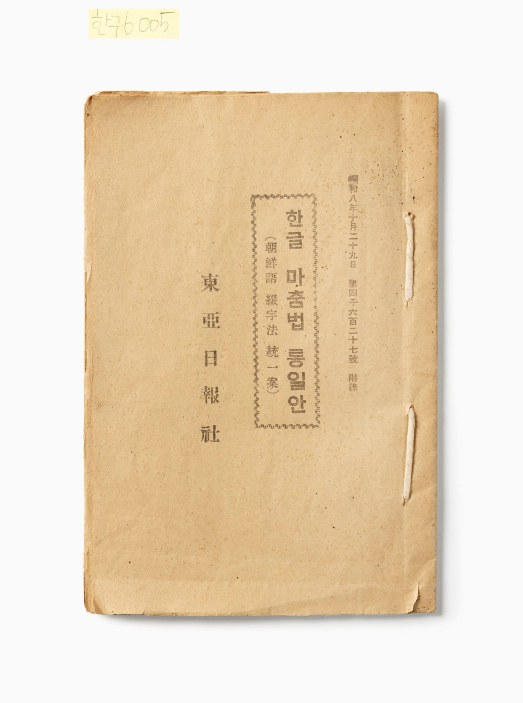

> **이번 글의 질문**
>
> 1920년대 이후 독립운동은 어떻게 다양해졌으며, 국내의 민족운동과 국외의 무장투쟁은 어떻게 이어졌을까요?

> **핵심 요약**
>
> - 국내에서는 **실력 양성·학생운동·노동·농민운동**이 전개됩니다.
> - **신간회**는 비타협적 민족주의 세력과 사회주의 세력이 연대한 공개 단체입니다.
> - 무장투쟁은 **봉오동·청산리 전투**에서 **한중 연합 작전**으로 이어집니다.
> - **의열단은 김원봉**, **한인애국단은 김구**를 연결합니다.
> - 민족 문화 수호는 **우리말·역사 연구**, 광복 준비는 **한국광복군·조선건국동맹**을 중심으로 기억합니다.

## 1. 실력 양성 운동

| 운동 | 핵심 내용과 단서 |
| --- | --- |
| 물산 장려 운동 | **조만식·평양**을 연결합니다. 국산품 애용으로 민족 기업을 보호하고자 합니다. **국산품 가격 상승**과 자본가 중심의 운동이라는 비판이 한계입니다. |
| 민립 대학 설립 운동 1923년 기성회 조직 | **이상재**를 중심으로 모금하여 민족의 대학을 세우려 합니다. 일제의 방해와 모금 부진 등으로 목표를 달성하지 못합니다. |
| 문자 보급 운동 1929년부터 | **조선일보**가 주도합니다. 문맹 퇴치와 한글 보급을 추진합니다. |
| 브나로드 운동 1931년부터 | **동아일보**가 주도합니다. 학생들이 농촌에서 **한글·산술·생활 지식**을 가르칩니다. |

> 국채 보상 운동: 대구·1907년  
> 물산 장려 운동: 평양·1920년대  
> 문자 보급 운동: 조선일보 / 브나로드 운동: 동아일보

## 2. 민족 협동 전선과 학생운동

민족주의 세력과 사회주의 세력은 독립운동의 역량을 모으기 위해 연대를 추진합니다. **정우회 선언**(1926)은 민족 협동 전선 형성의 중요한 계기입니다.

| 사건·단체 | 핵심 내용 |
| --- | --- |
| 6·10 만세 운동 1926년 | **순종의 인산일**에 학생들이 만세 시위를 전개합니다. 사회주의 세력과 천도교계 등이 준비에 참여하며, **민족 협동 전선 형성**에 영향을 줍니다. |
| 신간회 1927~1931년 | **비타협적 민족주의 세력과 사회주의 세력**이 연대합니다. 회장은 **이상재**, 부회장은 **권동진**입니다. 전국에 지회를 둔 공개 단체입니다. |
| 광주 학생 항일 운동 1929년 | **한·일 학생 간 충돌과 일제의 차별적 대응**을 계기로 발생합니다. 식민지 교육과 민족 차별에 저항하며, 전국적인 시위·동맹 휴학으로 확산됩니다. |

> **신간회 핵심 정리**
>
> - **강령:** 정치적·경제적 각성 촉진, 단결 강화, 기회주의 일체 부인입니다.
> - **활동:** 원산 노동자 총파업을 지원하고, 광주 학생 항일 운동에 진상 조사단을 파견합니다.
> - **민중대회:** 광주 학생 항일 운동을 알리기 위해 추진하지만, 일제의 탄압으로 열리지 못합니다.
> - **해소:** 일제의 탄압과 내부 노선 갈등, 사회주의 세력의 방침 변화 등이 겹쳐 1931년 해소됩니다.

> 6·10 만세 운동(1926) → 신간회 결성(1927) → 광주 학생 항일 운동(1929)

**신민회는 비밀결사**, **신간회는 공개 단체**입니다. 신간회 결성은 해방 이후의 좌우 합작 운동과 시기를 구별합니다.

## 3. 노동·농민·사회운동

| 운동 | 대표 사례와 단서 |
| --- | --- |
| 농민운동 | **암태도 소작 쟁의**(1923~1924)에서 높은 소작료에 저항합니다. 농민들의 단결로 소작료 인하를 이끌어 냅니다. |
| 노동운동 | **원산 노동자 총파업**(1929)은 노동 조건 개선 등을 요구하며, 국내외의 지원을 받습니다. **강주룡의 을밀대 고공 농성**(1931)은 임금 삭감에 대한 저항입니다. |
| 청년운동 | **조선청년총동맹**(1924)을 중심으로 청년들의 조직적 활동이 전개됩니다. |
| 소년운동 | **방정환·천도교·잡지 어린이**를 연결합니다. 어린이의 인격 존중과 권리 보호를 주장합니다. |
| 여성운동 | **근우회**(1927)는 민족주의·사회주의 계열 여성들이 연대한 단체입니다. 여성의 지위 향상과 민족운동을 추진합니다. |
| 형평운동 | **진주·조선형평사**(1923)를 연결합니다. 백정에 대한 사회적 차별 철폐를 주장합니다. |

## 4. 의열단과 한인애국단

| 단체 | 인물과 활동 |
| --- | --- |
| 의열단 1919년 조직 | **김원봉**을 중심으로 만주 지린에서 조직됩니다. 일제의 주요 인물과 식민 통치 기관을 공격합니다. **신채호의 조선 혁명 선언**(1923)을 활동 지침으로 삼습니다. |
| 한인애국단 1931년 조직 | **김구**가 조직합니다. **이봉창의 도쿄 의거**와 **윤봉길의 상하이 훙커우 공원 의거**가 1932년에 일어납니다. 윤봉길 의거는 중국 국민당 정부의 임시정부 지원을 강화하는 계기가 됩니다. |

> **의열단원과 공격 대상**
>
> - **박재혁:** 부산 경찰서
> - **김익상:** 조선 총독부
> - **김상옥:** 종로 경찰서
> - **김지섭:** 도쿄 궁성의 니주바시
> - **나석주:** 동양 척식 주식회사·조선 식산 은행

김원봉은 개인 의거의 한계를 느끼고 군사 간부 양성을 추진합니다. **조선혁명간부학교**(1932)를 세우고, 이후 **조선의용대** 창설로 나아갑니다.

## 5. 무장 독립투쟁의 전개

| 사건 | 핵심 내용 |
| --- | --- |
| 봉오동 전투 1920년 6월 | **홍범도의 대한독립군**과 최진동·안무 등이 이끄는 독립군 부대가 연합하여 일본군을 격파합니다. |
| 청산리 전투 1920년 10월 | **김좌진의 북로군정서군**, **홍범도의 대한독립군** 등 여러 부대가 일본군과 싸워 승리합니다. |
| 간도 참변 1920년 | 일본군이 간도 지역의 **한인 주민을 학살**하고 마을을 파괴합니다. |
| 자유시 참변 1921년 | 러시아 자유시로 이동한 독립군이 지휘권 갈등과 무장 해제 과정에서 큰 피해를 입습니다. |
| 3부 성립 | **참의부·정의부·신민부**가 성립합니다. 한인 사회의 **행정과 군사**를 담당합니다. |
| 미쓰야 협정 1925년 | 일본과 만주 군벌이 협력하여 독립운동가를 **체포·인도**하기로 합니다. 이에 맞서 3부 통합 운동이 추진됩니다. |

1931년 만주사변 이후에는 중국 항일 부대와 함께 **한중 연합 작전**을 전개합니다.

| 부대·지휘관 | 활동 지역과 전투 |
| --- | --- |
| 한국독립군 지청천 | **북만주**에서 활동합니다. **쌍성보·대전자령 전투**를 연결합니다. |
| 조선혁명군 양세봉 | **남만주**에서 활동합니다. **영릉가·흥경성 전투**를 연결합니다. |

> 지청천: 한국독립군·쌍성보·대전자령  
> 양세봉: 조선혁명군·영릉가·흥경성

## 6. 민족 문화 수호 운동

| 분야 | 핵심 내용 |
| --- | --- |
| 조선어연구회 1921년 조직 | **가갸날 제정(1926)**, 잡지 **한글** 발행 등으로 우리말과 글을 연구·보급합니다. |
| 조선어학회 1931년 개편 | **한글 맞춤법 통일안**(1933)과 표준어를 마련하고 사전 편찬을 추진합니다. **조선어학회 사건**(1942)으로 회원들이 체포됩니다. |
| 민족주의 사학 | **박은식:** 국혼, 한국통사·한국독립운동지혈사 **신채호:** 아와 비아의 투쟁, 조선상고사·조선사연구초 **정인보:** 조선의 얼 |
| 사회경제사학 | **백남운**은 조선사회경제사 등을 통해 한국사에도 **보편적인 역사 발전 법칙**이 적용된다고 주장하며 식민사관을 비판합니다. |
| 실증주의 사학 | **진단학회**(1934)를 중심으로 문헌과 자료에 근거한 연구를 추진합니다. **이병도·손진태**를 연결합니다. |
| 문학·영화 | **이육사·윤동주**의 저항시, **나운규의 아리랑**(1926)을 기억합니다. |

***한글 맞춤법 통일안, 1933년:** 표지의 **조선어학회**와 **한글 마춤법 통일안**을 확인합니다. 맞춤법 통일·표준어·사전 편찬은 조선어학회의 대표적인 활동입니다. 사진을 누르면 원본을 크게 볼 수 있습니다. · 자료: 국립한글박물관 한글 디지털 아카이브 · 이미지 제공: Wikimedia Commons, 퍼블릭 도메인 표시 · [원자료 보기](https://archives.hangeul.go.kr/ko/M000000600/archv/ar/item/view?rcrdId=19228)*

## 7. 1940년대의 독립과 건국 준비

| 조직 | 인물·활동·변화 |
| --- | --- |
| 조선의용대 1938년 창설 | **김원봉·중국 우한**을 연결합니다. 중국 관내에서 창설된 최초의 한인 무장부대입니다. 이후 화북으로 이동한 세력과 충칭에 남은 세력의 활동이 갈라집니다. |
| 조선의용군 1942년 | **조선의용대 화북지대**가 개편됩니다. **조선독립동맹** 산하에서 중국 공산당 계열과 함께 항일투쟁을 전개합니다. |
| 한국광복군 1940년 창설 | **대한민국 임시정부·충칭·지청천**을 연결합니다. 1942년 김원봉이 이끄는 **조선의용대 일부**가 편입됩니다. 미국 **OSS**와 국내 진공 작전을 준비합니다. |
| 조선건국동맹 1944년 조직 | **여운형**이 국내에서 조직한 비밀결사입니다. 광복 후 **조선건국준비위원회**로 이어집니다. |

> **구별할 내용**
>
> - **의열단은 김원봉**, **한인애국단은 김구**입니다.
> - **한국독립군은 1930년대 만주**, **한국광복군은 1940년 충칭**을 연결합니다. 두 부대 모두 지청천과 관련됩니다.
> - **조선의용대 전체가 광복군에 편입된 것은 아닙니다.** 화북지대는 조선의용군으로, 김원봉 계열의 일부는 한국광복군으로 이어집니다.
> - **조선건국동맹은 광복 이전**, **조선건국준비위원회는 광복 이후**입니다.

> **마지막 확인**
>
> - 순종 인산일 → 6·10 만세 운동(1926)
> - 정우회 선언·민족 협동 전선 → 신간회(1927)
> - 학생 충돌·민족 차별·전국 확산 → 광주 학생 항일 운동(1929)
> - 진주·백정 차별 철폐 → 조선형평사
> - 홍범도 → 봉오동 / 김좌진·홍범도 → 청산리
> - 지청천 → 쌍성보·대전자령 / 양세봉 → 영릉가·흥경성
> - 신채호·조선 혁명 선언 → 의열단
> - 김구·이봉창·윤봉길 → 한인애국단
> - 맞춤법 통일·사전 편찬 → 조선어학회
> - 충칭·임시정부·OSS → 한국광복군
> - 여운형·1944년 → 조선건국동맹
