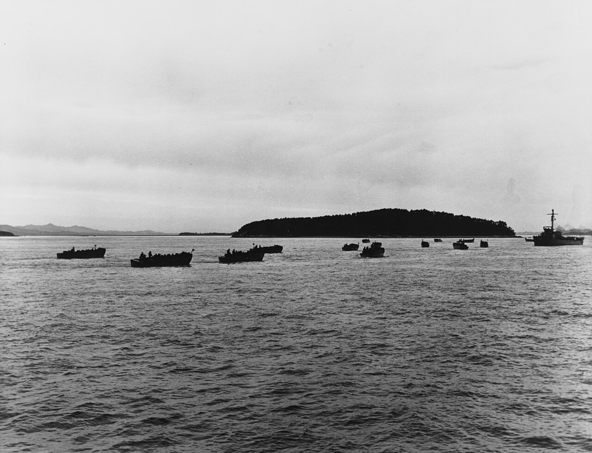

한국사 공부노트 · 21

광복과 정부 수립, 6·25 전쟁

> **이번 글의 질문**
>
> 광복 이후 통일 정부 수립 노력은 어떻게 전개되었으며, 대한민국 정부 수립과 6·25 전쟁은 어떤 순서로 이어졌을까요?

> **핵심 요약**
>
> -   광복 후 **38도선을 경계로 미국과 소련이 분할 점령**합니다.
> -   **모스크바 3국 외상 회의**와 신탁 통치 문제를 둘러싸고 좌우 대립이 심해집니다.
> -   통일 정부 수립 노력은 **좌우 합작 운동**과 **남북 협상**으로 이어집니다.
> -   **5·10 총선거 → 제헌헌법 공포 → 대통령 선출 → 대한민국 정부 수립** 순서로 기억합니다.
> -   6·25 전쟁은 **북한의 남침**으로 시작하며, **1953년 정전 협정**으로 전투가 중지됩니다.

## 1. 광복과 분할 점령

| 사건 | 핵심 내용 |
| --- | --- |
| 카이로 선언 1943년 | **미국·영국·중국**이 한국의 독립을 약속합니다. **적절한 시기에 독립**시킨다는 내용입니다. |
| 포츠담 선언 1945년 7월 | **카이로 선언의 이행**을 재확인합니다. |
| 광복 1945. 8. 15. | 일본의 항복으로 식민 지배에서 벗어납니다. 이후 일본군의 항복 접수와 무장 해제를 명분으로 **38도선 이남에 미군, 이북에 소련군**이 진주합니다. |
| 조선건국준비위원회 | **여운형·안재홍**을 중심으로 조직되어 치안 유지와 건국 준비에 나섭니다. 이후 **조선인민공화국** 수립이 선포됩니다. |
| 미군정 실시 | 미군정은 조선인민공화국과 **대한민국 임시정부를 정부로 인정하지 않습니다.** 임시정부 요인들은 개인 자격으로 귀국합니다. |

> 조선건국동맹(1944) → 조선건국준비위원회(1945) → 조선인민공화국 선포

## 2. 모스크바 회의와 통일 정부 수립 노력

> **모스크바 3국 외상 회의, 1945년 12월**
>
> 회의 참가국은 **미국·영국·소련**입니다. 한국 문제에 관한 핵심 결정은 다음 세 가지입니다.
>
> -   **민주주의 임시정부 수립**
> -   **미소 공동 위원회 설치**
> -   **미국·영국·소련·중국의 최대 5년 신탁 통치 방안 협의**

처음에는 좌우 모두 신탁 통치에 반대합니다. 이후 좌익은 임시정부 수립을 포함한 **회의 결정 전체를 지지**하고, 우익은 **신탁 통치 반대**를 지속하면서 갈등이 심해집니다.

| 사건 | 핵심 내용과 단서 |
| --- | --- |
| 제1차 미소 공동 위원회 1946년 | 임시정부 수립을 논의하지만, 협의에 참여할 **정당·사회단체의 자격 문제**로 대립하여 휴회합니다. |
| 정읍 발언 1946년 6월 | **이승만**이 남한만이라도 임시정부나 위원회 등을 조직할 필요가 있다고 주장합니다. |
| 좌우 합작 운동 1946년 | **여운형·김규식**이 주도합니다. **좌우 합작 7원칙**을 발표하여 통일 임시정부 수립, 미소 공동 위원회 재개, 친일파 처리, 토지 개혁 등을 추진합니다. |
| 제2차 미소 공동 위원회 1947년 | 냉전과 참가 단체 문제 속에서 합의에 실패합니다. 이후 한국 문제가 **유엔으로 이관**됩니다. |
| 남북 협상 1948년 4월 | **김구·김규식**이 평양을 방문합니다. 남한만의 선거와 단독 정부 수립에 반대하며 통일 정부 수립을 추진하지만, 분단을 막지 못합니다. |

> **인물을 구별하는 기준**
>
> -   **정읍 발언:** 이승만
> -   **좌우 합작 운동:** 여운형·김규식
> -   **남북 협상:** 김구·김규식

## 3. 대한민국 정부 수립

유엔은 남북한 총선거를 추진하지만, 소련이 유엔 한국 임시 위원단의 북한 지역 활동을 거부합니다. 이에 **1948년 2월 유엔 소총회**는 위원단이 접근할 수 있는 지역에서 선거를 실시하도록 결정합니다.

| 날짜 | 기억할 사건 |
| --- | --- |
| 1948\. 5. 10. | **5·10 총선거**로 제헌 국회의원을 선출합니다. **대통령 선거가 아닙니다.** |
| 1948\. 7. 17. | **제헌헌법을 공포**합니다. 민주공화국, 국민 주권, 대통령 중심제 등을 규정합니다. |
| 1948\. 7. 20. | **국회에서 간접선거**로 대통령 이승만과 부통령 이시영을 선출합니다. |
| 1948\. 8. 15. | **대한민국 정부 수립**을 선포합니다. |
| 1948\. 9. 9. | 북한에서 **조선민주주의인민공화국** 수립을 선포합니다. |

> 5·10 총선거 → 제헌헌법 공포 → 국회의 대통령 선출 → 정부 수립

**1948년 5·10 총선거는 제헌 국회**, **1950년 5·30 총선거는 제2대 국회**를 구성하는 선거입니다.

## 4. 정부 수립 전후의 갈등과 개혁

| 사건·정책 | 핵심 내용 |
| --- | --- |
| 제주 4·3 사건 | **1947년 3·1절 경찰 발포** 이후 갈등이 심해집니다. **1948년 4월 3일 무장봉기**가 발생하며, 무력충돌과 진압 과정에서 수많은 민간인이 희생됩니다. 제주 일부 선거구에서는 5·10 선거가 치러지지 못합니다. |
| 여수·순천 10·19 사건 1948년 | 여수 주둔 군대 일부가 **제주 4·3 진압을 위한 출동 명령을 거부**하며 봉기합니다. 충돌과 진압 과정에서 많은 민간인이 희생됩니다. |
| 반민특위 1948\~1949년 | **반민족 행위 처벌법**에 따라 친일파를 조사합니다. 이승만 정부의 방해, **경찰의 반민특위 습격**, 공소시효 단축 등으로 활동이 좌절됩니다. |
| 농지 개혁 1949년 법 제정 1950년 시행 | **유상 매수·유상 분배**를 원칙으로 합니다. 농가당 소유 상한은 **3정보**입니다. 지주 중심의 토지 소유를 줄이고 자작농을 늘리는 데 기여합니다. |

> **토지 개혁 비교**
>
> **남한:** 유상 매수·유상 분배  
> **북한:** 1946년 무상 몰수·무상 분배

## 5. 6·25 전쟁의 전개

냉전과 남북 대립 속에서 **1950년 6월 25일 북한의 전면 남침**으로 전쟁이 시작됩니다. 유엔군과 중국군의 참전으로 국제전의 성격을 띠게 됩니다.

| 시기 | 전쟁의 흐름 |
| --- | --- |
| 1950년 6\~8월 | 북한군이 남침하여 서울을 점령합니다. 국군과 유엔군은 **낙동강 방어선**에서 저항합니다. |
| 1950\. 9. 15. | **인천상륙작전**으로 전세가 바뀝니다. 이어 서울을 수복하고 북진합니다. |
| 1950년 10월 이후 | **중국군의 참전**으로 국군과 유엔군이 후퇴합니다. |
| 1950년 12월 | **흥남 철수**가 이루어집니다. 군인과 함께 많은 피란민이 배를 타고 남쪽으로 이동합니다. |
| 1951\. 1. 4. | **1·4 후퇴**로 서울을 다시 내줍니다. 이후 서울을 재수복하고 전선은 38도선 부근에서 교착됩니다. |
| 1951년 7월부터 | **정전 회담**이 시작됩니다. 회담 중에도 고지전 등 전투가 계속됩니다. |
| 1953\. 7. 27. | **정전 협정**이 체결됩니다. 군사분계선과 비무장지대가 설정됩니다. |

**인천상륙작전, 1950년 9월 15일** — *인천 해안으로 향하는 상륙정들입니다. **낙동강 방어선 이후 전세를 반전시킨 작전**이라는 점을 기억합니다. · 사진: 미국 해군 역사유산사령부(NHHC), NH 96877 · Wikimedia Commons 제공, 퍼블릭 도메인 · [사진 설명과 원본 보기](https://commons.wikimedia.org/wiki/File:First_wave_landing_craft_approach_Inchon,_Korea,_on_15_September_1950_\(NH_96877\).jpg)*

> 남침 → 낙동강 방어선 → 인천상륙작전·북진 → 중국군 참전 → 흥남 철수·1·4 후퇴 → 정전 회담 → 정전 협정

## 6. 정전 협정과 전쟁의 영향

| 구분 | 핵심 내용 |
| --- | --- |
| 포로 송환 문제 | 유엔군 측은 **포로의 의사를 존중하는 송환**을, 북한·중국군 측은 **전체 포로의 송환**을 주장하여 회담이 지연됩니다. |
| 반공 포로 석방 1953년 6월 | **이승만 정부**가 유엔군과 협의하지 않고 송환을 거부하는 반공 포로를 석방합니다. |
| 정전 협정 1953. 7. 27. | **유엔군·북한군·중국군** 측이 서명합니다. **대한민국 정부는 서명하지 않습니다.** 전투를 중지하는 협정이며, 평화협정과는 구별합니다. |
| 한미 상호 방위 조약 1953. 10. 1. | 정전 이후 **한국과 미국**이 체결합니다. 한미 동맹의 제도적 기반이 됩니다. |
| 전쟁의 피해 | 대규모 인명 피해, 민간인 학살, 이산가족 발생, 산업 시설 파괴가 일어납니다. 남북 간 적대감이 커지고 **분단이 고착화**됩니다. |

> **구별할 내용**
>
> -   **38도선:** 1945년 미국과 소련의 분할 점령 기준입니다.
> -   **군사분계선:** 1953년 정전 협정으로 정한 군사적 경계선입니다.
> -   **비무장지대:** 군사분계선에서 남북으로 각각 2km씩 설정됩니다.
> -   **정전 협정은 7월**, **한미 상호 방위 조약은 10월**입니다.

> **시험 직전 확인**  
> 한국 독립 약속 → 카이로 선언  
> 임시정부·미소 공동 위원회·신탁 통치 → 모스크바 3국 외상 회의  
> 여운형·김규식·7원칙 → 좌우 합작 운동  
> 김구·김규식·평양 → 남북 협상  
> 1948년: 5·10 총선거 → 7·17 헌법 공포 → 8·15 정부 수립  
> 친일파 조사·경찰 습격 → 반민특위  
> 유상 매수·유상 분배·3정보 → 농지 개혁  
> 1950\. 9. 15. → 인천상륙작전  
> 1951\. 1. 4. → 1·4 후퇴  
> 1953\. 7. 27. → 정전 협정
