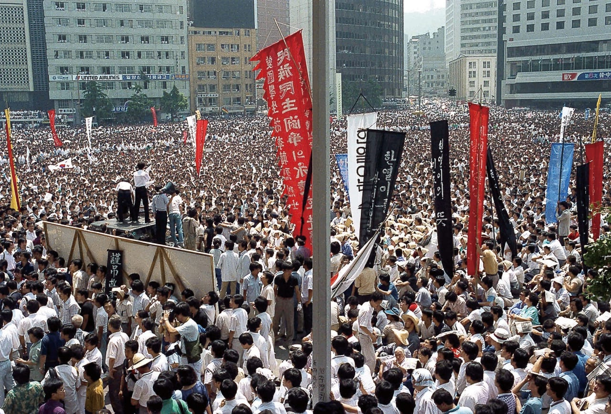

한국사 공부노트 · 22

민주주의·경제 발전과 통일 정책

> **이번 글의 질문**
>
> 민주주의는 어떤 사건과 개헌을 거쳐 발전했으며, 경제 정책과 남북 관계는 정부별로 어떻게 달라졌을까요?

> **핵심 요약**
>
> -   민주화는 **4·19 혁명 → 5·18 민주화 운동 → 6월 민주 항쟁**을 중심으로 정리합니다.
> -   **유신헌법은 간선제·6년 임기·중임 제한 없음**, **1987년 개헌은 직선제·5년 단임**입니다.
> -   경제는 **원조 경제 → 수출 중심 산업화 → 중화학공업 → 외환 위기와 구조조정**으로 이어집니다.
> -   **금융실명제는 김영삼 정부**, **외환 위기 극복은 김대중 정부**를 연결합니다.
> -   통일 정책은 **7·4 공동 성명·남북 기본 합의서·6·15 공동 선언·10·4 선언**을 구별합니다.

## 1. 이승만 정부와 4·19 혁명

| 사건 | 핵심 내용 |
| --- | --- |
| 발췌 개헌 1952년 | 6·25 전쟁 중 **부산 정치 파동**을 거쳐 대통령 선출을 **간선제에서 직선제**로 바꿉니다. |
| 사사오입 개헌 1954년 | **초대 대통령에 한해 중임 제한을 철폐**합니다. 부결된 개헌안을 반올림 논리로 통과시킵니다. |
| 정치·언론 탄압 | **진보당 사건과 조봉암 처형**, **경향신문 폐간**을 연결합니다. |
| 3·15 부정 선거 1960년 | 자유당이 부정 선거를 자행합니다. 특히 **이기붕의 부통령 당선**을 위해 조직적인 부정이 이루어집니다. |
| 4·19 혁명 1960년 | **마산에서 김주열의 시신 발견** 이후 저항이 커집니다. 학생·시민의 시위와 **4·25 대학교수 시국 선언**이 이어지며, **4·26 이승만 하야**로 이어집니다. |

> 3·15 부정 선거 → 김주열 시신 발견 → 4·19 혁명 → 교수 시위 → 이승만 하야

이후 **허정 과도정부**를 거쳐 내각 책임제와 양원제 개헌이 이루어집니다. 제2공화국은 **대통령 윤보선·국무총리 장면**을 연결합니다.

## 2. 박정희 정부와 유신 체제

| 사건 | 핵심 내용 |
| --- | --- |
| 5·16 군사 정변 1961년 | 박정희 등이 군사 정변을 일으켜 장면 내각을 무너뜨립니다. **국가재건최고회의**를 통해 군정을 실시합니다. |
| 한일 국교 정상화 1965년 | **6·3 시위(1964)** 등 반대 속에서 한일 기본 조약과 청구권 협정을 체결합니다. |
| 3선 개헌 1969년 | 대통령이 **세 차례 연속 재임**할 수 있도록 바꿉니다. |
| 10월 유신 1972년 | 국회 해산과 비상계엄 선포 후 **유신헌법**을 마련합니다. 대통령의 권한을 크게 강화합니다. |
| 유신 반대 운동 | **개헌 청원 백만인 서명 운동**, **3·1 민주 구국 선언(1976)** 등이 전개됩니다. 정부는 긴급조치와 수사·재판으로 탄압합니다. |
| 부마 민주 항쟁 1979년 | **YH 무역 사건·김영삼 의원 제명** 이후 부산과 마산에서 유신 반대 시위가 일어납니다. |
| 10·26 사건 1979년 | 중앙정보부장 김재규가 박정희 대통령을 살해합니다. 이후 **최규하 정부**가 들어섭니다. |

> **유신헌법의 단서**
>
> -   **통일주체국민회의**에서 대통령을 간접선거로 선출합니다.
> -   대통령 임기는 **6년**이며, **중임 제한이 없습니다.**
> -   대통령에게 **긴급조치권·국회 해산권** 등을 부여합니다.
> -   대통령이 추천한 후보를 통일주체국민회의가 선출하여 **국회의원 정수의 3분의 1**을 구성합니다.

## 3. 신군부와 민주화 운동

| 사건 | 핵심 내용과 결과 |
| --- | --- |
| 12·12 군사 반란 1979년 | **전두환·노태우 등 신군부**가 군 지휘권을 장악합니다. |
| 5·18 민주화 운동 1980년 | **5·17 비상계엄 전국 확대** 이후 광주에서 신군부의 집권과 계엄에 저항합니다. 계엄군의 폭력적 진압에 맞서 시민군이 조직되며, 많은 시민이 희생됩니다. |
| 전두환 정부 | **국가보위비상대책위원회·삼청교육대·언론 통폐합**을 연결합니다. 1980년 개헌으로 **대통령 간선제·7년 단임**을 규정합니다. |
| 4·13 호헌 조치 1987년 | 전두환 정부가 **직선제 개헌 논의를 중단**하고 기존 헌법을 유지하겠다고 발표합니다. |
| 6월 민주 항쟁 1987년 | **박종철 고문치사 사건**, 4·13 호헌 조치, **이한열 최루탄 피격**을 계기로 전국적인 항쟁이 전개됩니다. |
| 6·29 선언과 개헌 1987년 | 노태우가 직선제 개헌 수용을 발표합니다. 이후 **대통령 직선제·5년 단임**을 규정한 헌법이 마련됩니다. |

**이한열을 추모하는 시민들, 1987년 7월 9일** — *서울시청 앞에 모인 추모 군중입니다. **이한열 피격은 6월 민주 항쟁의 계기**였으며, 이 사진은 항쟁 이후 열린 장례 당시의 모습입니다. · 사진: 서울역사아카이브, 『세계는 서울로, 서울은 세계로: 1984-1988』 · Wikimedia Commons 제공 · 공공누리 제1유형, 출처표시 · [사진 설명과 원본 보기](https://commons.wikimedia.org/wiki/File:고_이한열_추모_군중_2.jpg)*

> 4·19 혁명: 부정 선거·이승만 하야  
> 5·18 민주화 운동: 광주·계엄군·신군부 반대  
> 6월 민주 항쟁: 호헌 철폐·대통령 직선제

## 4. 주요 개헌 비교

| 개헌 | 시험에 나오는 특징 |
| --- | --- |
| 1952년 발췌 개헌 | **대통령 직선제** 도입입니다. |
| 1954년 사사오입 개헌 | **초대 대통령의 중임 제한**을 없앱니다. |
| 1960년 3차 개헌 | **내각 책임제·양원제**를 도입합니다. |
| 1969년 3선 개헌 | **대통령의 3선**을 허용합니다. |
| 1972년 유신헌법 | **통일주체국민회의 간선제·6년 임기·중임 제한 없음**입니다. |
| 1980년 8차 개헌 | **대통령 선거인단 간선제·7년 단임**입니다. |
| 1987년 9차 개헌 | **대통령 직선제·5년 단임**입니다. |

## 5. 경제 발전과 외환 위기

| 시기·정부 | 정책과 핵심 단서 |
| --- | --- |
| 1950년대 이승만 정부 | 미국의 원조를 바탕으로 전후 복구를 추진합니다. **삼백 산업인 제당·제분·면방직**이 성장합니다. |
| 1960년대 박정희 정부 | <strong>제1차 경제 개발 5개년 계획(1962)</strong>을 시작합니다. 경공업과 수출을 육성하며, **한일 청구권 자금·베트남 파병 관련 수입·서독 파견 근로자의 송금** 등이 경제 개발에 활용됩니다. |
| 1970년대 박정희 정부 | **중화학공업 육성·경부고속도로 개통·새마을 운동**을 연결합니다. **1977년 수출 100억 달러**를 달성하지만, 석유 파동과 물가 상승 등 어려움도 겪습니다. |
| 1980년대 전두환 정부 등 | 1980년대 후반 **3저 호황**으로 수출과 경제가 성장합니다. **최저임금법은 1986년 제정**, **최저임금제는 1988년 1월 시행**입니다. |
| 김영삼 정부 | <strong>금융실명제(1993)</strong>를 실시하고 <strong>OECD(1996)</strong>에 가입합니다. 임기 말 <strong>외환 위기(1997)</strong>가 발생해 IMF의 지원을 받습니다. |
| 김대중 정부 | 금융·기업 구조조정과 정보 통신 산업 육성 등을 추진합니다. **금 모으기 운동**이 전개되고, **2001년 IMF 차입금 상환**을 완료합니다. |
| 노무현 정부 이후 | FTA를 통한 무역 개방이 확대됩니다. **한미 FTA는 2007년 서명**하고, **2012년 이명박 정부에서 발효**합니다. |

> **경제 분야에서 구별할 내용**
>
> -   **3저 호황:** 저유가·저금리·저달러입니다. 저달러는 달러 가치 하락을 뜻합니다.
> -   **금융실명제:** 전두환 정부가 아니라 김영삼 정부의 정책입니다.
> -   **외환 위기:** 외화 부족과 금융·기업의 부실이 겹쳐 발생합니다. 구조조정 과정에서 실업과 고용 불안이 커집니다.
> -   **산업화의 그늘:** 저임금과 장시간 노동에 대한 문제 제기가 이어집니다. **전태일 분신(1970)·근로기준법 준수 요구**를 연결합니다.

## 6. 민주화 이후 정부별 핵심 정책

| 정부 | 대표적인 단서 |
| --- | --- |
| 노태우 정부 | <strong>서울 올림픽(1988)·북방 외교·지방 의회 선거 재개(1991)</strong>입니다. 소련·중국과 수교합니다. |
| 김영삼 정부 | **금융실명제·하나회 해체·역사 바로 세우기**를 추진합니다. **1995년 지방 자치 단체장 선거**로 지방 자치가 본격화됩니다. |
| 김대중 정부 | **선거를 통한 여야 간 정권 교체**, 외환 위기 극복, **햇볕 정책·첫 남북 정상 회담**을 연결합니다. |
| 노무현 정부 | **지방 분권·국가 균형 발전**, 한미 FTA 서명, **두 번째 남북 정상 회담**을 연결합니다. |

## 7. 통일 정책과 남북 관계

| 정부·시기 | 합의와 교류 |
| --- | --- |
| 박정희 정부 1972년 | **7·4 남북 공동 성명**을 발표합니다. 통일의 3대 원칙인 **자주·평화·민족 대단결**을 제시하고 남북조절위원회를 설치합니다. |
| 전두환 정부 1985년 | **남북 이산가족 고향 방문단과 예술 공연단**이 서울과 평양을 방문합니다. |
| 노태우 정부 1991년 | **남북한 유엔 동시 가입**과 **남북 기본 합의서 채택**을 연결합니다. 기본 합의서는 **화해·불가침·교류 협력**을 규정합니다. |
| 노태우 정부 1991\~1992년 | **한반도 비핵화 공동 선언**에 합의합니다. 핵무기의 시험·제조·생산·보유 등을 하지 않는다는 내용을 담습니다. |
| 김대중 정부 1998년 | **정주영의 소떼 방북·금강산 관광 시작** 등 남북 교류가 확대됩니다. |
| 김대중 정부 2000년 | **김대중·김정일의 첫 남북 정상 회담**과 **6·15 남북 공동 선언**입니다. 남측의 연합제안과 북측의 낮은 단계의 연방제안에 공통성이 있음을 인정합니다. |
| 노무현 정부 2007년 | **노무현·김정일의 두 번째 남북 정상 회담**과 **10·4 선언**입니다. 남북 관계 발전과 평화 번영을 위한 협력을 제시합니다. |

> **선언문을 구별하는 단서**
>
> -   **자주·평화·민족 대단결:** 7·4 남북 공동 성명
> -   **화해·불가침·교류 협력:** 남북 기본 합의서
> -   **통일을 지향하는 과정의 잠정적 특수 관계:** 남북 기본 합의서
> -   **연합제안과 낮은 단계의 연방제안:** 6·15 남북 공동 선언
> -   **두 번째 정상 회담·평화 번영:** 10·4 선언

> **시험 직전 확인**  
> 김주열·3·15 부정 선거 → 4·19 혁명  
> 통일주체국민회의·긴급조치 → 유신헌법  
> 광주·계엄군·신군부 반대 → 5·18 민주화 운동  
> 박종철·이한열·호헌 철폐 → 6월 민주 항쟁  
> 직선제·5년 단임 → 1987년 개헌  
> 금융실명제·OECD·외환 위기 발생 → 김영삼 정부  
> 외환 위기 극복·햇볕 정책 → 김대중 정부  
> 1972년 7·4 → 1991년 남북 기본 합의서 → 2000년 6·15 → 2007년 10·4
