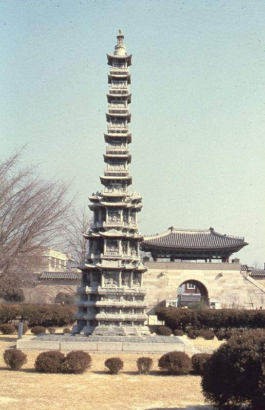
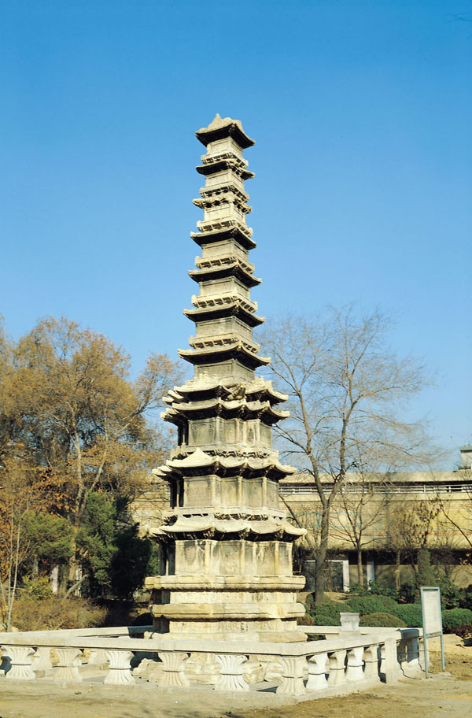

한국사 공부노트 · 시험 전 최종 복습

시험 전 2시간  
선사부터 현대까지 핵심 개념 총정리

> **이번 글의 질문**
>
> 사료에 인물과 사건의 이름이 없어도 시대를 찾고, 선지에 나온 정책과 유산을 정확히 연결할 수 있나요?

> **핵심 요약**
>
> -   **왕·인물:** 이름마다 대표 업적 두세 개를 묶습니다.
> -   **제도:** 시행 목적, 대상, 이전 제도와 달라진 점을 비교합니다.
> -   **사건:** 배경 → 전개 → 결과 → 다음 사건 순서로 외웁니다.
> -   **문화:** 시대·인물·작품·시각적 특징을 연결합니다.
> -   **복습:** 읽고 익숙해지는 데 그치지 않고, 답을 가린 뒤 직접 떠올립니다.

### 2시간 복습 순서

| 구간 | 범위 | 권장 시간 |
| --- | --- | --- |
| 1 | 선사·삼국·남북국 | 15분 |
| 2 | 고려 | 12분 |
| 3 | 조선의 정치·외교 | 15분 |
| 4 | 경제·사회·제도 비교 | 10분 |
| 5 | 문화·문화유산·지역사 | 15분 |
| 6 | 개항·개혁·국권 수호 | 12분 |
| 7 | 일제의 통치와 독립운동 | 13분 |
| 8 | 광복 이후 현대사 | 8분 |
| 마지막 | 순서·비교·단서 암기 확인 | 20분 |

## 1. 선사 시대부터 남북국까지

권장 15분 · 유물과 풍습으로 시대를 찾고, 왕의 업적을 연결합니다.

### 선사 시대와 고조선

| 시대 | 생활·유물 | 구별할 내용 |
| --- | --- | --- |
| 구석기 | 뗀석기·주먹도끼, 사냥·채집, 이동 생활, 동굴·막집 | 연천 전곡리, 공주 석장리, 단양 수양개. 후기에는 슴베찌르개 사용 |
| 신석기 | 간석기·빗살무늬 토기, 농경·목축 시작, 움집·정착 생활 | 가락바퀴·뼈바늘, 애니미즘·토테미즘·샤머니즘. 서울 암사동·부산 동삼동 |
| 청동기 | 벼농사, 민무늬 토기, 비파형 동검·거친무늬 거울, 고인돌 | 계급·군장 등장. 농기구는 주로 돌과 나무, 반달 돌칼로 수확 |
| 철기 | 철제 농기구·무기, 세형 동검·잔무늬 거울, 널무덤·독무덤 | 세형 동검은 한반도 중심의 독자적 청동기 문화. 명도전·반량전·붓은 중국과의 교류 단서 |
| 고조선 | 단군 건국 이야기, 비파형 동검·탁자식 고인돌, 8조법 | 살인·상해·절도 처벌을 통해 생명·노동력·사유 재산 중시와 계급 사회 확인 |
| 위만 조선 | 기원전 194년 위만 집권, 철기 문화 수용, 중계 무역 | 한 무제의 공격 → 왕검성 함락, 기원전 108년 멸망 → 한 군현 설치 |

### 여러 나라의 풍습

| 나라 | 정치·제천 행사 | 혼인·사회 풍습 |
| --- | --- | --- |
| 부여 | 마가·우가·저가·구가, 사출도, 12월 영고 | 순장, 형사취수제, 소 발굽으로 길흉 점치기 |
| 고구려 | 5부, 제가 회의, 10월 동맹 | 서옥제, 형사취수제, 부경이라는 창고 |
| 옥저 | 읍군·삼로, 강력한 왕권 미성립 | 민며느리제, 가족 공동 무덤, 고구려에 공납 |
| 동예 | 읍군·삼로, 10월 무천 | 책화·족외혼, 단궁·과하마·반어피 |
| 삼한 | 신지·읍차, 천군·소도, 제정 분리 | 5월·10월 제천 행사, 벼농사, 변한의 철 수출 |

> **자료에서 이 단서가 보이면**
>
> **사출도·가축 이름의 관직** → 부여
>
> **신랑이 신부 집의 작은 집에서 생활** → 고구려 서옥제
>
> **어린 신부를 데려와 기른 뒤 혼인** → 옥저 민며느리제
>
> **다른 부족의 영역을 침범하면 배상** → 동예 책화
>
> **죄인이 들어가도 붙잡지 못하는 신성한 구역** → 삼한 소도

### 삼국의 왕과 업적

| 나라 | 왕과 업적 |
| --- | --- |
| 고구려 체제 정비 | **태조왕:** 옥저 정복, 계루부 고씨의 왕위 독점 **고국천왕:** 부자 상속 확립, 행정적 5부, 을파소·진대법 **미천왕:** 낙랑군 축출 **소수림왕:** 불교 수용·태학·율령 |
| 고구려 전성기 | **광개토 대왕:** 영락 연호, 만주 진출, 신라에 침입한 왜 격퇴 **장수왕:** 평양 천도(427), 백제 한성 함락(475), 남진 정책 광개토 대왕릉비·충주 고구려비 |
| 백제 전성기 | **고이왕:** 관등·관복 정비 **근초고왕:** 마한 세력 병합, 평양성 공격, 고구려 고국원왕 전사, 중국·왜와 교류 **침류왕:** 불교 수용 |
| 백제 중흥 | **문주왕:** 웅진 천도 **동성왕:** 신라와 혼인 동맹 **무령왕:** 22담로에 왕족 파견 **성왕:** 사비 천도(538), 남부여, 한강 회복 시도, 관산성 전사 |
| 신라 체제 정비 | **내물왕:** 김씨 왕위 세습, 마립간 **눌지왕:** 고구려에 맞서 백제와 동맹 **지증왕:** 신라·왕 칭호, 우경 장려, 이사부의 우산국 복속 **법흥왕:** 율령, 이차돈·불교 공인, 금관가야 병합 |
| 신라 전성기 | **진흥왕:** 한강 유역 확보, 대가야 병합, 함경도 진출, 화랑도 정비 단양 적성비, 북한산·창녕·황초령·마운령 순수비 |
| 가야 | 전기: 김해 금관가야 / 후기: 고령 대가야 철 생산·중계 무역, 연맹 왕국 단계 금관가야는 법흥왕 때(532), 대가야는 진흥왕 때(562) 병합 |

> **전성기와 한강:** 백제 4세기 → 고구려 5세기 → 신라 6세기  
> **백제 수도:** 한성 → 웅진 → 사비  
> **불교 수용·공인:** 고구려 소수림왕 → 백제 침류왕 → 신라 법흥왕

### 전쟁과 삼국 통일

-   **수의 침입:** 을지문덕의 살수 대첩(612).
-   **당의 침입:** 연개소문의 정변 이후 당 태종 침입, 안시성 전투(645).
-   **나당 동맹:** 김춘추가 당과 연합. 백제 멸망(660), 고구려 멸망(668).
-   **백제 부흥:** 복신·도침·흑치상지, 부여풍 추대, 백강 전투(663).
-   **고구려 부흥:** 검모잠·고연무·안승. 신라는 안승을 보덕국 왕으로 임명.
-   **나당 전쟁:** 당의 한반도 지배 시도에 저항. 매소성(675)·기벌포(676) 전투.

> **태종 무열왕:** 김춘추, 최초의 진골 출신 왕, 백제 멸망 시기  
> **문무왕:** 고구려 멸망과 나당 전쟁, 삼국 통일 완성

### 통일 신라와 발해

| 주제 | 핵심 내용 |
| --- | --- |
| 신문왕 | 김흠돌의 난 진압, 관료전 지급·녹읍 폐지, 국학 설치 9주 5소경·9서당 10정 정비. 왕권 강화와 귀족 견제 |
| 성덕왕·경덕왕·원성왕 | **성덕왕:** 정전 지급 **경덕왕:** 녹읍 부활 **원성왕:** 독서삼품과, 유교 경전 이해에 따른 관리 선발 시도 |
| 신라 말 | 김헌창의 난(822), 장보고의 청해진(828), 원종·애노의 난(889) 호족 성장, 6두품의 골품제 비판, 선종·풍수지리설 유행 최치원: 시무 10여 조 |
| 후삼국 | 견훤의 후백제, 궁예의 후고구려 왕건의 고려 건국(918) → 신라 경순왕 항복(935) → 후삼국 통일(936) |
| 발해의 왕 | **대조영:** 동모산 일대 건국(698) **무왕:** 장문휴의 당 등주 공격, 돌궐·일본과 교류 **문왕:** 친당 외교, 신라도, 상경 천도 **선왕:** 해동성국, 5경 15부 62주 |
| 발해의 제도 | 3성 6부, 정당성 중심 운영. 6부 명칭에 유교 덕목 반영 주자감, 독자적 연호, 고구려 계승 의식. 거란에 멸망(926) |

## 2. 고려의 정치·외교·사회

권장 12분 · 호족 → 문벌 귀족 → 무신 → 권문세족 → 신진 사대부의 흐름을 잡습니다.

### 왕권 강화와 통치 체제

| 왕 | 정책 | 목적·단서 |
| --- | --- | --- |
| 태조 | 훈요 10조, 취민유도, 흑창, 북진 정책 혼인·사성 정책, 역분전, 사심관·기인 제도 | 호족 포섭과 견제, 민생 안정, 서경 중시 |
| 혜종·정종 | 왕규의 난 / 광군 조직 | 왕위 계승 갈등 / 거란 대비 |
| 광종 | 노비안검법, 쌍기 건의로 과거제, 공복 제정, 광덕·준풍 | 호족의 경제·군사 기반 약화, 왕권 강화 |
| 성종 | 최승로 시무 28조, 12목 지방관 파견, 국자감, 향리 제도 정비 | 유교 정치와 지방 통제 강화 |
| 현종 | 거란 침입 극복, 지방 제도 정비, 초조대장경 조성 시작 | 강감찬, 귀주 대첩 |
| 문종 | 경정 전시과, 공음전 정비, 문벌 귀족 사회의 안정 | 토지 제도와 귀족 기반 |
| 숙종·예종 | **숙종:** 별무반, 화폐 주조 **예종:** 동북 9성, 국학 7재·양현고 | 여진 정벌 / 관학 진흥 |

| 기구·제도 | 기능 |
| --- | --- |
| 2성 6부 | 중서문하성: 국정 총괄·정책 논의 / 상서성 아래 6부: 행정 실무 |
| 중추원·삼사·어사대 | 중추원: 군사 기밀·왕명 출납 / 삼사: 화폐·곡식의 출납 회계 / 어사대: 관리 감찰 |
| 도병마사·식목도감 | 도병마사: 국방·군사 문제, 이후 도평의사사로 개편 식목도감: 법제·격식 논의 |
| 대간 | 중서문하성 낭사와 어사대 관원. 간쟁·봉박·서경으로 왕권 견제 |
| 지방·군사 | 일반 행정 구역 5도, 군사 지역 양계. 속현·향·부곡·소 존재 중앙군 2군 6위, 지방군 주현군·주진군 |

### 지배 세력의 변화

| 시기 | 사건과 특징 |
| --- | --- |
| 문벌 귀족 | 음서·공음전, 왕실과 혼인 **이자겸의 난(1126):** 외척의 권력 독점 **묘청의 서경 천도 운동(1135):** 풍수지리설, 칭제건원·금 정벌, 김부식이 진압 |
| 무신 정권 | 무신 정변(1170), 정중부·이의방 등, 중방 **최충헌:** 교정도감, 봉사 10조 **최우:** 정방·서방, 삼별초, 강화도 천도 |
| 하층민 저항 | 망이·망소이: 공주 명학소 / 김사미·효심: 경상도 만적: 개경, 신분 해방을 추구한 노비 봉기 모의 |
| 원 간섭기 | 권문세족의 대농장, 도평의사사 장악 정동행성 이문소, 쌍성총관부, 공녀·몽골풍 충선왕: 원에 만권당 설치, 이제현 활동 |
| 공민왕 | 기철 등 친원 세력 제거, 정동행성 이문소 폐지, 쌍성총관부 공격 관제 복구, 몽골풍 금지, 신돈·전민변정도감, 신진 사대부 등용 |
| 고려 말 | 신진 사대부·신흥 무인 세력 성장 위화도 회군(1388) → 과전법(1391) → 조선 건국(1392) 정몽주 등 온건파와 정도전 등 급진파의 분화 |

### 대외 관계

| 상대 | 사건 | 결과·단서 |
| --- | --- | --- |
| 거란 1차 | 서희의 외교 담판(993) | 고구려 계승 의식, 강동 6주 확보 |
| 거란 2차 | 강조의 정변을 구실로 침입, 양규 활약 | 현종의 나주 피란 |
| 거란 3차 | 강감찬의 귀주 대첩(1019) | 이후 나성·천리장성 축조 |
| 여진 | 윤관의 별무반, 동북 9성 | 신기군·신보군·항마군. 금 건국 후 군신 관계 수용 |
| 몽골 | 박서의 귀주성 항전, 강화도 천도, 김윤후의 처인성·충주성 항전 | 초조대장경·황룡사 구층 목탑 소실, 팔만대장경 조판 |
| 삼별초 | 개경 환도에 반발, 배중손·김통정 | 강화도 → 진도 → 제주도 |
| 홍건적·왜구 | 공민왕의 안동 피란 최영 홍산, 최무선 진포, 이성계 황산, 박위 대마도 공격 | 화통도감·화포 → 최무선 |

> **귀주 대첩:** 강감찬·거란 / **귀주성 항전:** 박서·몽골  
> **살수:** 을지문덕·수 / **처인성:** 김윤후·몽골

## 3. 조선의 정치와 외교

권장 15분 · 왕권 강화, 사림의 성장, 붕당 정치의 변화를 연결합니다.

### 조선 전기의 왕

| 왕 | 대표 업적 |
| --- | --- |
| 태조 | 조선 건국, 한양 천도, 경복궁 정도전: 조선경국전·경제문감·불씨잡변, 재상 중심 정치 구상 |
| 태종 | 사병 혁파, 6조 직계제, 호패법, 양전 사업, 신문고 |
| 세종 | 집현전, 의정부 서사제, 훈민정음, 공법 4군 6진, 대마도 정벌, 계해약조, 과학·농업·의학 발전 |
| 세조 | 계유정난, 6조 직계제, 집현전 폐지, 직전법 경국대전 편찬 추진, 간경도감, 원각사지 십층석탑 |
| 성종 | 경국대전 완성, 홍문관, 관수관급제, 사림 등용 동국통감·동국여지승람·악학궤범 |
| 중종 | 조광조 등용, 현량과·위훈 삭제·소격서 폐지·향약 보급 기묘사화로 개혁 좌절 |

### 통치 기구와 교육·관리 선발

| 구분 | 핵심 개념 |
| --- | --- |
| 의정부·6조 | 의정부: 국정 총괄 / 6조: 이·호·예·병·형·공 6조 직계제는 6조가 왕에게 직접 보고, 의정부 서사제는 의정부 심의를 거침 |
| 삼사 | 사헌부: 감찰 / 사간원: 간쟁 / 홍문관: 경연·학문 언론 기능과 왕권 견제 |
| 왕권 보좌 | 승정원: 왕명 출납 / 의금부: 왕명에 따른 중죄인 심문 춘추관: 역사 기록 / 한성부: 수도 행정 |
| 지방 | 8도에 관찰사, 각 군현에 수령 파견 향리는 수령을 보좌하는 세습적 행정 실무층 |
| 향촌 자치 | 유향소: 지방 사족의 자치 기구, 향리 감찰·수령 보좌 경재소: 중앙에서 유향소 통제 향약: 덕업상권·과실상규·예속상교·환난상휼 |
| 교육 | 중앙 관학: 성균관·4학 / 지방 관학: 향교 사학: 서원·서당. 서원은 교육과 선현 제사, 사림의 기반 |
| 선발 | 문과·무과·잡과, 생원·진사시, 정기 식년시와 각종 별시 음서·천거도 존재. 여성·노비는 과거 응시 불가, 서얼은 문과 응시 제한 |

> **고려 지방:** 속현이 많고 향리의 영향력이 큽니다.  
> **조선 지방:** 모든 군현에 수령을 파견하는 체제가 정비됩니다.  
> **고려 삼사:** 회계 기관 / **조선 삼사:** 사헌부·사간원·홍문관

### 사화와 붕당

| 사건 | 왕·배경 |
| --- | --- |
| 무오사화 1498 | 연산군, 김종직의 조의제문이 문제 |
| 갑자사화 1504 | 연산군, 폐비 윤씨 사사 사건 |
| 기묘사화 1519 | 중종, 조광조의 급진적 개혁에 대한 반발 |
| 을사사화 1545 | 명종, 대윤·소윤의 외척 갈등 |
| 붕당 형성 | 선조, 이조 전랑 임명 문제 등을 둘러싸고 동인·서인 분화 동인은 남인·북인으로 분화, 광해군 때 북인 집권 |

### 왜란·호란과 군사 제도

-   **세종의 북방 개척:** 최윤덕의 4군, 김종서의 6진, 사민 정책·토관 제도.
-   **대일 관계:** 이종무의 대마도 정벌(1419) → 계해약조(1443) → 삼포왜란(1510) → 을묘왜변(1555).
-   **임진왜란(1592):** 이순신의 한산도 대첩, 김시민의 진주 대첩, 권율의 행주 대첩. 의병과 명군의 참전.
-   **정유재란(1597):** 명량 대첩. 노량 해전(1598)에서 이순신 전사.
-   **전후 기록:** 이순신의 난중일기, 류성룡의 징비록.
-   **광해군:** 명·후금 사이 중립 외교, 강홍립의 상황에 따른 대응. 일본과 기유약조(1609).
-   **인조반정(1623):** 서인 집권·친명배금 → 정묘호란(1627, 형제 관계) → 병자호란(1636, 군신 관계).
-   **병자호란:** 남한산성 항전, 주전론과 주화론, 삼전도에서 항복.
-   **효종:** 북벌 추진. 실제 나선 정벌은 청의 요청으로 러시아 세력에 맞선 원정.

| 군사 조직 | 핵심 내용 |
| --- | --- |
| 조선 전기 | 중앙 5위, 지방 진관 체제. 이후 제승방략 시행 |
| 훈련도감 | 임진왜란 중 설치, 포수·사수·살수의 삼수병, 급료 지급 |
| 조선 후기 | 중앙 5군영: 훈련도감·어영청·총융청·수어청·금위영 지방 속오군: 양인과 일부 노비를 편성 |
| 비변사 | 국방 문제를 처리하던 기구가 왜란·호란을 거치며 국정 전반을 장악 |

### 예송·환국·탕평·세도 정치

| 시기 | 내용 |
| --- | --- |
| 현종의 예송 | 효종·효종비의 죽음 이후 자의 대비의 상복 기간 논쟁 기해예송: 서인의 1년설 채택 / 갑인예송: 남인의 1년설 채택 |
| 숙종의 환국 | 경신환국: 서인 → 기사환국: 남인 → 갑술환국: 서인 서인은 노론·소론으로 분화. 정국이 급격히 교체되며 상대 붕당 배제 |
| 영조 | 탕평비, 이조 전랑 권한 약화, 균역법, 속대전 가혹한 형벌 정비, 신문고 부활, 청계천 준설 |
| 정조 | 규장각·초계문신제, 장용영, 수원 화성 신해통공, 대전통편, 서얼 출신 검서관 등용 |
| 세도 정치 | 순조·헌종·철종, 안동 김씨·풍양 조씨 등 외척 비변사·군영 장악, 매관매직, 삼정의 문란 |

> **왕을 찾는 단서**
>
> **탕평비·균역법·속대전** → 영조
>
> **규장각·장용영·초계문신·수원 화성** → 정조
>
> **환국·백두산정계비·안용복** → 숙종
>
> **백두산정계비:** 1712년, 서쪽 압록강·동쪽 토문강. 훗날 간도 영유권 논쟁과 연결됩니다.

## 4. 경제·사회와 제도 비교

권장 10분 · 토지 제도는 지급 대상, 조세 제도는 바뀐 세목을 확인합니다.

### 토지 제도의 흐름

| 제도 | 내용·변화 |
| --- | --- |
| 신라 녹읍·관료전 | 녹읍: 조세와 노동력 등을 수취하는 귀족의 기반 신문왕이 관료전 지급·녹읍 폐지 → 경덕왕 때 녹읍 부활 |
| 고려 역분전 | 태조, 후삼국 통일 과정의 공로와 인품 등을 고려하여 지급 |
| 고려 전시과 | 전지·시지의 수조권 지급, 원칙적으로 세습 불가 **경종 시정:** 관직·인품, 전·현직 **목종 개정:** 관직 중심, 전·현직 **문종 경정:** 현직 관리 중심, 지급량 축소 |
| 공음전 | 5품 이상 관리에게 지급, 세습 가능. 문벌 귀족의 경제 기반 |
| 과전법 | 1391년 고려 말, 경기 지역 토지의 수조권을 전·현직 관리에게 지급 수신전·휼양전으로 일부 세습 → 지급할 토지 부족 |
| 직전법 | 세조, 현직 관리에게만 지급, 수신전·휼양전 폐지 |
| 관수관급제 | 성종, 국가가 직전의 조세를 거두어 관리에게 지급 관리의 과도한 수취를 억제 |
| 직전 지급 중단 | 명종, 수조권 지급 중단. 관리에게 녹봉 지급 |

> **수조권은 세금을 거두는 권리입니다.** 토지의 소유권과 구분합니다.  
> **관수관급제:** 국가가 직접 거두고 관리에게 지급한다는 뜻입니다.

### 조선의 조세 개혁

| 제도 | 바뀐 내용 | 기억할 영향 |
| --- | --- | --- |
| 공법 세종 | 전분 6등법: 토지 비옥도 연분 9등법: 풍흉 1결당 4\~20두 | 토지 상태·수확에 따른 전세 |
| 영정법 인조 | 전세를 1결당 쌀 4두로 정액화 | 전세 부담 기준 고정 |
| 대동법 광해군 때 시작 | 공납을 토지 결수에 따라 쌀·포·동전으로 납부 경기에서 시작하여 장기간에 걸쳐 확대 | 방납 폐단 완화, 공인 성장, 상품 화폐 경제 발달 |
| 균역법 영조 | 군포 2필 → 1필 결작·선무군관포·어염선세 등으로 재정 보완 | 양인의 군역 부담 경감 |

> **세목 구별:** 전세 → 영정법 / 공납 → 대동법 / 군역 → 균역법  
> **삼정의 문란:** 전정·군정·환곡

### 상업·구휼·사회 변화

| 시대·분야 | 핵심 내용 |
| --- | --- |
| 고려 경제 | 벽란도, 송·아라비아 상인과 교역 건원중보·삼한통보·해동통보·은병. 화폐보다 곡물·포의 비중이 큼 관영 수공업, 소의 특산물 생산 |
| 고려 구휼·의료 | 의창: 빈민 구제 / 상평창: 물가 조절 동서대비원: 환자·빈민 구제 / 혜민국: 의약품 제공 제위보: 기금을 운용하여 빈민 구제 |
| 고려 사회 | 향·부곡·소 주민은 양인 신분이지만 차별받음 향도: 불교 신앙 중심에서 향촌 공동체 조직으로 변화 자녀 균분 상속, 윤행봉사, 여성의 재혼에 비교적 관대 |
| 조선 후기 농업 | 이앙법 확산, 벼·보리 이모작, 노동력 절약, 광작 상품 작물 재배, 부농·임노동자 등 농민층 분화 지대는 수확량 비율의 타조법과 정액 납부의 도조법 구별 |
| 상업 | 공인·사상·도고, 장시·포구, 상평통보 송상: 개성·송방 / 만상: 의주·대청 무역 내상: 동래·대일 무역 / 경강상인: 한강·운송·미곡 |
| 수공업·광업 | 민영 수공업 발달, 선대제·독립 수공업 설점수세제, 덕대의 광산 경영 |
| 신분제 동요 | 납속·공명첩·족보 매입, 양반 증가, 노비 감소 서얼의 통청 운동, 중인의 소청 운동 1801년 중앙 관서 공노비 해방 → 1894년 신분제 폐지 |
| 가족 제도 변화 | 조선 후기로 갈수록 부계 중심 질서 강화 장자 중심 상속·제사, 부계 족보·동성 촌락 발달 |
| 농민 봉기 | 홍경래의 난(1811): 평안도 차별, 정주성 임술 농민 봉기(1862): 진주·유계춘, 삼정이정청 설치 |

## 5. 문화·문화유산·지역사

권장 15분 · 인물과 저술을 연결하고, 유산의 형태와 소재지를 함께 봅니다.

### 불교·유학과 교육

| 인물·분야 | 핵심 연결 |
| --- | --- |
| 원효 | 일심·화쟁, 아미타 신앙, 불교 대중화 대승기신론소·십문화쟁론 |
| 의상 | 화엄 사상, 일즉다 다즉일, 관음 신앙, 부석사, 화엄일승법계도 |
| 혜초·설총·최치원 | 혜초: 왕오천축국전 / 설총: 이두 정리 최치원: 계원필경·토황소격문·시무 10여 조 |
| 의천 | 천태종, 교관겸수, 교종 중심의 선종 통합 시도 신편제종교장총록, 교장 간행 |
| 지눌·혜심 | 지눌: 수선사 결사, 정혜쌍수·돈오점수, 선종 중심 통합 혜심: 유불 일치설 |
| 고려 유학 | 최충의 9재 학당과 사학 12도 예종의 국학 7재·양현고, 인종의 경사 6학 안향의 성리학 소개, 이제현의 만권당 활동 |
| 이황·이이 | 이황: 성학십도, 기대승과 사단칠정 논쟁, 일본 성리학에 영향 이이: 성학집요·동호문답, 수미법 주장, 현실 개혁 강조 |
| 서원·향약 | 주세붕의 백운동 서원 → 이황 건의로 소수 서원 사액 이황의 예안 향약, 이이의 해주 향약 |

### 실학과 국학

| 인물 | 주장·저술 |
| --- | --- |
| 유형원 | 반계수록, 균전론. 신분에 따라 토지 차등 분배 구상 |
| 이익 | 성호사설, 한전론. 생계에 필요한 영업전의 매매 제한 |
| 정약용 | 여전론: 공동 경작·노동량에 따른 분배 / 이후 정전론 제시 목민심서: 지방 행정 / 경세유표: 국가 제도 / 흠흠신서: 형옥·재판 |
| 유수원 | 우서, 상공업 진흥, 사농공상의 직업적 평등 |
| 홍대용 | 의산문답, 지전설·우주 무한론, 중국 중심의 세계관 비판 |
| 박지원·박제가 | 박지원: 열하일기, 수레·선박·화폐 이용, 양반전·허생전 박제가: 북학의, 소비가 생산을 촉진한다는 관점 |
| 역사·지리 | 안정복: 동사강목 / 유득공: 발해고·남북국 인식 한치윤: 해동역사 / 이긍익: 연려실기술 이중환: 택리지 / 김정호: 대동여지도 |
| 문자·금석·자연 | 신경준: 훈민정음운해 / 유희: 언문지 김정희: 금석과안록, 북한산비를 진흥왕 순수비로 고증 정약전: 자산어보 / 서유구: 임원경제지 |

### 역사서·과학·인쇄

| 분야 | 시대·저술·특징 |
| --- | --- |
| 삼국의 역사서 | 고구려: 이문진의 신집 / 백제: 고흥의 서기 / 신라: 거칠부의 국사 |
| 고려 역사서 | 김부식 삼국사기: 기전체, 유교적 합리주의, 현존 가장 오래된 역사서 일연 삼국유사: 단군·불교 설화 이승휴 제왕운기: 단군부터 서술 / 이규보 동명왕편: 고구려 계승 의식 |
| 조선 역사·지리서 | 태종: 혼일강리역대국도지도 세종: 삼강행실도·농사직설 / 문종: 고려사·고려사절요 완성 성종: 동국통감·동국여지승람·악학궤범 중종: 신증동국여지승람 |
| 인쇄 | 통일 신라: 무구정광대다라니경 고려: 팔만대장경, 상정고금예문 금속 활자 인쇄 기록 직지(1377): 청주 흥덕사, 현존 가장 오래된 금속 활자본 |
| 과학 | 고구려: 천문도, 신라: 첨성대 고려: 최무선·화통도감 조선: 천상열차분야지도(태조), 칠정산·자격루·앙부일구·측우기(세종) |
| 의학 | 고려: 향약구급방 세종: 향약집성방·의방유취 허준: 동의보감, 광해군 때 간행 정조: 정약용의 마과회통 / 조선 말: 이제마의 동의수세보원 |

> **기전체:** 왕·인물 중심으로 본기·열전 등 구성. 삼국사기·고려사  
> **편년체:** 연월에 따라 기록. 조선왕조실록·고려사절요  
> **기사본말체:** 사건의 시작과 끝을 묶어 서술. 연려실기술

### 무덤·불상·탑의 식별

| 유산 | 시대·식별 포인트 |
| --- | --- |
| 고구려 무덤 | 돌무지무덤: 장군총, 계단식 돌 구조 굴식 돌방무덤: 벽화·천장 구조. 무용총·각저총, 사신도 |
| 백제 무덤 | 한성: 석촌동 돌무지무덤 / 웅진: 무령왕릉의 벽돌무덤 무령왕릉은 지석으로 주인 확인, 중국 남조와의 교류 |
| 신라 무덤 | 돌무지덧널무덤: 천마총·황남대총, 금관·천마도 입구가 없어 도굴이 어려움. 통일 이후 굴식 돌방무덤 확산 |
| 발해 무덤 | 정혜 공주 묘: 굴식 돌방무덤·모줄임 천장 정효 공주 묘: 벽돌무덤, 고구려와 당의 문화 요소 |
| 삼국 불상·공예 | 고구려: 연가 7년명 금동 여래 입상 백제: 서산 용현리 마애여래삼존상, 금동대향로 삼국: 금동 미륵보살 반가사유상, 일본에 영향 |
| 통일 신라 불상 | 석굴암 본존불, 인공 석굴·균형 있는 조각 경주 배동 석조여래삼존입상과 구별하여 시대 확인 |
| 고려 불상 | 논산 관촉사 석조미륵보살입상: 거대한 몸체·관 영주 부석사 소조여래좌상: 신라 양식 계승 |
| 백제의 탑 | 미륵사지 석탑: 목탑 구조를 돌로 표현, 사리 봉영기 정림사지 오층석탑: 정돈된 5층, 소정방의 백제 정복 기록 |
| 신라의 탑 | 분황사 모전석탑: 벽돌 모양으로 다듬은 돌 황룡사 구층 목탑: 선덕여왕·자장·아비지, 몽골 침입 때 소실 |
| 통일 신라의 탑 | 감은사지 삼층석탑, 불국사 삼층석탑·다보탑 화엄사 사사자 삼층석탑: 사자 네 마리 진전사지 삼층석탑: 탑신의 조각 |
| 발해·고려·조선 | 발해 영광탑: 벽돌탑 고려 월정사 팔각 구층석탑: 팔각·다층 고려 경천사지 십층석탑과 조선 원각사지 십층석탑: 대리석 |

### 사진으로 비교하는 십층석탑

***개성 경천사지 십층석탑:** 고려 충목왕, 1348년, 원의 영향, 대리석. 사진은 1993년 기록이며 현재는 국립중앙박물관에 있습니다. · 사진: 국립문화유산연구원 기록관, 공공누리 제1유형. [자료 보기](https://portal.nrich.go.kr/kor/textbookUseCulturalUsrView.do?idx=16&menuIdx=1229)*

***서울 원각사지 십층석탑:** 조선 세조, 1467년, 대리석, 탑골공원. 경천사지 십층석탑의 양식을 계승했습니다. · 사진 출처: 국가유산청 국가유산포털, 우리역사넷 수록. [자료 보기](https://contents.history.go.kr/mobile/kc/view.do?levelId=kc_r300756)*

> 두 탑은 모양이 비슷합니다. **고려·원의 영향·박물관**은 경천사지, **세조·탑골공원**은 원각사지로 연결합니다. 사진만 보지 말고 문제에 함께 제시된 제작 시기와 소재지를 확인합니다.

### 건축·회화·도자기

| 분야 | 대표 사례 |
| --- | --- |
| 주심포 | 기둥 위에 공포 배치. 안동 봉정사 극락전, 영주 부석사 무량수전, 예산 수덕사 대웅전 |
| 다포 | 기둥 위와 기둥 사이에도 공포 배치. 황주 성불사 응진전, 조선의 궁궐·사찰 건축 |
| 조선 후기 건축 | 보은 법주사 팔상전: 목탑 / 김제 금산사 미륵전: 다층 불전 수원 화성: 정조, 정약용의 거중기, 화성성역의궤 |
| 그림 | 안견: 몽유도원도 / 강희안: 고사관수도 정선: 인왕제색도·금강전도, 진경 산수화 김홍도: 씨름·서당 / 신윤복: 미인도·단오풍정 김정희: 세한도·추사체 |
| 도자기 | 고려: 청자·상감 청자 조선: 분청사기·백자. 분청사기는 회색 바탕에 백토로 장식 |
| 서민 문화 | 한글 소설, 사설시조, 판소리, 탈놀이, 민화 신분 질서 풍자와 서민의 감정 표현 |

### 지역 이름이 나오면 연결할 사건

| 지역 | 유적·사건 |
| --- | --- |
| 강화 | 고인돌, 고려의 대몽 항쟁, 팔만대장경 조판, 병인양요·신미양요, 강화도 조약 |
| 공주·부여·익산 | 공주: 웅진·무령왕릉·우금치 부여: 사비·정림사지·금동대향로 익산: 미륵사지·무왕 |
| 경주·안동 | 경주: 신라·불국사·석굴암·첨성대 안동: 봉정사·도산 서원, 공민왕 피란 |
| 개성·평양 | 개성: 고려 수도·송상·만월대·선죽교 평양: 장수왕 천도·묘청·물산 장려 운동 |
| 진주·대구 | 진주: 김시민·임술 농민 봉기·형평사 대구: 대한 광복회·국채 보상 운동·2·28 민주 운동 |
| 광주·부산·마산 | 광주: 학생 항일 운동·5·18 부산: 개항·동래 내상·부마 민주 항쟁 마산: 3·15 의거·김주열·부마 민주 항쟁 |
| 독도·간도 | 독도: 이사부·우산국, 안용복, 대한제국 칙령 제41호(1900), 일본의 불법 편입(1905) 간도: 백두산정계비, 이범윤, 청일 간도협약(1909) |

## 6. 개항과 개혁, 국권 수호

권장 12분 · 조약의 내용과 개혁의 주체를 구분합니다.

### 흥선 대원군과 개항

| 주제 | 정책·사건 |
| --- | --- |
| 왕권 강화 | 비변사 폐지, 의정부·삼군부 기능 회복, 경복궁 중건, 대전회통 원납전·당백전·도성문 통행세 등으로 재정 마련 |
| 민생 정책 | 서원 47개소만 남기고 철폐, 호포제, 사창제 호포제는 양반에게도 군포 부담, 사창제는 환곡 폐단 시정 |
| 병인양요 1866 | 병인박해를 구실로 프랑스 침입, 양헌수의 정족산성 승리 외규장각 도서 약탈 |
| 오페르트 1868 | 흥선 대원군 아버지 남연군 묘 도굴 미수 |
| 신미양요 1871 | 제너럴 셔먼호 사건을 구실로 미국 침입 어재연의 광성보 항전, 이후 척화비 건립 |
| 강화도 조약 1876 | 운요호 사건을 계기로 체결. 부산·원산·인천 개항 조선의 자주국 규정, 해안 측량권·영사 재판권 |
| 부속 문서 | 조일 수호 조규 부록: 일본 화폐 유통 등 조일 무역 규칙: 무관세, 양곡 유출 허용 |

### 개화 정책과 저항

-   **개화 기구:** 통리기무아문·12사, 별기군.
-   **일본 시찰:** 수신사, 조사 시찰단. **청 기술 학습:** 김윤식의 영선사. **미국:** 보빙사.
-   **조선책략:** 김홍집이 들여옴. 친중국·결일본·연미국 주장 → 이만손의 영남 만인소 등 반발.
-   **위정척사:** 이항로·기정진의 통상 반대 → 최익현의 왜양일체론·개항 반대 → 1880년대 개화 반대 → 의병으로 연결.

| 사건 | 원인·주체 | 결과 |
| --- | --- | --- |
| 임오군란 1882 | 구식 군인의 차별·급료 체불 흥선 대원군 재등장 | 청군 개입, 대원군 압송 제물포 조약, 조청 상민 수륙 무역 장정 |
| 갑신정변 1884 | 김옥균·박영효 등 급진 개화파 우정총국 개국 축하연 이용 | 청군 개입으로 3일 만에 실패 한성 조약, 청일 톈진 조약 |
| 동학 농민 운동 1894 | 전봉준, 고부 군수 조병갑의 수탈 보국안민·제폭구민 | 전주 화약·집강소 2차 봉기는 일본 침략에 저항, 우금치에서 패배 |

> **동학 농민 운동:**  
> 고부 봉기 → 백산 봉기 → 황토현·황룡촌 승리 → 전주성 점령 → 전주 화약 → 집강소 → 일본군 경복궁 점령·청일 전쟁 → 2차 봉기 → 우금치 패배

### 개혁안을 구별합니다

| 개혁 | 핵심 내용 |
| --- | --- |
| 갑신정변 개혁 정강 | 청에 대한 사대 관계 청산, 문벌 폐지, 인민 평등권 지조법 개혁, 호조로 재정 일원화, 혜상공국 폐지 |
| 동학 폐정 개혁안 | 탐관오리·횡포한 부호 처벌, 노비 문서 소각, 천인 대우 개선 과부 재가 허용, 무명잡세 폐지, 토지의 평균 분작 요구 |
| 제1차 갑오개혁 | 군국기무처, 신분제·과거제 폐지, 과부 재가 허용 은 본위제, 조세 금납화, 탁지아문으로 재정 일원화 |
| 제2차 갑오개혁 | 홍범 14조, 8아문 → 7부, 8도 → 23부 교육입국 조서, 재판소 설치로 사법·행정 분리 추진 |
| 을미개혁 | 을미사변 이후, 건양 연호, 태양력, 단발령, 종두법, 소학교 설치 |
| 광무개혁 | 대한제국, 구본신참, 황제권 강화 양전·지계, 원수부, 상공업 진흥, 기술 학교, 대한국 국제 |

> **집강소:** 동학 농민군의 자치 기구  
> **군국기무처:** 제1차 갑오개혁 추진 기구  
> **교정청:** 동학 농민 운동 중 정부가 설치한 개혁 기구

### 독립협회와 대한제국

> 을미사변·을미개혁(1895) → 아관파천·독립협회 창립(1896) → 대한제국 수립(1897) → 만민 공동회·관민 공동회·독립협회 해산(1898) → 대한국 국제(1899)

-   **독립협회:** 독립문 건립, 러시아의 절영도 조차 요구 반대, 자주 국권·자유 민권·자강 개혁.
-   **헌의 6조:** 외국에 의존하지 않는 정치, 이권 계약에 대신·중추원 의장의 합동 서명, 재정 공개 등.
-   **중추원 개편:** 의회 설립 추진. 보수 세력의 반발로 좌절.
-   **대한국 국제:** 황제의 전제 군주권 명시. 독립협회의 의회 설립 구상과 구별합니다.

### 국권 침탈과 저항

| 시기 | 침탈 내용 | 대응·연결 |
| --- | --- | --- |
| 1904 | 한일 의정서: 군사상 필요한 지역 사용 제1차 한일 협약: 재정·외교 고문 | 러일 전쟁, 메가타의 화폐 정리 사업으로 연결 |
| 1905 | 을사늑약: 외교권 박탈, 통감부 | 민영환 순국, 장지연의 시일야방성대곡, 을사의병 |
| 1907 | 헤이그 특사 → 고종 강제 퇴위 → 한일 신협약 → 군대 해산 | 차관 정치, 해산 군인의 의병 합류, 정미의병 |
| 1909 | 기유각서: 사법권·감옥 사무 박탈 청일 간도협약 | 안중근의 하얼빈 의거, 남한 대토벌 작전 |
| 1910 | 경찰권 박탈, 국권 피탈 | 조선 총독부의 식민 통치 |

> **을미의병:** 을미사변·단발령, 유인석·이소응  
> **을사의병:** 을사늑약, 최익현·신돌석  
> **정미의병:** 고종 퇴위·군대 해산, 13도 창의군·서울 진공 작전

| 단체·운동 | 단서 |
| --- | --- |
| 보안회 | 일본의 황무지 개간권 요구 저지 |
| 헌정 연구회·대한 자강회 | 헌정 연구회: 입헌 군주제 대한 자강회: 교육·산업 진흥, 고종 강제 퇴위 반대 |
| 신민회 | 1907년, 안창호·양기탁 등, 비밀 결사·공화정 지향 대성 학교·오산 학교·태극 서관·자기 회사, 국외 기지 건설 105인 사건으로 국내 조직 타격 |
| 경제적 저항 | 방곡령: 조병식, 곡물 유출 방지 황국 중앙 총상회: 상권 수호 국채 보상 운동: 1907년 대구, 서상돈·김광제, 대한매일신보 지원 |

### 개항기의 신문·교육·종교

-   **한성순보:** 1883년, 박문국, 최초 신문·순한문. **한성주보:** 국한문 혼용, 상업 광고.
-   **독립신문:** 1896년, 서재필, 한글·영문. **황성신문:** 시일야방성대곡.
-   **대한매일신보:** 양기탁·베델, 국채 보상 운동 지원. **제국신문:** 순한글.
-   **원산 학사:** 1883년, 주민·관료의 근대 교육. **육영 공원:** 관립, 외국인 교사.
-   **배재 학당·이화 학당:** 선교사가 설립한 근대 학교. **광혜원·제중원:** 1885년 근대식 병원.
-   **동학:** 최제우 창시, 최시형의 동경대전·용담유사 간행. 손병희가 천도교로 개칭.
-   **대종교:** 나철·오기호, 단군 신앙, 만주 무장 독립운동과 연결.

## 7. 일제강점기와 독립운동

권장 13분 · 통치 정책의 시기와 독립운동의 조직·인물·지역을 연결합니다.

### 식민 통치의 변화

| 시기 | 정치·사회 | 경제 |
| --- | --- | --- |
| 1910년대 | 무단 통치, 헌병 경찰, 조선 태형령, 즉결 처분 교원의 제복·칼, 언론·집회·결사 억압 | 토지 조사 사업, 회사령 허가제 토지 소유 관계 재편, 농민의 관습적 권리 약화 |
| 1920년대 | 3·1 운동 이후 문화 통치 표방 보통 경찰, 조선·동아일보 허용, 치안 유지법 문관 총독 임용 가능 규정은 마련했으나 실제 임명되지 않음 | 회사령 폐지, 산미 증식 계획, 일본 자본 진출 증산 비용의 농민 전가와 쌀 반출 증가 |
| 1930년대 이후 | 민족 말살 통치, 황국 신민 서사·신사 참배·궁성 요배 한국어 교육 억압, 일본식 성명 강요, 신문 폐간 | 병참 기지화, 국가 총동원법(1938) 지원병제·징용·학도 지원병제·징병제, 공출·배급 |

> **전쟁 확대:** 만주사변(1931) → 중일 전쟁(1937) → 태평양 전쟁(1941)  
> **병력 동원:** 지원병제(1938) → 학도 지원병제(1943) → 징병제(1944)  
> **문화 통치:** 통제 완화처럼 보이는 조치와 함께 경찰·사상 통제와 민족 분열 정책이 강화됩니다.

### 1910년대 독립운동과 3·1 운동

| 조직·지역 | 핵심 연결 |
| --- | --- |
| 독립 의군부 | 임병찬, 고종의 밀지, 복벽주의, 국권 반환 요구 |
| 대한 광복회 | 박상진, 대구, 공화정 지향, 군자금 모집·친일 부호 처단 |
| 서간도 | 삼원보, 이회영·이상룡, 경학사·부민단, 신흥 강습소·신흥 무관 학교 |
| 북간도 | 용정, 서전서숙·명동 학교, 중광단·북로 군정서 |
| 연해주 | 권업회, 대한 광복군 정부, 대한 국민 의회, 최재형·이상설 |
| 미주 | 대한인 국민회, 안창호의 흥사단, 박용만의 대조선 국민 군단 |

> **3·1 운동의 연결:**  
> 민족 자결주의의 영향·신한청년당 활동·도쿄 2·8 독립 선언 → 3·1 운동(1919) → 전국·국외 확산 → 대한민국 임시정부 수립, 일제 통치 방식 변화

-   **기미 독립 선언:** 민족 대표 33인, 독립·자주·평화 지향. 학생과 민중이 운동 확산을 이끌었습니다.
-   **제암리 사건:** 일제의 무력 탄압을 보여주는 사례입니다.
-   **대한민국 임시정부:** 민주 공화정, 상하이 통합 임시정부, 이승만 대통령·이동휘 국무총리.
-   **연통제·교통국:** 국내 연락·행정·군자금. 독립신문 발행, 구미 위원부의 외교 활동.
-   **국민 대표 회의(1923):** 창조파·개조파 갈등. 이승만 탄핵(1925), 박은식 대통령을 거쳐 국무령 중심 체제로 개편.

### 1920년대 국내 민족운동

| 운동 | 핵심 내용 |
| --- | --- |
| 물산 장려 운동 | 조만식, 평양에서 시작하여 확산. 국산품 애용·민족 기업 육성 상품 가격 상승, 자본가 중심 운동이라는 비판 |
| 민립 대학 설립 | 이상재 등, 민족의 힘으로 대학 설립 추진 모금 부진·일제 방해 등으로 좌절 |
| 6·10 만세 운동 | 1926년, 순종 인산일, 학생 중심 민족주의·사회주의 세력의 협력 시도 |
| 신간회 | 1927년, 정우회 선언의 영향 비타협적 민족주의·사회주의 연대, 이상재·홍명희 기회주의 배격, 광주 학생 항일 운동 지원, 1931년 해소 |
| 광주 학생 항일 운동 | 1929년, 한일 학생 충돌·차별적 처리, 전국 확산 신간회의 진상 조사와 민중 대회 추진 |
| 노동·농민 운동 | 암태도 소작 쟁의, 원산 총파업(1929) 생존권 요구와 항일 운동의 결합 |
| 여성·소년·형평 | 근우회: 여성 단체, 김활란·허정숙 등 방정환·천도교 소년회: 어린이 운동 형평사: 1923년 진주, 백정 차별 철폐 |

### 무장 독립운동

| 단체·사건 | 인물·전투·활동 |
| --- | --- |
| 봉오동·청산리 | 봉오동(1920.6): 홍범도 등 청산리(1920.10): 김좌진·홍범도 등, 백운평·어랑촌 전투 |
| 독립군의 이동 | 간도 참변 → 밀산에서 대한 독립 군단 결성 → 자유시 이동·자유시 참변(1921) |
| 3부 | 참의부·정의부·신민부, 행정·군사 조직을 갖춘 한인 자치 미쓰야 협정(1925): 일제와 만주 군벌의 독립군 탄압 협력 3부 통합 운동 → 국민부·혁신의회 |
| 한국 독립군 | 지청천, 북만주, 중국 호로군과 연합 쌍성보·사도하자·대전자령 전투 |
| 조선 혁명군 | 양세봉, 남만주, 중국 의용군과 연합 영릉가·흥경성 전투 |
| 의열단 | 1919년 김원봉, 신채호의 조선혁명선언 김익상: 조선 총독부 / 김상옥: 종로 경찰서 / 나석주: 동양 척식 주식회사·조선 식산 은행 이후 조선 혁명 간부 학교를 통한 간부 양성 |
| 한인 애국단 | 1931년 김구 이봉창: 도쿄 일왕 행렬 의거 / 윤봉길: 상하이 훙커우 공원 의거(1932) 중국 국민당 정부의 임시정부 지원 강화 |
| 조선 의용대 | 1938년 김원봉, 중국 한커우 일부가 화북으로 이동, 본부 세력은 한국 광복군에 합류 |
| 조선 의용군 | 1942년, 조선 독립 동맹의 무장 조직 화북 지역에서 중국 공산당 계열과 연합 |
| 한국 광복군 | 1940년 충칭, 대한민국 임시정부, 총사령 지청천 인도·미얀마 전선 활동, 미국 OSS와 국내 진공 작전 준비 일본의 항복으로 국내 진공 작전은 실행되지 못함 |

### 민족 문화 수호와 건국 준비

-   **조선어 연구회:** 가갸날 제정, 한글 잡지 발간 → 조선어학회로 개편.
-   **조선어학회:** 한글 맞춤법 통일안, 표준어 정리, 우리말 큰사전 편찬 추진 → 조선어학회 사건(1942).
-   **박은식:** 국혼, 한국통사·한국독립운동지혈사. **신채호:** 낭가 사상, 조선상고사·조선사연구초.
-   **정인보:** 조선의 얼. **백남운:** 사회경제사학, 조선사회경제사. **진단학회:** 실증적 연구.
-   **문맹 퇴치:** 조선일보의 문자 보급 운동, 동아일보의 브나로드 운동.
-   **대한민국 건국 강령(1941):** 조소앙의 삼균주의를 바탕으로 정치·경제·교육의 균등 지향.
-   **조선 건국 동맹(1944):** 여운형, 국내 비밀 결사, 광복 후 건국 준비 위원회로 연결.

> **선언과 강령의 단서**
>
> **민중의 직접 혁명·폭력으로 식민 지배 타도** → 조선혁명선언, 신채호·의열단
>
> **기회주의 배격·민족 단결** → 신간회
>
> **정치·경제·교육의 균등** → 삼균주의, 조소앙·대한민국 건국 강령
>
> **광복 직전 국내 비밀 조직·여운형** → 조선 건국 동맹

## 8. 광복 이후의 정치·경제·통일

권장 8분 · 정부 수립 과정, 개헌, 남북 합의의 순서를 확인합니다.

### 광복과 정부 수립

| 시기 | 핵심 사건 |
| --- | --- |
| 1945 | 광복, 여운형·안재홍의 건국 준비 위원회, 38도선 분할 점령 모스크바 3국 외상 회의: 임시 민주 정부, 미소 공동위원회, 최고 5년 신탁 통치 |
| 1946 | 제1차 미소 공동위원회, 이승만의 정읍 발언 여운형·김규식의 좌우 합작 위원회·좌우 합작 7원칙 |
| 1947 | 제2차 미소 공동위원회 결렬, 한국 문제 유엔 이관 유엔 한국 임시 위원단 구성 |
| 1948 | 제주 4·3 사건, 김구·김규식의 남북 협상 5·10 총선거 → 7·17 제헌 헌법 → 8·15 대한민국 정부 수립 9월 북한 정권 수립, 10월 여수·순천 사건 |
| 친일 청산 | 반민족 행위 처벌법, 반민특위 이승만 정부의 비협조, 경찰의 반민특위 습격 등으로 활동 좌절 |
| 농지 개혁 | 1949년 법 제정, 1950년 본격 시행 유상 매수·유상 분배, 농가당 3정보 소유 상한, 지주제 약화 |

> **5·10 총선거는 대통령 선거가 아닙니다.** 제헌 국회를 구성하는 선거입니다.  
> 초대 대통령 이승만은 제헌 국회에서 선출되었습니다.

### 6·25 전쟁

> 북한의 남침(1950.6.25) → 낙동강 방어선 → 인천 상륙 작전(9.15) → 서울 수복(9.28) → 중국군 개입 → 1·4 후퇴(1951) → 전선 교착·정전 회담 → 정전 협정(1953.7.27)

-   **유엔군 참전:** 북한의 남침 이후 유엔 안전보장이사회 결의.
-   **정전 회담:** 군사 분계선과 포로 송환 문제로 장기화.
-   **반공 포로 석방:** 이승만 정부, 정전 협정 체결 전인 1953년 6월.
-   **정전 협정:** 유엔군·북한군·중국 인민지원군 대표 서명. 대한민국은 서명 당사자가 아닙니다.
-   **한미 상호 방위 조약:** 1953년 10월 체결.

### 민주주의 발전과 개헌

| 시기 | 사건·헌법 |
| --- | --- |
| 이승만 정부 | 발췌 개헌(1952): 대통령 직선제 사사오입 개헌(1954): 초대 대통령 중임 제한 철폐 진보당 사건, 경향신문 폐간 |
| 4·19 혁명 | 3·15 부정 선거 → 마산 시위·김주열 시신 발견 → 4·19 → 교수단 시국 선언 → 이승만 하야 내각 책임제·양원제 개헌, 장면 내각 |
| 박정희 정부 | 5·16 군사 정변(1961), 국가 재건 최고 회의 한일 회담 반대 6·3 시위(1964) → 한일 국교 정상화(1965) 베트남 파병, 3선 개헌(1969) |
| 유신 체제 | 1972년, 통일 주체 국민 회의에서 대통령 선출 6년 임기·중임 제한 없음, 긴급 조치, 국회의원 3분의 1 추천 |
| 1979\~1980 | YH 무역 사건·김영삼 제명 → 부마 민주 항쟁 → 10·26 사태 12·12 군사 반란 → 5·17 비상계엄 확대 → 5·18 민주화 운동 |
| 전두환 정부 | 대통령 선거인단, 7년 단임, 언론 통폐합 1987년 박종철 고문치사, 4·13 호헌 조치 |
| 6월 민주 항쟁 | 박종철 사건 은폐·축소 폭로, 이한열 피격 6·29 선언 → 대통령 직선제·5년 단임제 개헌 |
| 김영삼 정부 | 하나회 해체, 공직자 재산 공개, 금융실명제 지방 자치 단체장 선거 실시(1995), 역사 바로 세우기 |

### 경제 발전과 남북 관계

| 정부·시기 | 경제 | 남북 관계 |
| --- | --- | --- |
| 1950년대 | 미국 원조, 삼백 산업: 제분·제당·면방직 | 이승만의 북진 통일론 |
| 박정희 | 경제 개발 5개년 계획(1962\~), 수출 중심 경공업 1970년대 중화학 공업·새마을 운동, 석유 파동 전태일 분신(1970), 수출 100억 달러(1977) | 7·4 남북 공동 성명(1972) 자주·평화·민족 대단결, 남북 조절 위원회 |
| 전두환 | 3저 호황: 저유가·저금리·저달러 최저임금법 제정(1986), 시행(1988) | 이산가족 고향 방문단·예술 공연단 교환(1985) |
| 노태우 | 북방 외교와 경제 교류 확대 | 남북한 유엔 동시 가입(1991) 남북 기본 합의서: 화해·불가침·교류 협력 한반도 비핵화 공동 선언 |
| 김영삼 | 금융실명제(1993), OECD 가입(1996) 외환 위기·IMF 구제금융(1997) | 남북 정상 회담 추진은 성사되지 못함 |
| 김대중 | 금 모으기 운동·구조조정, 정보 통신 산업 성장 | 금강산 관광(1998), 최초 남북 정상 회담·6·15 공동 선언(2000) |
| 노무현 | 한미 FTA 체결 | 개성 공단 사업, 제2차 남북 정상 회담·10·4 선언(2007) |

> **6·15 공동 선언:** 남측 연합제안과 북측 낮은 단계 연방제안의 공통성 인정  
> **외환 위기 발생·IMF 구제금융:** 김영삼 정부  
> **위기 극복 과정의 금 모으기·구조조정:** 김대중 정부

## 9. 마지막 20분, 가리고 떠올립니다

새 내용을 늘리기보다, 방금 본 개념을 기억에서 꺼내는 데 집중합니다.

> **복습 방법**
>
> 아래 표의 오른쪽을 종이나 손으로 가립니다. 왼쪽 단서를 보고 답을 말한 뒤 확인합니다. 바로 떠오르지 않는 항목에만 표시하고, 마지막 5분에 다시 봅니다.

### 첫 5분: 사건의 순서

> **고려:**  
> 이자겸의 난 → 묘청의 서경 천도 운동 → 무신 정변 → 강화도 천도 → 삼별초 항쟁 → 공민왕 개혁 → 위화도 회군

> **조선:**  
> 무오사화 → 갑자사화 → 기묘사화 → 을사사화 → 임진왜란 → 인조반정 → 정묘호란 → 병자호란

> **개항·개혁:**  
> 강화도 조약 → 임오군란 → 갑신정변 → 동학 농민 운동·갑오개혁 → 을미사변 → 아관파천 → 대한제국 → 을사늑약 → 헤이그 특사·군대 해산 → 국권 피탈

> **독립운동:**  
> 3·1 운동 → 봉오동·청산리 → 자유시 참변 → 국민 대표 회의 → 6·10 만세 운동 → 신간회 → 광주 학생 항일 운동 → 한인 애국단 → 조선 의용대 → 한국 광복군

> **현대:**  
> 모스크바 3국 외상 회의 → 미소 공동위원회·좌우 합작 → 유엔 이관 → 남북 협상 → 5·10 총선거 → 정부 수립 → 6·25 전쟁  
> 4·19 → 5·16 → 3선 개헌 → 유신 → 부마 민주 항쟁 → 10·26 → 12·12 → 5·18 → 6월 민주 항쟁

### 다음 5분: 서로 바꾸어 외우기 쉬운 개념

| 비교 | 정확한 연결 |
| --- | --- |
| 태학·국학·국자감·성균관 | 고구려 소수림왕 / 신라 신문왕 / 고려 성종 / 조선 최고 교육기관 |
| 진대법·흑창·의창 | 고구려 고국천왕 / 고려 태조 / 고려의 빈민 구제 창고 |
| 노비안검법·전민변정도감 | 고려 광종 / 고려 공민왕·신돈 |
| 직전법·관수관급제 | 조선 세조 / 조선 성종 |
| 영정법·대동법·균역법 | 전세 / 공납 / 군역 |
| 고려 삼사·조선 삼사 | 회계 / 언론·감찰·경연 |
| 의천·지눌 | 교관겸수·천태종 / 정혜쌍수·돈오점수·수선사 |
| 경천사지·원각사지 | 고려 충목왕·박물관 / 조선 세조·탑골공원 |
| 국채 보상·물산 장려 | 1907년 대구·서상돈 / 1920년대 평양·조만식 |
| 한국 독립군·조선 혁명군 | 지청천·쌍성보·대전자령 / 양세봉·영릉가·흥경성 |
| 의열단·한인 애국단 | 김원봉·조선혁명선언 / 김구·이봉창·윤봉길 |
| 조선 의용대·한국 광복군 | 1938년·김원봉·한커우 / 1940년·지청천·충칭 |
| 7·4·기본 합의서·6·15 | 박정희 / 노태우 / 김대중 |

### 다음 5분: 이름 없는 사료에서 주인공 찾기

| 사료에 제시된 내용의 단서 | 떠올릴 답 |
| --- | --- |
| 소도·천군·신성한 구역 | 삼한, 제정 분리 |
| 영락·신라 구원·왜 격퇴 | 광개토 대왕 |
| 김흠돌·관료전·녹읍 폐지 | 신문왕 |
| 풍수·서경 천도·칭제건원 | 묘청의 서경 천도 운동 |
| 쌍성총관부·친원 세력 제거 | 공민왕 |
| 현량과·위훈 삭제·소격서 | 조광조, 중종 |
| 육의전 외 금난전권 폐지 | 정조, 신해통공 |
| 군포 2필을 1필로 감면 | 영조, 균역법 |
| 양반에게도 군포 부담 | 흥선 대원군, 호포제 |
| 외교권 박탈·통감 | 을사늑약 |
| 민중의 직접 혁명 강조 | 신채호, 조선혁명선언, 의열단 |
| 정치·경제·교육의 균등 | 조소앙, 삼균주의, 대한민국 건국 강령 |
| 초대 대통령의 중임 제한 철폐 | 1954년 사사오입 개헌 |
| 통일 주체 국민 회의·긴급 조치 | 유신 체제 |
| 호헌 철폐·직선제 요구 | 1987년 6월 민주 항쟁 |

> **마지막 5분: 표시한 항목만 다시 확인**
>
> -   **왕과 업적:** 소수림왕·신문왕·광종·성종·공민왕·세종·영조·정조.
> -   **전투와 장수:** 살수·귀주·처인성·진포·황산·한산도·진주·행주.
> -   **토지와 조세:** 전시과 → 과전법 → 직전법 → 관수관급제, 영정법·대동법·균역법.
> -   **문화:** 원효·의상·의천·지눌, 이황·이이, 실학자의 저술, 탑과 무덤의 시대.
> -   **개항기:** 조약마다 빼앗긴 권리, 갑신·갑오·을미·광무개혁의 차이.
> -   **독립운동:** 조직·인물·지역·전투를 한 묶음으로 확인.
> -   **현대:** 정부 수립 순서, 개헌의 내용, 민주화 운동, 남북 합의.

> **문제 앞에서 확인할 세 가지**
>
> **누가, 언제, 무엇을 했는가.** 먼저 사료에서 시대를 특정합니다. 그다음 문제가 인물의 업적을 묻는지, 같은 시기의 사실을 묻는지, 사건 사이의 순서를 묻는지 확인합니다. 선지의 핵심 단어가 익숙해도 **주체와 시기가 맞는지**까지 살펴봅니다.

> 내용 확인·추가 자료: [국사편찬위원회 우리역사넷](https://contents.history.go.kr/) · [국립문화유산연구원 교과서 속 국가유산](https://portal.nrich.go.kr/kor/textbookUseCulturalUsrList.do?menuIdx=1229) · [국가유산포털](https://www.heritage.go.kr/)
>
> 사료 단서는 원문의 직접 인용이 아니라, 내용을 식별하기 위한 핵심 개념으로 정리했습니다.
