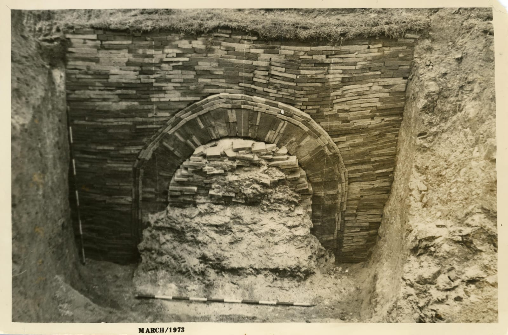
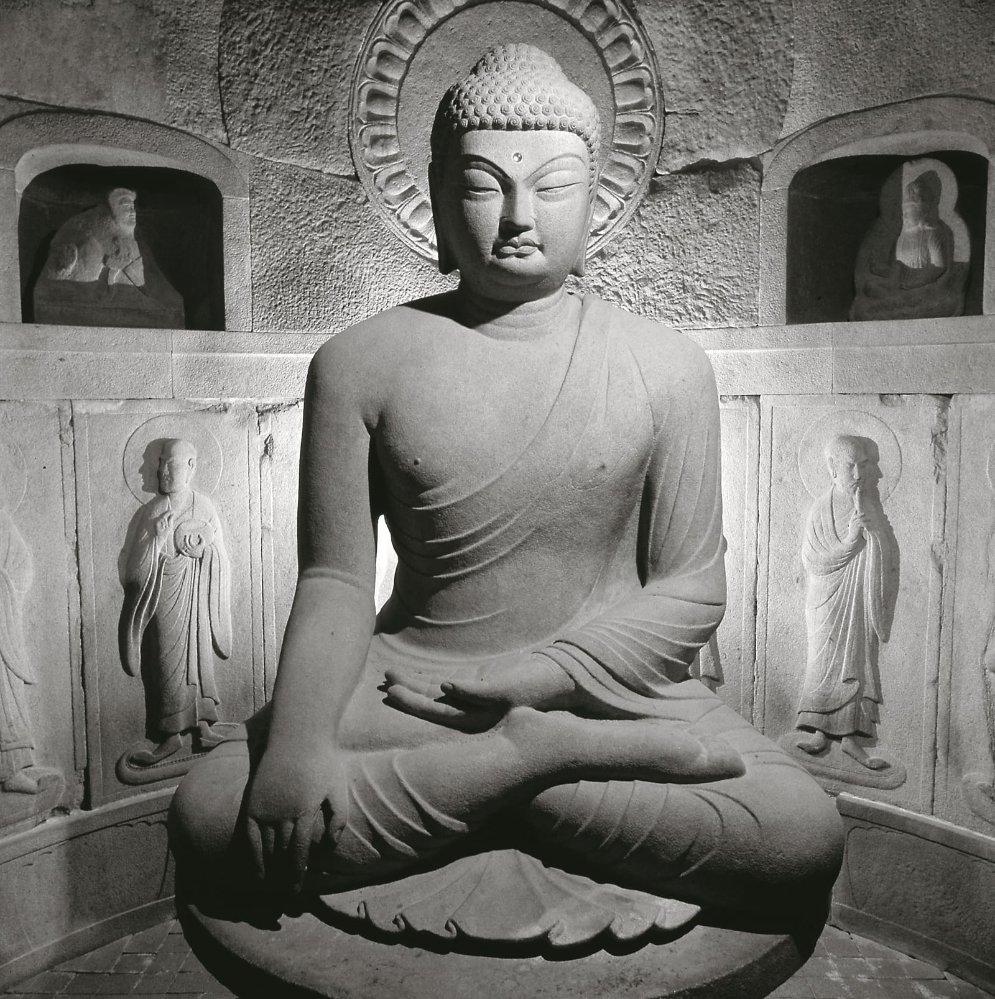
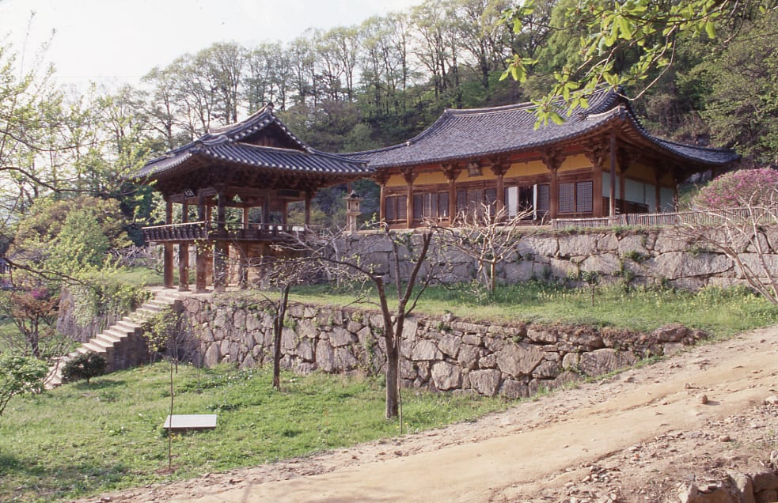
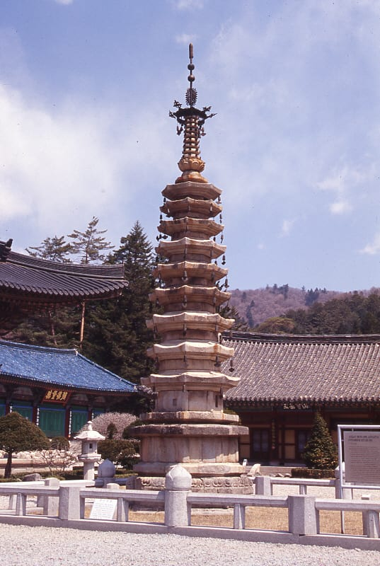

한국사 공부노트 · 심화 1급 최종정리

시험 전날 4시간  
선사부터 현대까지

> **이번 글의 질문**
>
> 사료에서 시대와 인물을 알아내고, 선지의 정책·유산·사건이 그 시대에 맞는지 판단할 수 있나요?

> **핵심 요약**
>
> -   **정치:** 왕과 업적을 묶고, 왕권 강화와 지배 세력의 변화를 이해합니다.
> -   **경제·사회:** 제도의 목적·대상·변화 방향을 비교합니다.
> -   **문화:** 인물·저술·시대·시각적 특징을 연결합니다.
> -   **근현대:** 사건의 순서와 조약·개혁·단체의 차이를 구별합니다.
> -   **마지막 확인:** 읽었던 내용을 가리고, 단서만으로 답을 떠올립니다.

### 전날 복습 시간표

이미 공부한 내용을 정리하는 기준입니다. 아는 항목은 빠르게 읽고, 헷갈리는 항목에 시간을 더 씁니다.

| 순서 | 범위 | 시간 |
| --- | --- | --- |
| 1 | 선사·삼국·남북국 | 30분 |
| 2 | 고려 | 25분 |
| 3 | 조선 정치·외교 | 30분 |
| 4 | 경제·사회·제도 비교 | 20분 |
| 5 | 문화·문화유산·지역사 | 35분 |
| 6 | 개항·개혁·국권 수호 | 35분 |
| 7 | 일제강점기·독립운동 | 35분 |
| 8 | 광복 이후 현대사 | 20분 |
| 마지막 | 사건 순서·오답 방지·암기 확인 | 10분 |

## 1. 선사 시대부터 남북국까지

30분 · 유물과 풍습으로 시대를 찾고, 왕의 업적을 연결합니다.

### 선사 시대

| 시대 | 생활과 유물 | 식별 포인트 |
| --- | --- | --- |
| 구석기 | 뗀석기·주먹도끼, 사냥·채집, 이동 생활, 동굴·막집 | 연천 전곡리, 공주 석장리, 단양 수양개. 후기에는 슴베찌르개 |
| 신석기 | 간석기·빗살무늬 토기, 농경·목축 시작, 움집·정착 | 가락바퀴·뼈바늘, 애니미즘·토테미즘·샤머니즘. 서울 암사동·부산 동삼동 |
| 청동기 | 벼농사, 민무늬 토기, 비파형 동검·거친무늬 거울, 고인돌 | 계급·군장 등장. 청동기는 주로 무기·의례 도구, 농기구는 돌·나무 |
| 철기 | 철제 농기구·무기, 세형 동검·잔무늬 거울, 널무덤·독무덤 | 세형 동검은 한반도 중심의 독자적 청동기 문화. 명도전·반량전·붓은 중국과 교류 |

> **농경 시작은 신석기, 계급 발생은 청동기입니다.**  
> 반달 돌칼은 청동기 시대의 수확 도구이며, 세형 동검은 철기 시대에도 사용된 청동제 무기입니다.

### 고조선과 여러 나라

-   **고조선:** 단군 건국 이야기의 홍익인간, 농경 사회·선민사상. 비파형 동검과 탁자식 고인돌은 문화 범위를 짐작하는 단서입니다.
-   **8조법:** 살인·상해·절도 처벌을 통해 생명·노동력·사유 재산 중시와 계급 사회를 확인합니다.
-   **위만 조선:** 기원전 194년 위만 집권, 철기 문화 수용, 중계 무역. 한 무제의 공격으로 기원전 108년 멸망합니다.

| 나라 | 정치·제천 행사 | 풍습·특산물 |
| --- | --- | --- |
| 부여 | 마가·우가·저가·구가, 사출도, 12월 영고 | 순장, 형사취수제, 소 발굽으로 점, 1책 12법 |
| 고구려 | 5부, 제가 회의, 10월 동맹 | 서옥제, 형사취수제, 부경, 1책 12법 |
| 옥저 | 읍군·삼로, 강력한 왕권 미성립 | 민며느리제, 가족 공동 무덤, 고구려에 공납 |
| 동예 | 읍군·삼로, 10월 무천 | 책화·족외혼, 단궁·과하마·반어피 |
| 삼한 | 신지·읍차, 천군·소도, 제정 분리 | 5월·10월 제천 행사, 벼농사, 변한의 철 생산·수출 |

> **사료의 단서**
>
> **가축 이름의 관직·사출도** → 부여
>
> **신랑이 신부 집 뒤의 작은 집에서 생활** → 고구려 서옥제
>
> **어린 신부를 데려와 기른 뒤 혼인** → 옥저 민며느리제
>
> **다른 부족의 영역을 침범하면 배상** → 동예 책화
>
> **죄인이 들어가도 붙잡지 못하는 신성한 구역** → 삼한 소도

### 고구려·백제·신라의 성장

| 나라 | 왕과 업적 |
| --- | --- |
| 고구려 초기 | **태조왕:** 옥저 정복, 계루부 고씨 왕위 독점 **고국천왕:** 부자 상속, 행정적 5부, 을파소·진대법 **동천왕:** 위 관구검의 침입 **미천왕:** 낙랑군 축출 |
| 고구려 체제 정비 | **고국원왕:** 백제 근초고왕의 공격으로 전사 **소수림왕:** 불교 수용·태학·율령. 정복 활동을 뒷받침할 국가 체제 정비 |
| 고구려 전성기 | **광개토 대왕:** 영락 연호, 만주 진출, 신라에 침입한 왜 격퇴 **장수왕:** 평양 천도(427), 백제 한성 함락(475), 남진 정책 광개토 대왕릉비·충주 고구려비 |
| 백제 전성기 | **고이왕:** 관등·관복 정비 **근초고왕:** 마한 세력 병합, 평양성 공격, 중국·왜와 교류 **침류왕:** 불교 수용 |
| 백제 중흥 | **문주왕:** 웅진 천도 **동성왕:** 신라와 혼인 동맹 **무령왕:** 22담로에 왕족 파견 **성왕:** 사비 천도(538), 남부여, 한강 회복 시도, 관산성 전사 |
| 백제 후기 | **무왕:** 익산 미륵사 **의자왕:** 신라 대야성 함락, 이후 나당 연합군에 패배 |
| 신라 초기 | **내물왕:** 김씨 왕위 세습, 마립간 **눌지왕:** 백제와 동맹 **소지왕:** 백제와 혼인 동맹 |
| 신라 체제 정비 | **지증왕:** 신라·왕 칭호, 우경 장려, 순장 금지, 이사부의 우산국 복속 **법흥왕:** 율령, 병부·상대등, 이차돈·불교 공인, 금관가야 병합 |
| 신라 전성기 | **진흥왕:** 한강 유역 확보, 대가야 병합, 함경도 진출, 화랑도 정비 단양 적성비, 북한산·창녕·황초령·마운령 순수비 |
| 가야 | 전기 김해 금관가야 → 후기 고령 대가야 철 생산·중계 무역, 연맹 왕국 단계 금관가야는 법흥왕(532), 대가야는 진흥왕(562) 때 병합 |

> **한강과 전성기:** 백제 4세기 → 고구려 5세기 → 신라 6세기  
> **백제 수도:** 한성 → 웅진 → 사비  
> **불교 수용·공인:** 고구려 소수림왕 → 백제 침류왕 → 신라 법흥왕

### 고대의 통치와 사회

| 대상 | 구별할 내용 |
| --- | --- |
| 귀족 회의 | 고구려 제가 회의 / 백제 정사암 회의 / 신라 화백 회의 |
| 화백 회의 | 진골 귀족 중심, 상대등, 만장일치 방식 |
| 골품제 | 관등 승진·관직 진출과 일상생활을 제한 6두품은 아찬까지 승진 가능, 진골과 차별 |
| 화랑도 | 청소년 수련 조직, 진흥왕 때 국가적 조직으로 정비 원광의 세속 5계: 사군이충·사친이효·교우이신·임전무퇴·살생유택 |
| 교육 | 고구려 태학: 중앙의 유학 교육 / 경당: 지방의 경전·활쏘기 교육 신라 임신서기석: 유교 경전 학습을 보여주는 자료 |

### 전쟁과 삼국 통일

-   **수의 침입:** 을지문덕의 살수 대첩(612).
-   **당의 침입:** 연개소문의 정변 이후 당 태종 침입, 안시성 전투(645).
-   **나당 동맹:** 김춘추가 당과 연합. 태종 무열왕 때 백제 멸망(660), 문무왕 때 고구려 멸망(668).
-   **백제 부흥:** 복신·도침·흑치상지, 부여풍 추대, 백강 전투(663).
-   **고구려 부흥:** 검모잠·고연무·안승. 신라는 안승을 보덕국 왕으로 임명.
-   **나당 전쟁:** 당의 웅진도독부·안동도호부 등 지배 기구 설치에 저항. 매소성(675)·기벌포(676) 전투.

> **김춘추는 태종 무열왕입니다.** 최초의 진골 출신 왕이며, 백제 멸망 시기의 왕입니다.  
> 고구려 멸망과 나당 전쟁을 거쳐 통일을 완성한 왕은 문무왕입니다.

### 통일 신라와 발해

| 왕·주제 | 핵심 내용 |
| --- | --- |
| 신문왕 | 김흠돌의 난 진압, 관료전 지급·녹읍 폐지, 국학 설치 9주 5소경·9서당 10정 정비, 귀족 견제와 왕권 강화 |
| 통일 신라의 제도 | 집사부 시중의 역할 강화, 상대등 견제 5소경: 수도의 동남쪽 편재 보완, 지방 통제 9서당: 고구려·백제·말갈 출신도 포함 |
| 성덕왕·경덕왕·원성왕 | 성덕왕: 정전 지급 / 경덕왕: 녹읍 부활 원성왕: 독서삼품과, 유교 경전 이해에 따른 관리 선발 시도 |
| 신라 말 | 김헌창의 난(822), 장보고의 청해진(828), 원종·애노의 난(889) 호족·6두품 성장, 선종·풍수지리설 유행 최치원의 시무 10여 조 |
| 후삼국 | 견훤의 후백제, 궁예의 후고구려 왕건의 고려 건국(918) → 신라 항복·견훤 귀순(935) → 후삼국 통일(936) |
| 발해의 왕 | 대조영: 동모산 일대 건국(698) 무왕: 장문휴의 당 등주 공격, 돌궐·일본과 교류 문왕: 친당 외교, 신라도, 상경 천도 선왕: 해동성국, 5경 15부 62주 |
| 발해의 제도 | 3성 6부, 정당성 중심 운영, 대내상 6부: 충·인·의·지·예·신, 중정대·주자감 독자적 연호, 고구려 계승 의식, 거란에 멸망(926) |

> **발해의 고구려 계승 단서**
>
> 일본에 보낸 국서의 고구려 계승 의식, 고구려계 지배층, 온돌·연꽃무늬, 정혜 공주 묘의 굴식 돌방 구조.
>
> **독서삼품과**를 고려의 과거제와 혼동하지 않습니다.

## 2. 고려의 정치·외교·사회

25분 · 호족 → 문벌 귀족 → 무신 → 권문세족 → 신진 사대부의 흐름을 잡습니다.

### 고려 전기의 왕

| 왕 | 정책과 목적 |
| --- | --- |
| 태조 | 훈요 10조, 취민유도, 흑창, 북진 정책·서경 중시 혼인·사성 정책, 역분전, 사심관·기인 제도 호족을 포섭하면서 지방 세력을 견제 |
| 혜종·정종 | 혜종: 왕규의 난 / 정종: 거란에 대비한 광군 조직 |
| 광종 | 노비안검법, 쌍기 건의로 과거제, 공복 제정, 광덕·준풍 호족의 경제·군사 기반 약화, 새로운 관료 등용 |
| 경종 | 시정 전시과. 관직과 인품을 고려한 수조권 지급 |
| 성종 | 최승로 시무 28조, 12목에 지방관, 국자감, 향리 제도 정비 유교 정치와 중앙집권 강화 |
| 현종 | 거란 침입 극복, 지방 제도 정비, 초조대장경 조성 시작 |
| 문종 | 경정 전시과, 공음전 정비, 문벌 귀족 사회의 안정 |
| 숙종·예종 | 숙종: 별무반, 화폐 주조·유통 추진 예종: 동북 9성, 국학 7재·양현고 |

> **사심관:** 지방 출신 고위 관료에게 출신 지역을 감독하게 합니다.  
> **기인:** 지방 호족의 자제를 중앙에 머물게 하여 견제하고 지방 사정에 자문하게 합니다.  
> **노비안검법:** 불법적으로 노비가 된 사람을 양인으로 돌려 호족의 기반을 약화합니다.

### 통치·교육·관리 선발

| 기구·제도 | 기능과 구별 |
| --- | --- |
| 2성 6부 | 중서문하성: 국정 총괄·정책 논의 상서성 아래 6부: 행정 실무 |
| 중추원 | 추밀: 군사 기밀 / 승선: 왕명 출납 |
| 삼사·어사대 | 삼사: 화폐·곡식의 출납 회계 어사대: 관리 감찰 |
| 대간 | 중서문하성 낭사와 어사대 관원 간쟁·봉박·서경으로 왕권 견제 |
| 도병마사·식목도감 | 도병마사: 국방·군사 문제, 원 간섭기에 도평의사사로 개편 식목도감: 법제·격식 논의 |
| 지방 | 5도에 안찰사, 양계에 병마사 주현보다 속현이 많음, 향·부곡·소, 향리의 실무·영향력 |
| 군사 | 중앙 2군 6위 / 지방 주현군·주진군 중방은 고위 무신의 회의 기구 |
| 과거·음서 | 제술과·명경과·잡과, 승과 별도 음서로 고위 관리의 자손 등에게 관직 진출 혜택 일반적인 무과는 시행되지 않음 |
| 교육 | 국자감·향교, 최충의 9재 학당·사학 12도 예종의 국학 7재·양현고, 인종의 경사 6학 |

### 문벌 귀족에서 무신 정권으로

| 사건·시기 | 원인·주체·결과 |
| --- | --- |
| 문벌 귀족 | 여러 세대에 걸친 고위 관직, 음서·공음전, 왕실과 혼인 |
| 이자겸의 난 1126 | 인종의 외척 이자겸이 권력 독점 척준경과 결별하여 몰락, 왕권과 귀족 사회 동요 |
| 묘청의 서경 천도 1135 | 풍수지리설·서경 길지설, 칭제건원·금 정벌 주장 개경의 김부식 세력과 대립, 서경에서 반란 후 진압 |
| 무신 정변 1170 | 문벌 귀족 사회의 모순, 무신 차별 정중부·이의방 등, 의종 폐위·명종 옹립 |
| 무신 집권 | 정중부 → 경대승 → 이의민 → 최충헌 경대승의 도방, 최씨 정권의 사병 조직으로 확대 |
| 최충헌·최우 | 최충헌: 교정도감, 봉사 10조 최우: 정방·서방, 삼별초, 강화도 천도 정방은 인사권, 서방은 문신 자문 |
| 하층민 저항 | 망이·망소이: 공주 명학소 김사미·효심: 경상도 만적: 개경, 신분 해방을 추구한 노비 봉기 모의 |

### 거란·여진·몽골·왜구

| 상대 | 인물·사건 | 후속 연결 |
| --- | --- | --- |
| 거란 1차 | 서희의 외교 담판(993) | 고구려 계승 의식, 강동 6주 확보 |
| 거란 2차 | 강조의 정변을 구실로 침입, 양규 활약 | 현종의 나주 피란 |
| 거란 3차 | 강감찬의 귀주 대첩(1019) | 이후 나성·천리장성 축조 |
| 여진 | 윤관의 별무반, 동북 9성 | 신기군·신보군·항마군, 9성 반환 금 건국 후 군신 관계 수용 |
| 몽골 | 박서의 귀주성 항전, 강화도 천도(1232) 김윤후의 처인성·충주성 항전 | 초조대장경·황룡사 구층 목탑 소실 팔만대장경 조판 |
| 삼별초 | 개경 환도에 반발, 배중손·김통정 | 강화도 → 진도 → 제주도 |
| 홍건적 | 공민왕의 안동 피란 | 개경 수복, 신흥 무인 세력 성장 |
| 왜구 | 최영 홍산, 최무선 진포, 이성계 황산 박위의 대마도 공격 | 화통도감·화포 → 최무선 |

> **귀주 대첩:** 강감찬·거란 / **귀주성 항전:** 박서·몽골  
> **처인성:** 김윤후·몽골 / **진포:** 최무선·왜구

### 원 간섭기와 공민왕

-   **원 간섭:** 왕실 혼인, 관제 격하, 정동행성 이문소, 쌍성총관부·동녕부·탐라총관부, 공녀·몽골풍.
-   **권문세족:** 원과의 관계 등을 바탕으로 성장, 도평의사사 장악, 대농장 확대.
-   **충선왕:** 원에 만권당 설치, 이제현의 학문 교류.
-   **공민왕의 반원 정책:** 기철 제거, 정동행성 이문소 폐지, 쌍성총관부 공격, 관제 복구·몽골풍 금지.
-   **공민왕의 내정 개혁:** 정방 폐지, 신돈 등용, 전민변정도감으로 불법 토지·노비 문제 시정.
-   **신진 사대부:** 성리학, 과거를 통한 진출, 권문세족 비판. 정몽주 등 온건파와 정도전 등 급진파로 분화.

> 위화도 회군(1388) → 과전법(1391) → 조선 건국(1392)

## 3. 조선의 정치·외교

30분 · 왕권 강화, 사림의 성장, 붕당 정치의 변화를 연결합니다.

### 조선 전기의 왕과 국가 운영

| 왕 | 핵심 업적 |
| --- | --- |
| 태조 | 조선 건국, 한양 천도, 경복궁 정도전: 조선경국전·경제문감·불씨잡변, 재상 중심 정치 |
| 태종 | 사병 혁파, 6조 직계제, 호패법, 양전 사업, 신문고 왕권 강화와 국가의 인구·토지 파악 |
| 세종 | 집현전, 의정부 서사제, 훈민정음, 공법 4군 6진, 대마도 정벌, 계해약조, 과학·농업·의학 발전 |
| 세조 | 계유정난, 6조 직계제, 집현전 폐지, 직전법 경국대전 편찬 추진, 간경도감, 원각사지 십층석탑 |
| 성종 | 경국대전 완성, 홍문관, 관수관급제, 사림 등용 동국통감·동국여지승람·악학궤범 |
| 중종 | 조광조 등용, 현량과·위훈 삭제·소격서 폐지·향약 보급 기묘사화로 개혁 좌절 |

### 중앙·지방·관리 선발

| 구분 | 기능과 개념 |
| --- | --- |
| 의정부·6조 | 의정부: 국정 총괄 / 6조: 이·호·예·병·형·공 6조 직계제: 왕에게 직접 보고 의정부 서사제: 의정부가 심의한 뒤 왕에게 보고 |
| 삼사 | 사헌부: 감찰 / 사간원: 간쟁 / 홍문관: 경연·학문 언론과 왕권 견제 |
| 왕권 보좌 | 승정원: 왕명 출납 / 의금부: 왕명에 따른 중죄인 심문 |
| 기타 기구 | 춘추관: 역사 기록 / 한성부: 수도 행정 성균관: 최고 교육기관 / 사역원: 외국어·통역 |
| 지방 | 8도 관찰사, 모든 군현에 수령 파견하는 체제 정비 향리는 세습적 행정 실무층, 수령의 통제 강화 |
| 향촌 자치 | 유향소: 사족의 자치 기구, 향리 감찰·수령 보좌 경재소: 중앙에서 유향소 통제 서원·향약: 사림의 향촌 기반 |
| 교육 | 중앙 관학: 성균관·4학 / 지방 관학: 향교 사학: 서원·서당. 서원은 교육과 선현 제사 |
| 관리 선발 | 문과·무과·잡과, 생원·진사시, 3년마다 식년시와 각종 별시 음서·천거도 존재 여성·노비 응시 불가, 서얼의 문과 응시 제한 |
| 법률 | 경국대전을 기본 법전으로 운영, 형법은 대명률을 주로 적용 태·장·도·유·사, 수령이 행정과 사법을 함께 담당 |

> **향약의 네 덕목:** 덕업상권·과실상규·예속상교·환난상휼  
> **유향소는 기구, 향약은 향촌의 자치 규약입니다.**  
> 고려의 삼사는 회계, 조선의 삼사는 언론 기능과 연결합니다.

### 사림의 성장과 사화

| 사건 | 배경과 왕 |
| --- | --- |
| 무오사화 1498 | 연산군, 김종직의 조의제문이 사초에 실린 문제 |
| 갑자사화 1504 | 연산군, 폐비 윤씨 사사 사건 |
| 기묘사화 1519 | 중종, 조광조의 개혁과 위훈 삭제에 대한 반발 |
| 을사사화 1545 | 명종, 대윤·소윤의 외척 대립 |
| 붕당 형성 | 선조, 이조 전랑 임명 문제와 척신 정치 청산 등을 둘러싸고 동인·서인 분화 |
| 동인의 분화 | 정여립 모반 사건과 정철의 건저의 사건 등을 거치며 남인·북인 분화 |

> 사림은 사화로 타격을 받았지만 **서원·향약**을 기반으로 성장하여 선조 때 정국을 주도합니다.  
> 사림이 사화를 거치며 완전히 사라졌다고 판단하지 않습니다.

### 왜란·호란과 군사 조직

| 주제 | 핵심 내용 |
| --- | --- |
| 세종의 국경 개척 | 최윤덕의 4군, 김종서의 6진 사민 정책·토관 제도 |
| 일본과 교류·갈등 | 이종무의 대마도 정벌(1419), 계해약조(1443) 삼포왜란(1510), 을묘왜변(1555) |
| 임진왜란 1592 | 이순신 한산도, 김시민 진주, 권율 행주 의병, 명군 참전, 조명 연합군의 평양성 탈환 |
| 정유재란 1597 | 명량 대첩, 노량 해전(1598)에서 이순신 전사 |
| 전후 기록·교류 | 이순신 난중일기, 류성룡 징비록 사명대사의 포로 송환, 통신사 파견, 기유약조(1609) |
| 광해군 | 명·후금 사이 중립 외교, 강홍립의 대응 경기 대동법, 동의보감 간행, 궁궐 중건, 북인 집권 |
| 인조 | 인조반정(1623), 친명배금, 이괄의 난 정묘호란(1627): 후금과 형제 관계 병자호란(1636): 청과 군신 관계 |
| 병자호란 | 남한산성 항전, 주전론·주화론, 삼전도 항복 최명길의 주화론과 김상헌 등의 척화론 |
| 효종 | 북벌 추진, 송시열 등 나선 정벌은 청의 요청으로 러시아 세력에 맞선 원정 |

| 군사 기구 | 변화 |
| --- | --- |
| 비변사 | 국방 문제 처리 → 왜란·호란을 거치며 국정 전반 장악 → 흥선 대원군 때 폐지 |
| 중앙군 | 전기 5위 → 후기 5군영 훈련도감·어영청·총융청·수어청·금위영 |
| 훈련도감 | 임진왜란 중 설치, 포수·사수·살수의 삼수병, 급료 지급 |
| 지방군 | 진관 체제 → 제승방략 → 속오군 속오군은 양인과 일부 노비를 편성 |

### 예송·환국·탕평·세도 정치

| 시기 | 정치 변화 |
| --- | --- |
| 현종의 기해예송 | 효종 사망 뒤 자의 대비의 상복 기간 논쟁 서인 1년설, 남인 3년설 → 서인 주장 채택 |
| 현종의 갑인예송 | 효종비 사망 뒤 자의 대비의 상복 기간 논쟁 서인 9개월설, 남인 1년설 → 남인 주장 채택 |
| 숙종의 환국 | 경신환국: 서인 → 기사환국: 남인 → 갑술환국: 서인 서인의 노론·소론 분화, 정국의 급격한 교체 |
| 숙종의 업적 | 백두산정계비(1712), 안용복의 활동, 금위영 설치 대동법 확대 완료, 상평통보 유통 확대 |
| 영조 | 탕평비, 이조 전랑 권한 약화, 균역법, 속대전 가혹한 형벌 정비, 신문고 부활, 청계천 준설 |
| 정조 | 규장각·초계문신제, 장용영, 수원 화성 신해통공, 대전통편, 서얼 검서관 등용 |
| 세도 정치 | 순조·헌종·철종, 안동 김씨·풍양 조씨 등 외척 비변사·군영 장악, 매관매직, 삼정의 문란 |

> **사료의 단서**
>
> **탕평비·균역법·속대전** → 영조
>
> **규장각·장용영·초계문신·화성** → 정조
>
> **환국·백두산정계비·안용복** → 숙종
>
> **서쪽 압록강·동쪽 토문강** → 백두산정계비, 훗날 간도 문제

## 4. 경제·사회·제도를 비교합니다

20분 · 무엇을, 누구에게, 어떤 기준으로 지급하거나 거두었는지 확인합니다.

### 토지 제도의 변화

| 제도 | 내용 | 구별 |
| --- | --- | --- |
| 신라 녹읍 | 조세·노동력 등을 수취하는 귀족의 기반 | 신문왕 폐지, 경덕왕 부활 |
| 관료전·정전 | 신문왕의 관료전 지급 성덕왕의 정전 지급 | 왕을 바꾸어 외우지 않습니다. |
| 역분전 | 고려 태조, 통일 과정의 공로·인품 등을 고려 | 전시과 이전 |
| 시정 전시과 | 경종, 관직·인품, 전·현직 관료 | 전지·시지의 수조권 |
| 개정 전시과 | 목종, 관직 중심, 전·현직 관료 | 인품 기준 배제 |
| 경정 전시과 | 문종, 현직 관리 중심, 지급량 축소 | 1076년 정비 |
| 공음전 | 5품 이상 관리, 세습 가능 | 문벌 귀족의 경제 기반 |
| 과전법 | 1391년 고려 말, 경기 지역 수조권을 전·현직 관리에게 지급 | 수신전·휼양전으로 일부 세습 |
| 직전법 | 세조, 현직 관리에게만 지급 | 수신전·휼양전 폐지 |
| 관수관급제 | 성종, 국가가 직전의 조세를 거두어 관리에게 지급 | 관리의 직접 수취 제한 |
| 직전 지급 중단 | 명종, 수조권 지급 중단 | 녹봉 지급으로 운영 |

> **수조권은 세금을 거둘 권리입니다.** 토지 소유권과 구분합니다.  
> 과전법은 조선 건국 뒤가 아니라 **고려 말인 1391년**에 시행되었습니다.

### 조세 개혁

| 제도 | 바뀐 내용 | 목적·영향 |
| --- | --- | --- |
| 공법 세종 | 전분 6등법: 비옥도 연분 9등법: 풍흉 1결당 4\~20두 | 전세의 기준 정비 |
| 영정법 인조 | 전세를 1결당 쌀 4두로 정액화 | 풍흉과 관계없이 일정액 |
| 대동법 광해군 때 시작 | 공납을 토지 결수에 따라 쌀·포·동전으로 납부 경기에서 시작하여 확대 | 방납 폐단 완화, 공인 성장, 상품 화폐 경제 발달 |
| 균역법 영조 | 군포 2필 → 1필 결작·선무군관포·어염선세 등으로 보완 | 양인의 군역 부담 경감 |

> **전세:** 공법·영정법  
> **공납:** 대동법  
> **군역:** 균역법  
> **삼정의 문란:** 전정·군정·환곡

### 경제 활동

| 시대·분야 | 핵심 내용 |
| --- | --- |
| 통일 신라 | 촌락 문서: 호구·토지·가축 등의 변동을 조사, 조세·노동력 수취에 활용 장보고의 청해진, 당의 신라방·신라소·신라원 |
| 고려 | 벽란도, 송·아라비아 상인과 교역 건원중보·삼한통보·해동통보·은병, 곡물·포가 주요 교환 수단 관영 수공업, 소의 특산물 생산 |
| 고려 후기 농업 | 이암의 농상집요 소개, 문익점의 목화씨 반입 농법 발전과 면포 생산 확대 |
| 조선 후기 농업 | 이앙법 확산, 벼·보리 이모작, 노동력 절약, 광작 상품 작물 재배, 농민층 분화 타조법: 수확량 비율 / 도조법: 정액 지대 |
| 조선 후기 상업 | 공인·사상·도고, 장시·포구, 상평통보 송상: 개성·송방 / 만상: 의주·대청 무역 내상: 동래·대일 무역 / 경강상인: 한강·미곡 운송 |
| 신해통공 | 정조, 육의전을 제외한 시전 상인의 금난전권 폐지 사상의 활동 범위 확대 |
| 수공업·광업 | 민영 수공업, 선대제·독립 수공업 설점수세제, 덕대의 광산 경영 |

### 신분·가족·구휼

| 주제 | 핵심 내용 |
| --- | --- |
| 고려의 특수 행정 구역 | 향·부곡·소 주민은 양인 신분이지만 거주·부담 등에서 차별 소는 특산물 생산과 연결 |
| 고려 향도 | 불교 신앙 활동에서 출발, 향촌 공동체 조직으로 변화 |
| 고려의 가족 | 자녀 균분 상속, 윤행봉사, 여성 재혼에 비교적 관대 사위·외손자도 음서 혜택을 받을 수 있음 |
| 조선의 신분 | 양천제가 법적 기본, 실제로 양반·중인·상민·천민의 위계 서얼·기술관·향리 등 중간 계층, 노비의 신분 제약 |
| 조선 후기 변화 | 납속·공명첩·족보 매입, 양반 증가, 노비 감소 서얼 통청 운동·중인 소청 운동 1801년 중앙 관서 공노비 해방 → 1894년 신분제 폐지 |
| 가족 질서 변화 | 조선 후기로 갈수록 장자 중심 상속·제사, 부계 족보·동성 촌락 발달 |
| 구휼·의료 | 의창: 빈민 구제 / 상평창: 물가 조절 고려 동서대비원·혜민국·제위보 조선 의정부·호조 등의 구휼, 혜민서·활인서 |
| 농민 봉기 | 홍경래의 난(1811): 평안도 차별, 정주성 임술 농민 봉기(1862): 진주·유계춘, 삼정이정청 설치 |

> **공노비 해방과 신분제 폐지는 다릅니다.** 1801년 조치는 중앙 관서 공노비를 대상으로 했고, 법적 신분제 폐지는 갑오개혁입니다.

## 5. 문화·문화유산·지역사

35분 · 이름만 외우지 않고 시대·형태·소재지·관련 인물을 연결합니다.

### 불교 사상과 인물

| 인물 | 사상·저술·활동 |
| --- | --- |
| 원광·자장 | 원광: 세속 5계 자장: 황룡사 구층 목탑 건립 건의, 계율 중시 |
| 원효 | 일심·화쟁, 아미타 신앙, 불교 대중화 대승기신론소·십문화쟁론 |
| 의상 | 화엄 사상, 일즉다 다즉일, 관음 신앙 부석사, 화엄일승법계도 |
| 혜초 | 인도·중앙아시아 순례, 왕오천축국전 |
| 신라 말 선종 | 참선·개인의 깨달음 중시, 9산 선문, 호족의 지원 승탑·탑비 발달 |
| 의천 | 천태종, 교관겸수, 교종 중심의 선종 통합 시도 신편제종교장총록, 교장 간행 |
| 지눌 | 수선사 결사, 정혜쌍수·돈오점수, 선종 중심 통합 송광사와 연결 |
| 혜심·요세 | 혜심: 유불 일치설 요세: 백련 결사, 참회·법화 신앙, 강진 만덕사 |

> **교관겸수:** 교리 공부와 수행을 함께 함 → 의천  
> **정혜쌍수·돈오점수:** 선정과 지혜를 함께 닦고, 깨달은 뒤에도 꾸준히 수행 → 지눌

### 유학과 실학

| 인물 | 핵심 연결 |
| --- | --- |
| 설총·최치원 | 설총: 이두 정리·화왕계 최치원: 계원필경·토황소격문·시무 10여 조 |
| 안향·이제현 | 안향: 성리학 소개 이제현: 만권당 활동, 원 학자들과 교류 |
| 이황 | 성학십도, 기대승과 사단칠정 논쟁 도산 서원, 일본 성리학에 영향 |
| 이이 | 성학집요·동호문답, 수미법 주장, 현실 개혁 해주 향약 |
| 유형원 | 반계수록, 균전론. 신분에 따른 토지 차등 분배 구상 |
| 이익 | 성호사설, 한전론. 최소 생계 토지인 영업전의 매매 제한 |
| 정약용 | 여전론: 공동 경작·노동량에 따른 분배, 이후 정전론 목민심서: 지방 행정 / 경세유표: 국가 제도 / 흠흠신서: 형옥·재판 |
| 유수원 | 우서, 상공업 진흥, 사농공상의 직업적 평등 |
| 홍대용 | 의산문답, 지전설·우주 무한론, 중국 중심 세계관 비판 |
| 박지원 | 열하일기, 수레·선박·화폐 이용 양반전·허생전·호질 |
| 박제가 | 북학의, 청의 문물 수용, 소비가 생산을 촉진한다는 관점 |

> **서원의 시작:** 주세붕의 백운동 서원 → 이황의 건의로 명종에게 소수 서원 사액을 받습니다.  
> **실학의 토지론:** 유형원 균전론 → 이익 한전론 → 정약용 여전론·정전론

### 역사서·지리서·과학서

| 분야 | 인물·저술·시대 |
| --- | --- |
| 삼국 역사서 | 고구려 이문진 신집 / 백제 고흥 서기 / 신라 거칠부 국사 |
| 삼국사기 | 김부식, 고려 인종, 기전체, 유교적 합리주의 현존 가장 오래된 한국 역사서 |
| 민족적 역사 인식 | 이규보 동명왕편: 고구려 계승 일연 삼국유사: 단군·불교 설화 이승휴 제왕운기: 단군부터 서술 |
| 조선 전기 역사서 | 고려사: 기전체 / 고려사절요: 편년체 동국통감: 성종, 고조선부터 고려까지 |
| 조선 후기 역사서 | 안정복 동사강목: 정통론 유득공 발해고: 남북국 인식 한치윤 해동역사: 다양한 외국 자료 활용 이긍익 연려실기술: 조선 정치·문화, 기사본말체 |
| 지도·지리 | 혼일강리역대국도지도: 태종, 세계 지도 동국여지승람: 성종 / 신증동국여지승람: 중종 이중환 택리지 / 김정호 대동여지도: 목판본, 산줄기·하천·도로 |
| 국어·금석 | 신경준 훈민정음운해 / 유희 언문지 김정희 금석과안록: 북한산비를 진흥왕 순수비로 고증 |
| 농업 | 농사직설: 세종, 우리 풍토·농민 경험 신속 농가집성 / 홍만선 산림경제 / 서유구 임원경제지 |
| 의학·자연 | 고려 향약구급방 세종 향약집성방·의방유취 허준 동의보감: 광해군 때 간행 정약용 마과회통 / 정약전 자산어보 / 이제마 동의수세보원 |

> **기전체:** 왕·인물 중심, 삼국사기·고려사  
> **편년체:** 연월 순서, 조선왕조실록·고려사절요  
> **기사본말체:** 사건의 시작과 끝을 묶음, 연려실기술

### 인쇄·천문·문자

-   **무구정광대다라니경:** 통일 신라, 불국사 삼층석탑에서 발견된 목판 인쇄물.
-   **초조대장경:** 고려 현종 때 거란 침입 극복을 기원하여 조성, 몽골 침입 때 소실.
-   **팔만대장경:** 몽골 침입기에 조판, 해인사에 보관.
-   **상정고금예문:** 고려 금속 활자 인쇄 기록. **직지:** 1377년 청주 흥덕사, 현존 가장 오래된 금속 활자본.
-   **천상열차분야지도:** 조선 태조. **칠정산:** 세종, 한양을 기준으로 천체 운동 계산.
-   **자격루:** 물시계. **앙부일구:** 해시계. **측우기:** 강우량 측정.
-   **훈민정음:** 1443년 창제, 1446년 반포. 훈민정음 해례본은 제자 원리와 사용법 설명.

### 무덤과 불상

| 유산 | 시대와 특징 |
| --- | --- |
| 고구려 무덤 | 돌무지무덤: 장군총, 계단식 석조 구조 굴식 돌방무덤: 벽화·천장 구조, 무용총·각저총·사신도 |
| 백제 무덤 | 한성: 석촌동 돌무지무덤 웅진: 무령왕릉의 벽돌무덤, 지석으로 주인 확인, 중국 남조와 교류 사비: 능산리 고분군 |
| 신라 무덤 | 돌무지덧널무덤: 천마총·황남대총, 금관·천마도 입구가 없어 도굴이 어려움. 통일 이후 굴식 돌방무덤 확산 |
| 발해 무덤 | 정혜 공주 묘: 굴식 돌방무덤·모줄임 천장 정효 공주 묘: 벽돌무덤, 고구려·당의 문화 요소 |
| 고구려 불상 | 연가 7년명 금동 여래 입상. 명문으로 제작 배경 파악 |
| 백제 불상·공예 | 서산 용현리 마애여래삼존상: 부드러운 미소 금동대향로: 부여 능산리, 봉황·산악·연꽃·용 |
| 삼국 반가사유상 | 한쪽 다리를 다른 무릎에 올리고 손을 뺨에 댄 자세 일본에 영향 |
| 통일 신라 | 석굴암 본존불, 균형 있는 조각, 인공 석굴 성덕대왕신종, 상원사 동종 |
| 고려 불상 | 논산 관촉사 석조미륵보살입상: 거대한 몸체·관 영주 부석사 소조여래좌상: 신라 양식 계승 |

***무령왕릉:** 백제 웅진 시기, 벽돌무덤, 중국 남조의 영향, 지석으로 주인 확인. 벽돌로 쌓은 구조를 확인합니다. · 사진: 국립문화유산연구원, 공공누리 제1유형. [원자료](https://portal.nrich.go.kr/kor/textbookUseCulturalUsrView.do?menuIdx=1229&idx=3)*

***석굴암:** 통일 신라, 김대성·불국사와 연결합니다. 본존불의 자세와 인공 석굴이라는 점을 기억합니다. · 사진: 국립문화유산연구원, 공공누리 제1유형. [원자료](https://portal.nrich.go.kr/kor/textbookUseCulturalUsrView.do?menuIdx=1229&idx=4)*

### 탑과 건축

| 유산 | 식별 포인트 |
| --- | --- |
| 익산 미륵사지 석탑 | 백제 무왕, 목탑 구조를 돌로 표현, 사리 봉영기 |
| 부여 정림사지 오층석탑 | 백제, 정돈된 5층, 소정방의 백제 정복 기록 |
| 분황사 모전석탑 | 신라 선덕여왕, 벽돌 모양으로 다듬은 돌 |
| 황룡사 구층 목탑 | 신라 선덕여왕, 자장·아비지, 몽골 침입 때 소실 |
| 감은사지 삼층석탑 | 통일 신라 신문왕, 두 기의 삼층석탑 |
| 불국사 삼층석탑·다보탑 | 통일 신라, 삼층석탑은 간결한 구조, 다보탑은 복잡하고 장식적인 구조 삼층석탑에서 무구정광대다라니경 발견 |
| 화엄사 사사자 삼층석탑 | 통일 신라, 사자 네 마리가 받치는 구조 |
| 발해 영광탑 | 벽돌로 만든 전탑, 당 문화 수용 |
| 월정사 팔각 구층석탑 | 고려, 팔각·다층, 앞의 석조보살좌상 |
| 경천사지 십층석탑 | 고려 충목왕, 원의 영향, 대리석, 국립중앙박물관 |
| 원각사지 십층석탑 | 조선 세조, 대리석, 서울 탑골공원 |
| 주심포 건축 | 공포를 기둥 위에 배치 봉정사 극락전·부석사 무량수전·수덕사 대웅전 |
| 다포 건축 | 기둥 위와 기둥 사이에도 공포 배치 성불사 응진전, 조선의 궁궐·사찰 건축 |
| 조선 후기 건축 | 법주사 팔상전: 목탑 금산사 미륵전: 다층 불전 수원 화성: 정조·정약용·거중기·화성성역의궤 |

***부석사 무량수전:** 고려의 대표적 목조 건축, 주심포·배흘림기둥. 부석사 창건과 관련된 인물은 통일 신라의 의상입니다. · 사진: 국립문화유산연구원, 공공누리 제1유형. [원자료](https://portal.nrich.go.kr/kor/textbookUseCulturalUsrView.do?menuIdx=1229&idx=5)*

***월정사 팔각 구층석탑:** 고려, 팔각 평면과 여러 층의 구조를 확인합니다. 통일 신라의 전형적인 사각 삼층석탑과 비교합니다. · 사진: 국립문화유산연구원, 공공누리 제1유형. [원자료](https://portal.nrich.go.kr/kor/textbookUseCulturalUsrView.do?menuIdx=1229&idx=6)*

> **사찰의 창건 시기와 남아 있는 건물의 건립 시기를 구별합니다.**  
> 부석사는 의상과 연결되지만, 무량수전은 고려 목조 건축으로 분류합니다.

### 회화·도자기·대외 문화 교류

| 분야 | 핵심 연결 |
| --- | --- |
| 조선 전기 회화 | 안견 몽유도원도: 안평대군의 꿈 강희안 고사관수도 신사임당 초충도 |
| 조선 후기 회화 | 정선: 인왕제색도·금강전도, 진경 산수화 김홍도: 씨름·서당 / 신윤복: 단오풍정·미인도 김정희: 세한도·추사체 |
| 서민 문화 | 한글 소설·사설시조·판소리·탈놀이·민화 서민의 감정과 신분 질서 풍자 |
| 도자기 | 고려 청자·상감 청자 조선 분청사기·백자 상감은 무늬를 파고 다른 색 흙을 메우는 기법 |
| 고구려의 일본 교류 | 혜자: 쇼토쿠 태자의 스승 담징: 종이·먹 제작 기술 등 전파 |
| 백제의 일본 교류 | 아직기: 한자 교육 / 왕인: 논어·천자문 전래 노리사치계: 불교 전파, 오경박사·기술자 파견 |
| 가야·통일 신라 | 가야의 철기·토기 기술이 일본에 영향 통일 신라의 당 유학·구법, 최치원·혜초, 장보고의 해상 활동 |

### 지역사·영토 문제

| 지역 | 연결할 유산·사건 |
| --- | --- |
| 강화 | 고인돌, 고려의 대몽 항쟁, 팔만대장경 조판, 외규장각, 병인양요·신미양요, 강화도 조약 |
| 공주·부여 | 공주: 웅진·무령왕릉·공산성·우금치 부여: 사비·정림사지·금동대향로 |
| 익산·전주 | 익산: 미륵사지·무왕 전주: 후백제·견훤, 동학 농민 운동의 전주 화약 |
| 경주·안동 | 경주: 신라·첨성대·불국사·석굴암 안동: 봉정사·도산 서원, 공민왕 피란 |
| 개성·평양 | 개성: 고려 수도·송상·만월대·선죽교 평양: 장수왕 천도·묘청·물산 장려 운동 |
| 진주·대구 | 진주: 김시민·임술 농민 봉기·형평사 대구: 대한 광복회·국채 보상 운동·2·28 민주 운동 |
| 광주·부산·마산 | 광주: 학생 항일 운동·5·18 부산: 개항·동래 내상·부마 민주 항쟁 마산: 3·15 의거·김주열·부마 민주 항쟁 |
| 제주·여수·순천 | 제주: 삼별초·4·3 사건 여수·순천: 1948년 10·19 사건 |
| 독도 | 이사부의 우산국 복속, 안용복 활동 대한제국 칙령 제41호(1900), 일본의 불법 편입(1905) |
| 간도 | 백두산정계비, 토문강 해석 문제 이범윤의 간도 관리 활동, 청일 간도협약(1909) |

## 6. 개항과 개혁, 국권 수호

35분 · 조약의 내용, 개혁의 주체, 외세 개입의 결과를 구분합니다.

### 흥선 대원군의 정책

| 분야 | 정책·의미 |
| --- | --- |
| 왕권 강화 | 비변사 폐지, 의정부·삼군부 기능 회복, 경복궁 중건, 대전회통 |
| 재정·민생 | 서원 47개소만 남기고 철폐, 호포제, 사창제 호포제: 양반에게도 군포 부담 / 사창제: 환곡 폐단 시정 |
| 경복궁 중건 | 원납전·당백전·도성문 통행세 등 백성의 부담과 물가 상승 |
| 병인양요 1866 | 병인박해를 구실로 프랑스 침입, 양헌수의 정족산성 승리 외규장각 도서 약탈 |
| 오페르트 1868 | 남연군 묘 도굴 미수, 통상 수교 거부 강화 |
| 신미양요 1871 | 제너럴 셔먼호 사건을 구실로 미국 침입 어재연의 광성보 항전, 척화비 건립 |

> 병인박해·제너럴 셔먼호 사건·병인양요(1866) → 오페르트 도굴 미수(1868) → 신미양요(1871) → 운요호 사건(1875) → 강화도 조약(1876)

### 조약을 내용으로 구별합니다

| 조약·문서 | 핵심 조항 |
| --- | --- |
| 강화도 조약 1876 | 조선의 자주국 규정, 부산·원산·인천 개항 해안 측량권·영사 재판권, 불평등 조약 |
| 조일 수호 조규 부록 | 일본 화폐 유통, 개항장 내 일본인의 활동 범위 등 |
| 조일 무역 규칙 | 무관세, 양곡 유출 허용 |
| 조미 수호 통상 조약 1882 | 청의 알선, 서양 국가와 맺은 최초의 근대적 조약 거중 조정·관세·최혜국 대우·영사 재판권 |
| 제물포 조약 1882 | 임오군란 후 일본과 체결 배상금, 일본 공사관 경비 병력 주둔 |
| 조청 상민 수륙 무역 장정 | 임오군란 후, 청의 종주권 강조 청 상인의 내지 통상 허용 등 |
| 조일 통상 장정 1883 | 관세 부과, 방곡령 규정·사전 통고, 최혜국 대우 |
| 한성 조약·톈진 조약 1885 | 한성 조약: 갑신정변 후 조선·일본, 배상금 등 톈진 조약: 청·일 양군 철수, 조선 파병 시 상호 통고 |

> **영사 재판권:** 외국인이 자국 영사의 재판을 받는 권리  
> **최혜국 대우:** 다른 나라에 준 유리한 조건을 해당 국가에도 적용  
> **거중 조정:** 제3국과 분쟁이 생겼을 때 조정에 도움을 준다는 조항  
> 조약의 자주국 규정이 곧 대등한 권리 보장을 뜻하지는 않습니다.

### 개화 정책과 위정척사

-   **개화 기구:** 통리기무아문·12사, 별기군.
-   **일본:** 수신사·조사 시찰단. **청:** 김윤식의 영선사, 근대 무기 기술 학습. **미국:** 보빙사.
-   **조선책략:** 김홍집이 들여옴, 친중국·결일본·연미국 → 이만손의 영남 만인소 등 반발.
-   **온건 개화파:** 김홍집·김윤식·어윤중, 동도서기, 청과의 관계 속 점진적 개혁.
-   **급진 개화파:** 김옥균·박영효·홍영식·서광범·서재필, 청의 간섭 배제와 정치 제도 개혁.
-   **위정척사:** 1860년대 이항로·기정진의 통상 반대 → 1870년대 최익현의 왜양일체론 → 1880년대 개화 반대 → 항일 의병.

### 임오군란·갑신정변·동학 농민 운동

| 사건 | 전개 | 결과 |
| --- | --- | --- |
| 임오군란 1882 | 구식 군인 차별·급료 체불, 도시 하층민 합류 흥선 대원군 재등장 | 청군 개입·대원군 압송 청의 내정 간섭 강화, 제물포 조약·조청 장정 |
| 갑신정변 1884 | 급진 개화파, 우정총국 행사 이용 일본의 지원을 기대 | 청군 개입으로 3일 만에 실패 한성 조약·톈진 조약 |
| 동학 1차 봉기 1894 | 고부 봉기 → 백산 봉기 → 황토현·황룡촌 승리 → 전주성 점령 | 전주 화약, 집강소 설치 정부의 교정청 설치 |
| 동학 2차 봉기 | 일본군 경복궁 점령·청일 전쟁 남접·북접 연합, 항일 성격 강화 | 공주 우금치 전투 패배 전봉준 체포·처형 |

> **개혁 정강을 구별하는 단서**
>
> **지조법 개혁·혜상공국 폐지·호조로 재정 일원화** → 갑신정변
>
> **보국안민·제폭구민·집강소·폐정 개혁안** → 동학 농민 운동
>
> **군국기무처·과거제와 신분제 폐지** → 제1차 갑오개혁

### 갑오·을미·광무개혁

| 개혁 | 핵심 내용 |
| --- | --- |
| 갑신정변 개혁 정강 | 청에 대한 사대 관계 청산, 문벌 폐지·인민 평등권 지조법 개혁, 호조로 재정 일원화, 혜상공국 폐지 |
| 동학 폐정 개혁안 | 탐관오리·횡포한 부호 처벌, 노비 문서 소각, 천인 대우 개선 과부 재가 허용, 무명잡세 폐지, 토지의 평균 분작 요구 |
| 제1차 갑오개혁 | 군국기무처, 신분제·과거제 폐지, 과부 재가 허용 은 본위제, 조세 금납화, 탁지아문으로 재정 일원화 |
| 제2차 갑오개혁 | 홍범 14조, 8아문 → 7부, 8도 → 23부 교육입국 조서, 재판소 설치로 사법·행정 분리 추진 |
| 을미개혁 | 을미사변 이후, 건양 연호, 태양력, 단발령, 종두법, 소학교 |
| 광무개혁 | 대한제국, 구본신참, 황제권 강화 양전·지계, 원수부, 상공업·기술 교육 진흥, 대한국 국제 |

> 청일 전쟁 → 시모노세키 조약·삼국 간섭 → 러시아 영향력 확대 → 을미사변 → 을미개혁 → 아관파천

### 독립협회와 대한제국

-   **독립협회(1896):** 독립문, 토론회, 자주 국권·자유 민권·자강 개혁.
-   **만민 공동회:** 러시아의 절영도 조차 요구 등 이권 침탈에 반대.
-   **관민 공동회·헌의 6조:** 외국에 의존하지 않는 정치, 이권 계약에 대신·중추원 의장의 합동 서명, 재정 공개 등.
-   **중추원 개편:** 의회 설립 추진. 보수 세력의 반발로 독립협회 해산(1898).
-   **대한제국(1897):** 고종 황제 즉위, 광무 연호, 환구단.
-   **대한국 국제(1899):** 황제의 전제 군주권 명시. 독립협회의 의회 설립 구상과 구별합니다.

### 국권 침탈과 의병

| 시기 | 침탈 내용 | 대응·연결 |
| --- | --- | --- |
| 1904 | 한일 의정서: 군사상 필요한 지역 사용 제1차 한일 협약: 재정·외교 고문 | 러일 전쟁, 메가타·화폐 정리 사업 |
| 1905 | 가쓰라·태프트 밀약, 제2차 영일 동맹, 포츠머스 조약 을사늑약: 외교권 박탈, 통감부 | 민영환 순국, 시일야방성대곡, 을사의병 |
| 1907 | 헤이그 특사 → 고종 강제 퇴위 → 한일 신협약 → 군대 해산 | 차관 정치, 정미의병 확대, 해산 군인 합류 |
| 1909 | 기유각서: 사법권·감옥 사무 박탈 청일 간도협약 | 안중근의 하얼빈 의거, 남한 대토벌 작전 |
| 1910 | 경찰권 박탈, 국권 피탈 | 조선 총독부의 식민 통치 |

| 의병 | 계기·인물 |
| --- | --- |
| 을미의병 | 을미사변·단발령, 유인석·이소응 등 유생 중심 |
| 을사의병 | 을사늑약, 최익현·신돌석 신돌석은 평민 의병장 |
| 정미의병 | 고종 퇴위·군대 해산, 전투력 강화 이인영·허위의 13도 창의군, 서울 진공 작전 |
| 의병의 이동 | 1909년 남한 대토벌 작전 이후 만주·연해주 등으로 이동 국외 무장 독립운동으로 연결 |

### 애국 계몽·경제적 저항·근대 문화

| 단체·주제 | 핵심 연결 |
| --- | --- |
| 보안회 | 일본의 황무지 개간권 요구 저지 |
| 헌정 연구회 | 입헌 군주제, 일진회 비판 |
| 대한 자강회 | 교육·산업 진흥, 고종 강제 퇴위 반대 |
| 신민회 | 1907년 안창호·양기탁 등, 비밀 결사·공화정 지향 대성 학교·오산 학교·태극 서관·자기 회사, 국외 기지 건설 105인 사건으로 국내 조직 타격 |
| 경제적 저항 | 방곡령: 조병식, 곡물 유출 방지 황국 중앙 총상회: 상권 수호 국채 보상 운동: 1907년 대구, 서상돈·김광제 |
| 신문 | 한성순보: 최초·순한문 / 한성주보: 국한문 혼용·상업 광고 독립신문: 서재필·한글과 영문 황성신문: 시일야방성대곡 대한매일신보: 양기탁·베델, 국채 보상 지원 제국신문: 순한글 |
| 학교·병원 | 원산 학사: 주민·관료의 근대 교육 육영 공원: 관립·외국인 교사 배재·이화 학당: 선교사 광혜원·제중원: 1885년 근대식 병원 |
| 시설·문학 | 경인선 개통(1899), 전차·전등·전신 유길준 서유견문, 이인직 혈의 누, 최남선 해에게서 소년에게 |
| 여성·종교 | 여권통문·찬양회, 순성 여학교 동학: 최제우 → 최시형 → 손병희의 천도교 대종교: 나철·오기호, 단군 신앙·만주 독립운동 |

## 7. 일제의 통치와 독립운동

35분 · 통치의 시기, 단체의 노선, 인물·지역·전투를 한 묶음으로 외웁니다.

### 식민 통치와 경제 수탈

| 시기 | 통치 | 경제·사회 |
| --- | --- | --- |
| 1910년대 | 무단 통치, 헌병 경찰, 조선 태형령, 즉결 처분 교원의 제복·칼, 언론·집회·결사 억압 | 토지 조사 사업, 회사령 허가제 지주 소유권 강화와 농민의 관습적 권리 약화 |
| 1920년대 | 문화 통치 표방, 보통 경찰, 일부 신문 허용 치안 유지법, 민족 분열·회유 | 회사령 폐지, 산미 증식 계획, 일본 자본 진출 증산 비용 전가와 쌀 반출 증가 |
| 1930년대 이후 | 민족 말살 통치, 황국 신민 서사·신사 참배·궁성 요배 한국어 교육 억압, 일본식 성명 강요, 조선·동아일보 폐간 | 병참 기지화, 국가 총동원법(1938) 지원병제·징용·학도 지원병제·징병제, 공출·배급 |

-   **토지 조사 사업:** 1910년대. 토지 소유권·지가 등을 조사하고 식민지 지세 수입과 지배 기반을 확보합니다.
-   **산미 증식 계획:** 1920년대. 일본의 식량 문제 해결을 위해 추진했으며, 증산이 조선 농민의 생활 개선으로 이어지지 않았습니다.
-   **문화 통치의 한계:** 문관 총독 임용 가능 규정은 마련했지만 실제 문관 총독은 없었습니다. 경찰력과 사상 통제는 강화되었습니다.
-   **전쟁 확대:** 만주사변(1931) → 중일 전쟁(1937) → 태평양 전쟁(1941).
-   **인적 동원:** 지원병제(1938) → 학도 지원병제(1943) → 징병제(1944). 강제 동원과 일본군 ‘위안부’ 피해를 함께 기억합니다.

### 1910년대 비밀 결사와 국외 기지

| 조직·지역 | 인물·활동 |
| --- | --- |
| 독립 의군부 | 1912년, 임병찬, 고종의 밀지, 복벽주의 국권 반환 요구·의병 전쟁 계획 |
| 대한 광복회 | 1915년, 박상진, 대구, 공화정 지향 의병·계몽 운동 계열 결합, 군자금 모집·친일 부호 처단 |
| 서간도 | 삼원보, 이회영·이상룡, 경학사·부민단 신흥 강습소 → 신흥 무관 학교 |
| 북간도 | 용정, 이상설의 서전서숙, 김약연의 명동 학교 중광단·북로 군정서 |
| 연해주 | 신한촌, 최재형·이상설, 권업회 대한 광복군 정부, 대한 국민 의회 |
| 미주 | 대한인 국민회, 안창호의 흥사단 박용만의 대조선 국민 군단 |
| 상하이 | 신한청년당, 김규식의 파리 강화 회의 파견 |

### 3·1 운동과 대한민국 임시정부

> 민족 자결주의의 영향·신한청년당 활동·도쿄 2·8 독립 선언 → 3·1 운동(1919) → 전국·국외 확산 → 대한민국 임시정부 수립, 일제 통치 방식 변화

-   **민족 대표 33인:** 천도교·기독교·불교 인사. 학생·민중이 전국적 확산을 주도합니다.
-   **제암리 사건:** 일제의 무력 탄압 사례입니다.
-   **임시정부 통합:** 상하이·한성·연해주 등의 정부를 통합, 민주 공화정 지향.
-   **초기 체제:** 이승만 대통령·이동휘 국무총리, 임시 의정원.
-   **연통제·교통국:** 국내 연락·행정·군자금. 독립신문, 구미 위원부의 외교 활동.
-   **국민 대표 회의(1923):** 창조파·개조파 대립, 임시정부 개편 논의가 결렬됩니다.
-   **이승만 탄핵(1925):** 박은식 대통령을 거쳐 국무령 중심 체제로 개편합니다.

> **독립 의군부는 왕정 복고, 대한 광복회는 공화정 지향입니다.**  
> 대한민국 임시정부의 기본 정체는 민주 공화정입니다.

### 실력 양성·민족 협동·사회 운동

| 운동 | 내용·단서 |
| --- | --- |
| 물산 장려 운동 | 조만식, 평양에서 시작, 국산품 애용·민족 기업 육성 가격 상승과 자본가 중심 운동이라는 비판 |
| 민립 대학 설립 | 이상재 등, 민족의 힘으로 대학 설립 추진 일제의 방해·모금 부진 등으로 좌절 |
| 문맹 퇴치 | 조선일보의 문자 보급 운동, 동아일보의 브나로드 운동 |
| 6·10 만세 운동 | 1926년, 순종 인산일, 학생 중심 민족주의·사회주의 세력의 협력 시도 |
| 신간회 | 1927년, 정우회 선언의 영향 비타협적 민족주의·사회주의 연대, 이상재·홍명희 기회주의 배격, 민족 단결, 1931년 해소 |
| 광주 학생 항일 운동 | 1929년, 한일 학생 충돌·차별적 처리, 전국 확산 신간회의 진상 조사·민중 대회 추진 |
| 노동·농민 운동 | 암태도 소작 쟁의, 원산 총파업(1929) 소작료 인하·노동 조건 개선과 항일 운동 결합 |
| 여성·소년·형평 | 근우회: 여성 단체, 김활란·허정숙 등 방정환·천도교 소년회: 어린이 운동 형평사: 1923년 진주, 백정 차별 철폐 |
| 종교 | 천도교: 개벽·소년 운동 대종교: 만주 무장 독립운동 원불교: 박중빈, 새생활·간척 사업 불교: 한용운의 조선불교유신론 |

> **국채 보상 운동:** 1907년 대구, 서상돈·김광제  
> **물산 장려 운동:** 1920년대 평양, 조만식  
> **민립 대학 운동:** 이상재, 교육 기관 설립

### 무장 독립운동의 흐름

| 사건·단체 | 인물·지역·전투 |
| --- | --- |
| 봉오동 전투 | 1920년 6월, 홍범도 등, 대한 독립군을 비롯한 연합 부대 |
| 청산리 대첩 | 1920년 10월, 김좌진의 북로 군정서·홍범도 등 백운평·어랑촌 등 여러 전투 |
| 간도 참변·이동 | 일제의 한인 학살 → 밀산에서 대한 독립 군단 결성 → 자유시 이동 |
| 자유시 참변 | 1921년, 독립군의 군권 갈등과 소련 측의 무장 해제 과정에서 발생 |
| 3부 | 참의부·정의부·신민부, 행정·군사 조직을 갖춘 한인 자치 미쓰야 협정(1925), 3부 통합 운동 |
| 한국 독립군 | 지청천, 북만주, 중국 호로군과 연합 쌍성보·사도하자·대전자령 |
| 조선 혁명군 | 양세봉, 남만주, 중국 의용군과 연합 영릉가·흥경성 |
| 조선 의용대 | 1938년, 김원봉, 중국 한커우 일부 화북 이동, 본부 세력은 한국 광복군 합류 |
| 조선 의용군 | 1942년, 조선 독립 동맹의 무장 조직 화북에서 중국 공산당 계열과 연합 |
| 한국 광복군 | 1940년 충칭, 대한민국 임시정부, 총사령 지청천 인도·미얀마 전선, 미국 OSS와 국내 진공 작전 준비 일본의 항복으로 국내 진공 작전은 실행되지 못함 |

### 의열 투쟁과 인물

| 인물·단체 | 연결할 사건 |
| --- | --- |
| 의열단 | 1919년 김원봉, 신채호의 조선혁명선언 민중의 직접 혁명 강조, 이후 조선 혁명 간부 학교 |
| 김익상·김상옥·나석주 | 김익상: 조선 총독부 김상옥: 종로 경찰서 나석주: 동양 척식 주식회사·조선 식산 은행 |
| 한인 애국단 | 1931년 김구, 임시정부의 침체 극복 |
| 이봉창·윤봉길 | 이봉창: 도쿄 일왕 행렬 의거 윤봉길: 상하이 훙커우 공원 의거(1932) 중국 국민당 정부의 임시정부 지원 강화 |
| 장인환·전명운 | 1908년 샌프란시스코, 스티븐스 처단 |
| 안중근 | 1909년 하얼빈, 이토 히로부미 처단, 동양평화론 |
| 강우규 | 1919년, 신임 총독 사이토에게 폭탄 투척 |
| 박열·김지섭·이회영 | 아나키즘 계열의 항일 활동과 연결 이회영은 신흥 무관 학교 설립 기반 마련에도 참여 |

### 민족 문화 수호와 건국 준비

| 주제 | 핵심 내용 |
| --- | --- |
| 국어 연구 | 조선어 연구회: 가갸날·한글 잡지 조선어학회: 한글 맞춤법 통일안·표준어·우리말 사전 편찬 추진 조선어학회 사건(1942) |
| 민족주의 사학 | 박은식: 국혼, 한국통사·한국독립운동지혈사 신채호: 낭가 사상, 조선상고사·조선사연구초 정인보: 조선의 얼 |
| 다양한 역사 연구 | 백남운: 사회경제사학, 조선사회경제사 진단학회: 실증적 연구 식민 사관의 정체성론·타율성론 등에 대응 |
| 문학·예술 | 한용운 님의 침묵, 김소월 진달래꽃, 윤동주·이육사의 저항시 나운규 아리랑, 이중섭·이쾌대 등의 미술 활동 |
| 대한민국 건국 강령 | 1941년, 조소앙의 삼균주의를 바탕으로 정치·경제·교육의 균등 지향 |
| 조선 독립 동맹 | 1942년, 김두봉 등, 중국 화북 지역 조선 의용군과 연결 |
| 조선 건국 동맹 | 1944년, 여운형, 국내 비밀 결사 광복 후 건국 준비 위원회로 연결 |

> **선언·강령을 찾는 단서**
>
> **민중의 직접 혁명** → 신채호·조선혁명선언·의열단
>
> **기회주의 배격·민족 단결** → 신간회
>
> **정치·경제·교육의 균등** → 조소앙·삼균주의·건국 강령
>
> **광복 직전 국내 비밀 조직·여운형** → 조선 건국 동맹

## 8. 광복 이후 현대사

20분 · 정부 수립 순서, 개헌, 경제 정책, 남북 합의를 연결합니다.

### 광복과 정부 수립

| 시기 | 사건과 의미 |
| --- | --- |
| 1945년 광복 | 여운형·안재홍의 건국 준비 위원회, 치안·식량 대책 38도선 분할 점령, 남한의 미군정 |
| 모스크바 3국 외상 회의 | 1945년 12월, 미국·영국·소련 임시 민주 정부 수립, 미소 공동위원회, 최고 5년 신탁 통치 |
| 1946년 | 제1차 미소 공동위원회, 협의 대상 단체를 둘러싼 대립 이승만의 정읍 발언, 여운형·김규식의 좌우 합작 운동 |
| 1947년 | 제2차 미소 공동위원회 결렬, 한국 문제 유엔 이관 유엔 한국 임시 위원단 |
| 1948년 상반기 | 제주 4·3 사건, 김구·김규식의 남북 협상 5·10 총선거로 제헌 국회 구성 |
| 1948년 정부 수립 | 7·17 제헌 헌법 → 국회에서 대통령 선출 → 8·15 대한민국 정부 수립 9월 북한 정권 수립, 10월 여수·순천 사건 |

-   **좌우 합작:** 중도 좌우 세력, 여운형·김규식, 좌우 합작 7원칙. 토지 개혁·친일파 처리 등을 논의합니다.
-   **남북 협상:** 김구·김규식의 평양 방문, 남북 분단을 막기 위한 시도입니다.
-   **제주 4·3:** 단독 선거 반대와 무장봉기, 진압 과정에서 대규모 민간인 희생이 발생합니다.
-   **여수·순천 사건:** 제주 진압 출동을 거부한 군인들의 봉기와 진압 과정에서 민간인 희생이 발생합니다.
-   **반민특위:** 반민족 행위 처벌법에 따라 활동했으나 정부의 비협조·경찰의 습격 등으로 좌절합니다.
-   **농지 개혁:** 1949년 법 제정, 1950년 본격 시행. 유상 매수·유상 분배, 농가당 3정보 상한.

> **5·10 총선거는 대통령 선거가 아닙니다.** 제헌 국회를 구성하는 선거입니다.  
> **미소 공동위원회**는 미국·소련, **모스크바 3국 외상 회의**는 미국·영국·소련입니다.

### 6·25 전쟁

> 북한의 남침(1950.6.25) → 낙동강 방어선 → 인천 상륙 작전(9.15) → 서울 수복(9.28) → 중국군 개입 → 1·4 후퇴(1951) → 전선 교착·정전 회담 → 정전 협정(1953.7.27)

-   **유엔군 참전:** 북한의 남침 이후 유엔 안전보장이사회 결의.
-   **정전 회담:** 군사 분계선·포로 송환 문제로 장기화.
-   **반공 포로 석방:** 이승만 정부, 1953년 6월.
-   **정전 협정:** 유엔군·북한군·중국 인민지원군 대표가 서명. 대한민국은 서명 당사자가 아닙니다.
-   **한미 상호 방위 조약:** 정전 이후인 1953년 10월 체결.

### 민주주의 발전과 개헌

| 시기 | 사건·제도 |
| --- | --- |
| 이승만 정부 | 발췌 개헌(1952): 대통령 직선제 사사오입 개헌(1954): 초대 대통령 중임 제한 철폐 진보당 사건·조봉암, 경향신문 폐간 |
| 4·19 혁명 | 3·15 부정 선거 → 마산 시위·김주열 시신 발견 → 4·19 → 교수단 시국 선언 → 이승만 하야 |
| 장면 내각 | 내각 책임제·양원제, 윤보선 대통령·장면 국무총리 민주화 요구 확대, 5·16 군사 정변으로 붕괴 |
| 박정희 정부 | 5·16 군사 정변(1961), 국가 재건 최고 회의 6·3 시위(1964), 한일 국교 정상화(1965), 베트남 파병 3선 개헌(1969) |
| 유신 체제 | 1972년, 통일 주체 국민 회의의 대통령 간선 6년 임기·중임 제한 없음, 긴급 조치 국회의원 3분의 1 추천, 대통령 권한 강화 |
| 유신 반대 | 개헌 청원 100만 인 서명 운동, 3·1 민주 구국 선언 YH 무역 사건·김영삼 제명, 부마 민주 항쟁 |
| 1979\~1980 | 10·26 사태 → 12·12 군사 반란 → 서울의 봄 → 5·17 비상계엄 확대 → 5·18 민주화 운동 |
| 전두환 정부 | 대통령 선거인단·7년 단임, 언론 통폐합 박종철 고문치사, 4·13 호헌 조치 |
| 6월 민주 항쟁 | 박종철 사건 은폐·축소 폭로, 이한열 피격 6·29 선언 → 대통령 직선제·5년 단임제 개헌 |
| 김영삼 정부 | 하나회 해체, 공직자 재산 공개, 금융실명제 지방 자치 단체장 선거 실시(1995), 역사 바로 세우기 |

| 헌법 | 대통령 선출·임기 |
| --- | --- |
| 제헌 헌법 | 국회에서 선출 |
| 발췌 개헌 | 직선제 도입 |
| 4·19 이후 | 내각 책임제, 양원제 |
| 유신 헌법 | 통일 주체 국민 회의, 6년, 중임 제한 없음 |
| 1980년 헌법 | 대통령 선거인단, 7년 단임 |
| 1987년 개헌 | 직선제, 5년 단임 |

### 경제 발전과 사회 변화

| 시기 | 핵심 내용 |
| --- | --- |
| 1950년대 | 미국의 원조, 삼백 산업: 제분·제당·면방직 |
| 1960년대 | 경제 개발 5개년 계획(1962\~), 수출 중심 경공업 파독 광부·간호사, 해외 차관·한일 협정 자금 등 |
| 1970년대 | 경부 고속 도로, 새마을 운동, 중화학 공업, 석유 파동 전태일 분신(1970), 수출 100억 달러(1977) |
| 1980년대 | 3저 호황: 저유가·저금리·저달러 최저임금법 제정(1986), 시행(1988) 1987년 노동자 대투쟁 |
| 1990년대 | 금융실명제(1993), OECD 가입(1996) 외환 위기·IMF 구제금융(1997), 김영삼 정부 |
| 김대중 정부 이후 | 금 모으기 운동·구조조정, 정보 통신 산업 성장 무역 개방과 FTA 확대 |

### 통일 정책과 남북 합의

| 정부 | 정책·합의 | 결정적 단서 |
| --- | --- | --- |
| 박정희 | 7·4 남북 공동 성명(1972) | 자주·평화·민족 대단결, 남북 조절 위원회 |
| 전두환 | 이산가족 고향 방문단 교환(1985) | 예술 공연단 교환 |
| 노태우 | 북방 외교, 남북한 유엔 동시 가입(1991) 남북 기본 합의서, 한반도 비핵화 공동 선언 | 화해·불가침·교류 협력 통일을 지향하는 잠정적 특수 관계 |
| 김대중 | 금강산 관광(1998), 최초 남북 정상 회담·6·15 공동 선언(2000) | 남측 연합제안과 북측 낮은 단계 연방제안의 공통성 인정 |
| 노무현 | 개성 공단 사업, 제2차 남북 정상 회담·10·4 선언(2007) | 남북 관계 발전과 평화 번영 |
| 문재인 | 판문점 선언·9월 평양 공동 선언(2018) | 판문점 남측 지역의 정상 회담, 남북 관계 개선·평화 논의 |

## 9. 마지막 10분, 오답을 줄이는 확인

오른쪽 답을 가리고 확인합니다. 바로 떠오르지 않는 항목만 다시 봅니다.

### 사건 순서

> **고려:**  
> 이자겸의 난 → 묘청의 서경 천도 운동 → 무신 정변 → 강화도 천도 → 삼별초 항쟁 → 공민왕 개혁 → 위화도 회군

> **조선:**  
> 무오사화 → 갑자사화 → 기묘사화 → 을사사화 → 임진왜란 → 인조반정 → 정묘호란 → 병자호란 → 예송 → 환국 → 탕평 정치 → 세도 정치

> **개항기:**  
> 강화도 조약 → 임오군란 → 갑신정변 → 동학 농민 운동·갑오개혁 → 을미사변·을미개혁 → 아관파천 → 대한제국 → 을사늑약 → 헤이그 특사·군대 해산 → 국권 피탈

> **독립운동:**  
> 3·1 운동 → 봉오동·청산리 → 자유시 참변 → 국민 대표 회의 → 6·10 만세 운동 → 신간회 → 광주 학생 항일 운동 → 한인 애국단 → 조선 의용대 → 한국 광복군 → 조선 건국 동맹

> **현대:**  
> 모스크바 3국 외상 회의 → 미소 공동위원회·좌우 합작 → 유엔 이관 → 남북 협상 → 5·10 총선거 → 정부 수립 → 6·25 전쟁  
> 4·19 → 5·16 → 3선 개헌 → 유신 → 부마 → 10·26 → 12·12 → 5·18 → 6월 민주 항쟁

### 사료 단서로 왕·인물·단체 찾기

| 단서 | 답과 추가 연결 |
| --- | --- |
| 영락·신라 구원 | 광개토 대왕, 고구려 전성기 |
| 평양 천도·한성 함락 | 장수왕, 남진 정책 |
| 22담로·왕족 파견 | 무령왕, 웅진 시기 |
| 순수비·대가야 병합 | 진흥왕, 한강 확보 |
| 김흠돌·녹읍 폐지 | 신문왕, 국학·관료전 |
| 노비안검법·과거제 | 광종, 공복·광덕·준풍 |
| 시무 28조·12목 | 성종, 최승로·국자감 |
| 전민변정도감·반원 | 공민왕, 신돈·쌍성총관부 |
| 현량과·위훈 삭제 | 조광조, 중종·기묘사화 |
| 균역법·속대전 | 영조, 탕평비 |
| 규장각·장용영·신해통공 | 정조, 수원 화성·대전통편 |
| 양반 군포·사창제 | 흥선 대원군, 호포제 |
| 집강소·보국안민 | 동학 농민 운동, 전봉준 |
| 군국기무처·신분제 폐지 | 제1차 갑오개혁 |
| 구본신참·지계·원수부 | 광무개혁, 대한제국 |
| 국권 반환 요구·왕정 복고 | 독립 의군부, 임병찬 |
| 대구·군자금·공화정 | 대한 광복회, 박상진 |
| 민중의 직접 혁명 | 조선혁명선언, 신채호·의열단 |
| 정치·경제·교육 균등 | 삼균주의, 조소앙·대한민국 건국 강령 |
| 호헌 철폐·직선제 | 6월 민주 항쟁, 1987년 |

### 끝까지 구별할 비교 항목

| 비교 | 정확한 연결 |
| --- | --- |
| 태학·국학·국자감 | 고구려 소수림왕 / 신라 신문왕 / 고려 성종 |
| 고려 삼사·조선 삼사 | 회계 / 사헌부·사간원·홍문관 |
| 직전법·관수관급제 | 세조 / 성종 |
| 영정법·대동법·균역법 | 전세 / 공납 / 군역 |
| 의천·지눌 | 교관겸수·천태종 / 정혜쌍수·돈오점수·수선사 |
| 삼국사기·삼국유사 | 김부식·기전체·유교 / 일연·단군·불교 설화 |
| 경천사지·원각사지 | 고려 충목왕·국립중앙박물관 / 조선 세조·탑골공원 |
| 정혜 공주·정효 공주 | 굴식 돌방무덤 / 벽돌무덤 |
| 병인양요·신미양요 | 프랑스·양헌수 / 미국·어재연 |
| 임오군란·갑신정변 뒤 조약 | 제물포 조약 / 한성 조약·톈진 조약 |
| 국채 보상·물산 장려 | 1907년 대구·서상돈 / 1920년대 평양·조만식 |
| 한국 독립군·조선 혁명군 | 지청천·쌍성보·대전자령 / 양세봉·영릉가·흥경성 |
| 의열단·한인 애국단 | 김원봉·조선혁명선언 / 김구·이봉창·윤봉길 |
| 조선 의용대·한국 광복군 | 1938년 한커우·김원봉 / 1940년 충칭·지청천 |
| 4·19·5·18·6월 항쟁 | 1960년 이승만 하야 / 1980년 신군부 반대 / 1987년 직선제 |
| 7·4·기본 합의서·6·15 | 박정희 / 노태우 / 김대중 |
| 금융실명제·외환 위기 | 둘 다 김영삼 정부. 1993년 / 1997년 |

> **1급을 목표로 한 최종 확인**
>
> -   왕의 이름을 가려도 대표 정책 두세 개로 왕을 찾을 수 있습니다.
> -   개혁의 이름을 보면 주체·목적·결과를 설명할 수 있습니다.
> -   문화유산의 사진을 보고 시대와 식별 근거를 말할 수 있습니다.
> -   독립운동 단체를 인물·지역·활동과 연결할 수 있습니다.
> -   개항 이후의 주요 사건을 앞뒤 순서로 배열할 수 있습니다.
> -   틀린 선지를 보면 어느 시대·인물의 사실인지 고칠 수 있습니다.

> **문제를 읽는 순서**
>
> 먼저 **인물·지명·기구·연호·사건**에서 시대의 단서를 찾습니다. 다음으로 문제가 묻는 것이 인물의 업적인지, 같은 시기의 사실인지, 앞뒤 사건인지를 확인합니다. 마지막으로 선지의 **주체·시기·내용**이 모두 맞는지 살펴봅니다.
>
> 익숙한 단어가 있다는 이유만으로 고르지 않습니다. **맞는 말이지만 다른 시대의 사실인 선지**를 구별하는 것이 중요합니다.

> **복습을 마친 뒤**
>
> 아직 풀지 않은 기출문제가 있다면 실제 시험처럼 풀어봅니다. 틀린 문제는 **개념 부족·사료 식별 실패·순서 혼동·문제 오독**으로 나누고, 해당 항목으로 돌아와 정답의 근거와 오답의 이유를 한 문장으로 정리합니다.

> 내용 확인·추가 자료: [한국사능력검정시험 시험 안내](https://www.historyexam.go.kr/pageLink.do?link=examGuideline) · [국사편찬위원회 우리역사넷](https://contents.history.go.kr/) · [국립문화유산연구원 교과서 속 국가유산](https://portal.nrich.go.kr/kor/textbookUseCulturalUsrList.do?menuIdx=1229)
>
> 사료 단서는 원문의 직접 인용이 아니라, 내용을 식별하기 위한 핵심 개념으로 정리했습니다. 사진은 각 자료의 출처와 이용 조건을 표시했습니다.
