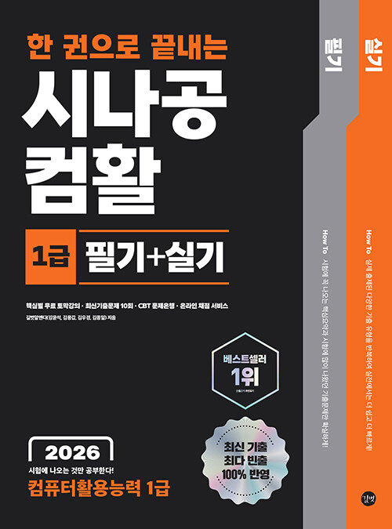

군대에서 처음 응시하는 자격증 시험으로 **컴퓨터활용능력 1급 필기**를 선택했습니다.  
  
오는 3월 6일 시험까지 주어진 시간은 짧지만, 그 안에서 최대한 효율적으로 준비해서 한 번에 합격하는 것을 목표로 하고 있습니다.  
  
컴퓨터공학을 전공하면서 파이썬, C, C++ 같은 언어를 꾸준히 다뤄왔기 때문에 시험 범위가 완전히 낯설지는 않습니다.  
노베이스는 아니지만, 그렇다고 가볍게 볼 수 있는 시험도 아니라고 생각합니다.  
짧은 기간 안에 필요한 내용을 정리하고, 한 번에 끝내는 방향으로 준비해보려고 합니다.

---

## 시험 정보

-   **종목:** 컴퓨터활용능력 1급 (필기)
-   **응시일:** 2026. 03. 06. (금) 10:50
-   **결과 발표:** 2026. 03. 07. (토) 10:00
-   **주관:** [대한상공회의소](https://license.korcham.net/ "대한상공회의소")

---

## 활용 자료

-   **교재**  
    
-   **육군 전자도서관**
    -   『\[전자책\] 컴퓨터활용능력 1급 필기 핵심 요점정리집』 (이용일 저 / 다부터에듀)
    -   『\[전자책\] 컴퓨터활용능력 1급 필기 핵심 기출 유형 문제 450제』 (이용일 저 / 다부터에듀)
-   **온라인 CBT**

[시나공 CBT](https://www.sinagong.co.kr/cbt/003001001/exams "시나공 CBT")

> **[길벗, 이지톡](http://www.gilbut.co.kr)**  
> IT, 어학, 자기계발, 재테크, 인문, 여행 등 학습과 실용 분야 출판  
> www.gilbut.co.kr

[영진닷컴 CBT](https://cbt.youngjin.com/index.php "영진닷컴 CBT")

> **[이기적 CBT, 영진닷컴](https://cbt.youngjin.com/index.php)**  
> cbt.youngjin.com

[전자문제집 CBT](https://www.comcbt.com/ "전자문제집 CBT")

> **[최강 자격증 기출문제 전자문제집 CBT](https://www.comcbt.com)**  
> 전자문제집,CBT,자격증,기출문제,해설,워드,워드프로세서,컴활,컴퓨터,활용능력,1급,2급,기사,산업기사,기능사,기능장,정보,전기,산업,안전,PC,네트워크,건축,건설,토목,가스,금속,미용,위험물,자  
> www.comcbt.com

---

## 공부할 것

**1과목 (컴퓨터 일반)**

기본적인 컴퓨터 상식과 시스템 관련 내용이 중심일 것 같습니다.  
익숙한 내용도 있겠지만, 시험용으로는 따로 정리해야 할 부분이 있을 것 같아 방심하지 않고 보려고 합니다.

**2과목 (스프레드시트 일반)**

엑셀은 그동안 간단한 함수나 단축키 위주로 사용해왔기 때문에,  
이번 기회에 함수 구조와 기능을 조금 더 체계적으로 정리해두려고 합니다.  
앞으로 실제 작업에도 도움이 될 것 같습니다.

**3과목 (데이터베이스 일반)**

SQL이나 데이터베이스 개념은 학교에서 이미 접해본 적이 있어 완전히 새롭지는 않습니다.  
다만 시험은 시험인 만큼, 실무나 전공 수업에서 아는 것과 별개로 다시 정리할 필요는 있어 보입니다.

---

## 학습 계획(3/3 ~ 3/6)

일단 교재 이론을 먼저 전체적으로 보고,  
그다음 기출문제를 풀면서 시험 감각을 정리할 생각입니다.

1.  **3/3 ~ 3/4:** 주교재 이론 파트 완독
2.  **3/5:** 교재에 있는 기출문제 10회 풀
3.  **3/6 오전:** 시험장 입실 전까지 개념 복습

짧은 기간이기 때문에 완벽하게 넓게 보기보다는,  
핵심 내용을 빠르게 정리하고 반복하는 쪽에 더 집중하려고 합니다.

---

## 다짐

새로운 지식을 익히고, 모르던 부분을 정리해가는 과정 자체를 좋아하는 편입니다.  
  
이번 시험도 단순히 자격증 하나를 따는 것에서 끝나는 것이 아니라,  
제가 알고 있는 것과 부족한 부분을 다시 점검하는 과정이 되었으면 합니다.  
  
군대라는 환경이 때로는 제약처럼 느껴질 때도 있지만,  
한편으로는 한 가지에 집중하기에는 오히려 괜찮은 환경이 되기도 합니다.  
  
남은 며칠 동안 차분하게 준비해서,  
3월 6일 시험을 한 번에 잘 마무리하고 싶습니다.
